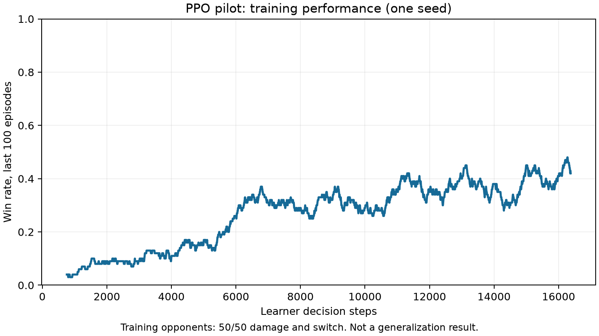

# Development pilot · November 11, 2026

The local environment runs end to end, and one short PPO run outperformed a random-action baseline on the development games below. This does **not** test the opponent-diversity hypothesis: there is only one training condition and one training seed.

## Training

- Source commit: `f47173762a4b0cc3479468f30ff744abfe19d78f`, clean working tree at launch.
- 16,384 learner decisions; seed 1; 50/50 damage/switch opponent mixture.
- 2,180 completed episodes: 584 wins and 1,596 losses; no recorded truncations.
- Rolling training win rate: 4% in the first 100 episodes, 42% in the last 100.
- CPU, one PyTorch thread; approximately 522 learner decisions/second on this local run. This is a machine-specific observation, not a cloud throughput estimate.



See [training manifest](training/manifest.json), [episode records](training/episodes.jsonl), and [update metrics](training/metrics.jsonl). The curve uses overlapping 100-episode windows and is training performance, not an evaluation confidence interval.

## Development evaluation

100 battles per opponent, user seeds 10,000–10,099, identical simulator-seed and opponent-team schedules for the PPO and random baselines. PPO actions are sampled stochastically. Opponents use the same two roster fixtures as training. Every game completed; there were no ties, truncations, or simulator errors in these six batches.

| Opponent | Random-action baseline | PPO after 16,384 steps | PPO 95% Wilson interval |
| --- | ---: | ---: | ---: |
| Random | 55/100 (55%) | 92/100 (92%) | 85.0–95.9% |
| Damage | 0/100 (0%) | 27/100 (27%) | 19.3–36.4% |
| Switch | 7/100 (7%) | 55/100 (55%) | 45.2–64.4% |

Raw results: [PPO](evaluation/summary.json), [random vs random](random-baseline/random/summary.json), [random vs damage](random-baseline/damage/summary.json), [random vs switch](random-baseline/switch/summary.json). The accompanying JSONL files contain every game. These intervals reflect game-sampling uncertainty for this checkpoint, not variability across training seeds.

The reserved `setup` evaluation and final evaluation seed range were not used here. The baseline is a uniform choice among legal joint actions, not an untrained instance of the PPO network. Fixed-team and opponent-strength effects remain; no competitive or cross-team claim follows from these results.

## Engineering checks

- 11 tests passed, including the train/save/load/evaluate integration test, repeatable seeded battles, joint-action constraints, an unrevealed-move observation check, and correct truncation bootstrapping.
- Ruff and Node syntax checks passed.
- A separate 1,000-battle random-vs-mixture stress run completed with 45 wins, 955 losses, no ties, no truncations, and no simulator failures. This earlier run preceded the initial commit; its manifest has no source SHA. It is engineering evidence, not part of the development evaluation table. See [its raw summary](stress/summary.json).
- A pre-commit training run with the same parameters produced the same 2,180-episode outcome totals and final loss. This is a local repeatability check, not an additional independent seed.

## Reproduce

After the repository setup in the main README:

```sh
uv run pokemon-rl train --steps 16384 --seed 1 --opponent mixture \
  --run-dir runs/pilot-reproduction
uv run pokemon-rl evaluate --checkpoint runs/pilot-reproduction/checkpoint.pt \
  --opponents random damage switch --battles 100 --seed 10000 \
  --run-dir runs/pilot-reproduction-eval
uv run pokemon-rl battle --agent random --opponent random \
  --battles 100 --seed 10000 --replays 0 --run-dir runs/baseline-random
uv run pokemon-rl battle --agent random --opponent damage \
  --battles 100 --seed 10000 --replays 0 --run-dir runs/baseline-damage
uv run pokemon-rl battle --agent random --opponent switch \
  --battles 100 --seed 10000 --replays 0 --run-dir runs/baseline-switch
uv run --group analysis python scripts/plot_training.py runs/pilot-reproduction \
  --output runs/pilot-reproduction/training-curve.png
```

The original checkpoint remains locally at `runs/pilot-v1/checkpoint.pt`; it is excluded from Git along with the run directory. [Its checksum](checkpoint-reference.json) identifies that local artifact. The tracked data include full episode records, runtime/team manifests, summaries, and the first evaluation replay against each opponent under [example-replays](example-replays). Replay selection is by episode index, not outcome.

Next: review the implementation and team fixtures together, measure heuristic cross-play, freeze the experiment budget, then run the three-condition study with independent training seeds.
