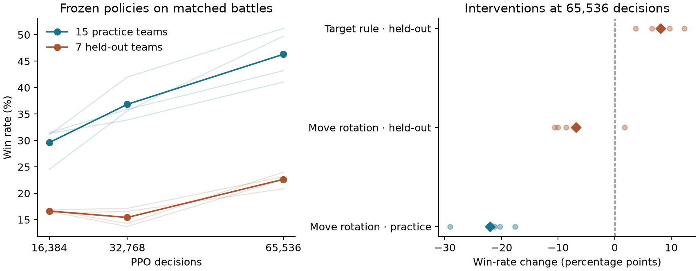

# What the full-history Transformer does in battle

The full-history PPO policy learned some team plays by 65,536 decisions. Target selection cost it wins even when it picked a useful move. We kept the four trained models frozen on Sketch5 and changed which Pokémon received certain damaging moves. The models won **1,893 of 5,600** held-out battles with this rule and **1,428 of 5,600** on their own. All four training seeds improved. [Matched benchmark](confirmation.csv)

## Three games from the same evaluation schedule

**Farigiraf and Pelipper used the rain team well.** On Toler Webb's roster, Farigiraf survived both opposing attacks to set Trick Room on turn 1. On turn 2 both allies aimed at Gardevoir, and Pelipper finished it. On turn 3 Pelipper's Muddy Water knocked out Arcanine while Archaludon's Electro Shot knocked out Gyarados in rain. Golisopod finished Tyranitar on turn 5. The smaller current-decision Transformer got the same opening and targeted its own Pelipper with Psychic on turn 1. It lost. This compares two trained policies. The replay alone cannot establish that memory produced the winning line. [Full-history replay](replays/MC646-s2-switch-610004-native.log) · [Small Transformer replay](replays/MC646-s2-switch-610004-small.log)

**Raichu picked a good move and missed an immediate knockout.** Against the damage bot, the full-history policy opened with Staraptor using Protect and Raichu aiming Zap Cannon at Gardevoir. It paralyzed Gardevoir, left the 4× Electric-weak Gyarados alive until turn 3, and lost on turn 5. On the same seed, the target rule kept both opening moves and pointed Zap Cannon at Gyarados. It knocked Gyarados out immediately, Staraptor blocked Moonblast, and the bot won on turn 4. This was the only target the rule edited in the whole game. Later policy actions could change in response to the new board. [Original replay](replays/MC403-s2-damage-610004-native.log) · [Changed target](replays/MC403-s2-damage-610004-retarget.log)

**Whimsicott and Charizard wasted a turn together.** On Kyle Livinghouse's roster, the full-history policy first switched Kingambit into a Psychic immunity while Whimsicott protected from Ice Fang. The double Protect on turn 7 also blocked both incoming attacks. On turn 8 Charizard aimed Weather Ball at its own Whimsicott, who blocked it with Protect. Tyranitar knocked out Charizard. Whimsicott's third consecutive Protect failed on turn 9 and Moonblast ended the battle. The smaller model kept Sneasler in on turn 1. It knocked out Gardevoir with Dire Claw, then the incoming Tyranitar with Close Combat, and won on turn 7. [Full-history replay](replays/MC751-s2-switch-610004-native.log) · [Small Transformer replay](replays/MC751-s2-switch-610004-small.log)

## How often targeting mattered

On the first 1,400 held-out battles, the full-history policy selected 11,433 damaging moves, including 227 explicitly aimed at its ally. This excludes spread damage. On 4,579 orders, the same ordinary damaging move could legally hit either opponent while the partner kept its action, and the type multipliers differed. The policy chose the lower multiplier 2,054 times (44.9%). A weaker multiplier can be a good choice against a wounded or dangerous opponent. [Action counts](action-counts.csv) · [Selected moves and targets](actions.csv.gz)

We therefore tested actual wins. The target rule preserves the policy's choice of move, Mega Evolution, switches and joint legality. For eligible direct attacks, it redirects a same-side target to an opponent or changes foes when the alternative has a strictly higher type multiplier. It uses the visible board and excludes variable-type and other special-case moves listed in the script. The rule flipped 711 losses to wins and 246 wins to losses. Its net gain was **8.30 percentage points** (paired 95% interval +5.59 to +11.02). On the 4,200 battles beyond the initial replay sample the gain was +8.38 points. One original win that became a loss illustrates the cost of always treating type advantage as decisive. [All matched results](confirmation-games.csv.gz) · [Original win](replays/MC462-s2-switch-610005-native.log) · [Retargeted loss](replays/MC462-s2-switch-610005-retarget.log)

Protect was also more common with the full-history model. The simulator recorded 297 failures in 1,871 uses (15.9%), compared with 78 in 1,192 (6.5%) for the smaller Transformer. The policies visited different board positions. These counts alone cannot tell us how many games a change to Protect would win. [Action counts](action-counts.csv)

## Training time and transfer

| Frozen checkpoint | 15 practice teams | 7 held-out teams |
| --- | ---: | ---: |
| 16,384 decisions | 29.60% | 16.64% |
| 32,768 decisions | 36.83% | 15.43% |
| 65,536 decisions | 46.30% | 22.64% |

These curves use the same 25 evaluation seeds per team and opponent style at each checkpoint (3,000 practice and 1,400 held-out games per row). The 25.50% final benchmark uses all 100 seeds per team and opponent style. Between 32k and 65k all four seeds improved on both splits. From 16k to 65k, the gain was 16.70 points on practice teams and 6.00 on held-out teams. Longer training helped within the tested range, with more of the gain on familiar teams. [Per-seed scores](per-seed.csv) · [Paired differences](paired-differences.csv)



### How much of the battle history helped?

We took the **same 65k full-history weights** and shortened the visible history only during evaluation. Each current token retained the visible board and the immediately preceding learner action. Recent tokens kept the same relative ages. Each condition played the same 5,600 battles. [History ablations by seed](confirmation.csv)

| Decisions the trained model could see | Wins | Win rate | Change from full history (paired 95% interval) |
| --- | ---: | ---: | ---: |
| Whole battle so far | 1,428 | 25.50% | Reference |
| Latest eight decisions | 1,430 | 25.54% | +0.04 points (−0.53 to +0.60) |
| Current decision only | 1,387 | 24.77% | −0.73 points (−4.16 to +2.69) |

Removing everything before the latest eight decisions flipped 49 losses to wins and 47 wins to losses. Keeping only the current decision changed the outcome of 1,149 games, with 554 flips to wins and 595 to losses. Earlier context can change how a battle plays out, but it contributed little to the aggregate win rate here. The current board already carries persistent information such as HP, fainted Pokémon and revealed moves. These results measure the frozen model's use of extra history on this schedule. Training a different policy with shorter context is a separate comparison. [Original context-length training study](../sketch5-policy-size/README.md)

### Dependence on move order

Rotating the same four moves by one place leaves the Pokémon, movesets and legal named commands unchanged. On practice teams this dropped wins from **46.30% to 24.27%** across the 3,000 games, a decline for all four training seeds. On all 5,600 held-out battles it dropped wins from **25.50% to 19.18%**. Three of four seeds declined on held-out teams (paired interval for the change −16.79 to +4.15 points). [Practice comparison](paired-differences.csv) · [Full benchmark](confirmation.csv)

We also scored every legal opening command by name, target, partner action and modifier. After rotating the slots, the top command changed for every held-out opening tested (7 teams × 2 opponent rosters × 4 trained policies = 56). On practice team MC650 facing Balance, one policy changed from Snarl + Parting Shot to Protect + Spirit Break. Mean total variation distance between opening action distributions was 0.975 on held-out teams and 0.982 on practice teams. [Opening choices by name](opening-move-order.csv)

The training data consist of the policy's own battles with 15 tournament rosters, fixed move orders, a terminal win/loss reward and two scripted opponents piloting Balance or Sun. Tournament players supplied roster lists. The model never saw their decisions. The move encoder exposes type, power, category, accuracy, priority and remaining PP fraction. At full PP, Reflect, Light Screen, Calm Mind and Imprison have identical move descriptors. The rest of the board and legal choices can provide clues, and fixed move slots also identify moves on a familiar team. This gives a concrete reason the model could learn a useful play on one roster and misapply it on another. [Feature code](../../src/pokemon_rl/features.py) · [Identical move descriptors](identical-move-descriptors.csv)

## Next experiment

Keep full-history PPO, four training seeds, opponents, rewards and roster split fixed. Compare **fixed vs. independently shuffled move slots during training** at **65,536 and 262,144 decisions**. Evaluate each checkpoint with both original and rotated move order. Track held-out win rate, sensitivity to rotation, and the extra wins supplied by the frozen target rule. This would show whether more experience teaches the same shortcuts and whether removing slot cues helps the policy learn mechanics that transfer. A subsequent experiment could give each legal move–target pair a shared scoring network with explicit type matchups, target class and move effects. Opponent quality and expert demonstrations were held fixed here, so their contribution is still open.

## Reproduction

The original full-history weights are in `runs/sketch5-policy-size-v1` and the smaller Transformer weights in `runs/sketch5-transformer-v1` on Sketch5. Each reconstructed training run matched the archived initialization tensors, episode log and PPO metrics through 32,768 decisions, excluding throughput. The native and smaller 65k replay outcomes and turn counts matched all 1,400 archived battles in the close-reading sample. The confirmation schedule checks both opponent roster and simulator seed against every archived game. Intervals are pointwise paired t intervals across the four PPO training seeds, conditional on this roster and opponent schedule. [Checkpoint hashes](recovered-checkpoints.csv) · [Matched games for the learning curves](games.csv.gz)

```sh
run=runs/action-repeat
out=results/action-repeat
.venv/bin/python scripts/recover_action_checkpoints.py --output "$run/early"
.venv/bin/python scripts/trace_battle_actions.py --runs "$run" --jobs 12
.venv/bin/python scripts/probe_move_order.py --runs "$run" --output "$run/order-probe"
.venv/bin/python scripts/analyze_battle_actions.py --runs "$run" --output "$out"
.venv/bin/python scripts/trace_battle_actions.py --runs "$run/confirm" --held-out-only \
  --modes retarget rotate last1 last8 --battles 100 --jobs 12
.venv/bin/python scripts/confirm_battle_actions.py --runs "$run" --output "$out"
```
