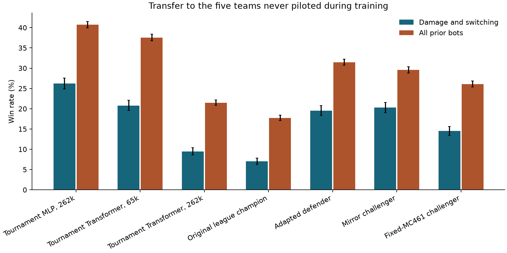
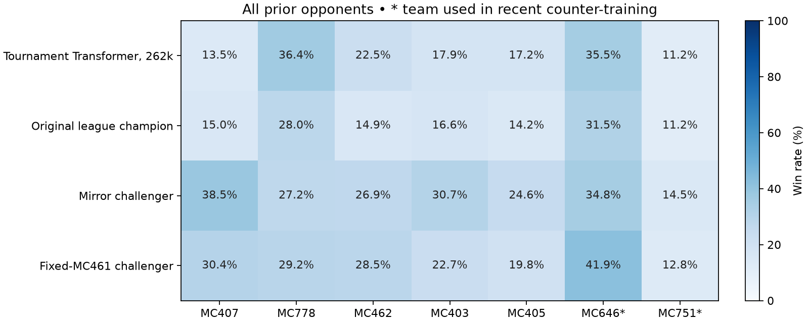

# Challenger transfer to the previous bots

**The mirror challenger improved over its parent on unseen teams, while the earlier feedforward and 65k Transformer policies still performed better against the prior bots.** On the five rosters absent from its training ancestry, it won 4,141/14,000 games (29.58%), up from the parent's 2,486/14,000 (17.76%). The paired gain was 11.82 percentage points, with a 95% interval of 11.15–12.49. The feedforward tournament policy won 5,701/14,000 (40.72%), leading the challenger by 11.14 points (10.41–11.87). These comparisons use the same greedy action-selection rule and paired battle schedule. [Paired comparisons](paired.csv)

| Frozen learner policy | All seven original test teams | Five teams absent from training |
| --- | ---: | ---: |
| Tournament feedforward PPO, 262k | 37.79% | **40.72%** |
| Tournament full-history Transformer, 65k | 39.41% | 37.56% |
| Tournament full-history Transformer, 262k | 22.02% | 21.49% |
| Original league champion / challenger initialization | 18.79% | 17.76% |
| Adapted defender | **40.26%** | 31.49% |
| Mirror challenger | 28.18% | 29.58% |
| Fixed-MC461 challenger | 26.44% | 26.09% |

The fixed-MC461 challenger was also handed each test team here. Both challengers' names describe their training conditions. The 94.65% mirror result from counter-training used different opponents and included five familiar teams. This evaluation measures their ability to pilot other rosters against the earlier field. [Previous counter-training result](../sketch5-counterleague/README.md) · [Scores and intervals](summary.csv)



## Which skills transferred?

On the five unseen teams, the mirror challenger improved over its parent against every opponent family. Its win rate against damage and switching together rose from 7.00% to 20.30%, and against the frozen PPO rivals from 15.15% to 25.78%. The earlier feedforward policy scored 26.20% and 55.93% on those two groups. The challenger did outperform it against the tactical bot, 12.35% versus 4.40%. The relative strength depends on which opponent it faces. [Opponent breakdown](summary.csv)

| Opponent family | Original parent | Mirror challenger | Earlier feedforward PPO |
| --- | ---: | ---: | ---: |
| Damage | 3.20% | 14.45% | 18.40% |
| Switching | 10.80% | 26.15% | 34.00% |
| Setup | 7.00% | 17.70% | 28.90% |
| Tactical | 2.80% | **12.35%** | 4.40% |
| Frozen PPO rivals | 15.15% | 25.78% | 55.93% |
| Random | 70.20% | 84.85% | 87.50% |

The result also varied by learner team. Against the full field, the mirror challenger rose from 15.04% to 38.50% on MC407 but declined from 28.00% to 27.18% on MC778. Even on MC751, which it piloted during counter-training, it won 14.54% against these bots. That familiar-roster score accompanied its 100% result against the adapted Transformer in the earlier mirror test. This pattern supports both transferable improvement and substantial specialization to its training opponent. [All seven team scores](per-team.csv)



The sampled-action pass reached the same ranking on the five unseen teams against damage and switching. The mirror challenger won 16.75%, its parent 8.90%, the 65k tournament Transformer 21.15%, and the earlier feedforward PPO 24.10%. The fixed-team challenger scored 14.70%. Changing the action-selection rule therefore preserved the finding that the challenger improved over its parent and remained behind those earlier policies. [Sampled-action scores](summary.csv)

## Evaluation

We evaluated the two selected single-network challengers, their original league-champion parent, the adapted defender, and three earlier tournament policies. The earlier policies were the seed-2 feedforward PPO at 262,144 decisions and the seed-2 full-history Transformers at 65,536 and 262,144 decisions. Each evaluated checkpoint was frozen before this test. [Checkpoint identities, hashes and source training runs](manifest.json)

The learner piloted each of the original seven test teams. MC646 and MC751 had subsequently been used in counter-training, so the five-team transfer result covers MC407, MC778, MC462, MC403 and MC405. The model ancestry's training manifests confirm that those five exact rosters were absent as both learner and opponent teams. Their individual Pokémon and moves can still overlap with training rosters. [Roster split](../../teams/reg-mc-regionals/split.csv)

The opponent field contained fourteen equally weighted combinations. The random, damage, switching, setup and tactical bots each piloted Balance and Sun. The four frozen PPO rivals from the earlier league piloted their own Balance, Sun, MC463 and MC751 teams. Each learner policy played 200 games per combination on each of the seven learner teams, giving 19,600 games per policy and 14,000 on the five unseen teams. Every cell split evenly between simulator sides. Ties and turn-limit cutoffs counted as non-wins. [All matchup scores](per-matchup.csv)

The main evaluation used greedy action selection for all neural players, matching the challenger experiment. A second pass sampled the learner's actions against damage and switching bots on Balance and Sun, with 100 games per cell. This matches the action-selection convention in the earlier tournament experiments. We reran all comparison policies on the new schedule in both modes. [All 156,800 games](games.csv.gz)

The physical simulator seeds were fresh to the recorded ancestral training runs and paired across candidates within each evaluation mode. Each reset cleared the full battle history. The analysis verifies every seed, side, model, roster and opponent, and the recorded checkpoint and team hashes. Four sampled games and four greedy games were replayed with identical outcomes and turn counts.

Win-rate intervals use Wilson 95% intervals. Change intervals use paired win/loss differences within each fixed team, opponent and simulator-side group. They measure battle randomness for these selected policies. This evaluation uses one checkpoint per policy condition, so its intervals do not measure variation from retraining. [Aggregate scores](summary.csv) · [Paired comparisons](paired.csv)

## Reproduction

The raw evaluation cells are on Sketch5 in `runs/sketch5-challenger-transfer-v1`. The older tournament weights remain in their archived training directories recorded in the manifest. Run from the project checkout with those archives and the pinned simulator available.

```sh
run=runs/challenger-transfer-repeat
for mode in greedy sampled; do
  .venv/bin/python scripts/evaluate_challenger_transfer.py --runs "$run" --mode "$mode"
done
.venv/bin/python scripts/analyze_challenger_transfer.py --runs "$run" \
  --output results/challenger-transfer-repeat
```
