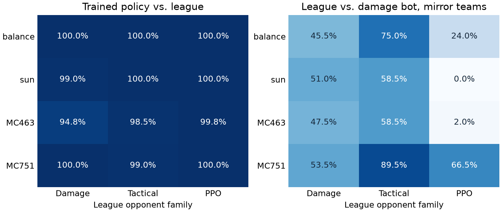

# A fixed-team PPO policy against a twelve-bot doubles league

**A single full-history Transformer won 4,756 of 4,800 reserved games (99.08%).** It exceeded 90% against each individual opponent. Its lowest result was 382/400 (95.50%) against the tactical pilot on the Frankfurt-winning MC463 roster. An opening-based router scored 4,764/4,800 (99.25%) on the same seeds. [Single-network matchups](single-scores.csv) · [Router matchups](confirmation-scores.csv)

| Frozen policy | Wins | Win rate | Stratified 95% interval | Lowest individual matchup |
| --- | ---: | ---: | ---: | ---: |
| Single Transformer | 4,756 / 4,800 | 99.08% | 98.81–99.33% | 95.50% |
| Router over PPO experts | 4,764 / 4,800 | 99.25% | 99.00–99.48% | 94.75% |

The single network has two Transformer blocks, four attention heads, width 256 and 1,748,023 parameters. It attends to all player-visible decisions in the current battle. We initialized it from the seed-2 tournament checkpoint after 262,144 decisions, then fine-tuned for 65,536 decisions on MC461 against the league with terminal win/loss PPO. Its two masked action heads select legal moves, targets and switches directly. The original checkpoint scored 63.72% on this league's initial development screen. The router selected its expert from the visible opening pair and earned eight additional wins in aggregate. [Exported weights and source hashes](weights.csv) · [Confidence intervals](confirmation-summary.csv)



## Team and benchmark

The learner always piloted MC461, the third-place Frankfurt regional team from the project roster collection. We chose it because it had the highest familiar-team win rate in the preceding study. Meowstic-F and Kommo-o lead, with Indeedee and Sneasler in back. The fixed team selection applies equally in training and evaluation. The engine is the project's pinned local Pokémon Showdown doubles simulator. [Team export](../../teams/reg-mc-regionals/MC461.txt) · [Previous familiar-team results](../sketch5-move-slots/per-team.csv)

We fixed four opposing rosters before evaluating candidates. Balance and Sun were the existing fixtures. MC463 and MC751 were the Frankfurt and Puebla regional winners' rosters. Each roster had three pilots and each of the twelve combinations received equal weight.

| Opponent family | How it plays |
| --- | --- |
| Damage | Scores legal joint attacks by power, accuracy, STAB, type matchup and spread damage. |
| Tactical | Scores the two orders together using estimated damage, target HP, knockouts, weather, terrain, priority, Fake Out, speed control and overkill. This is a heuristic estimate of damage. |
| PPO specialist | A frozen feedforward PPO policy trained on that opponent's own roster. For each roster, two independent training seeds produced 32k and 65k checkpoints. We selected among the four using 256 games per checkpoint against reference opponents, including an archived policy playing MC461. |

The calibration used mirror rosters. Both sides had the same Pokémon, and the reference player and league bot alternated simulator sides. Each league member played 200 games against each of random, damage and tactical reference play. Random play was excluded from the scored league. The league won **98.0% against random** and **47.6% against the damage reference**. The tactical family won **70.4% against damage**. The learned rivals were weaker in mirror matches against damage, but collectively won **46.4%** against the previously strongest MC461 checkpoint on its development battles. These measurements establish the level of this particular bot league. [Calibration scores](calibration-scores.csv) · [Rival selection](rival-selection-scores.csv) · [Archived-policy baselines](baseline-scores.csv)

## Training and selection

All training and battles ran on Sketch5. Every candidate used a legal-action mask and terminal win/loss PPO. A feedforward policy could train from scratch, and a full-history Transformer could fine-tune from one of four archived 262k tournament policies. We tried training on the existing damage/switch mixture across all four opponent rosters, training directly on the frozen league, and training separate experts per opposing roster. Every roster-specific expert still played all three pilots for its roster. Candidates selected actions deterministically during evaluation.

The development screen used 48 games per matchup and candidate. We also fit a router by selecting an expert for each pair of opposing leads on these games. The router reads the two species visible on the opening board, chooses once, then retains that expert for the entire battle. A single development-selected default handles unfamiliar openings. Training with a known population lets the bot specialize to these matchups. Neither the opponent pilot identity, its simultaneous move, hidden battle state nor the simulator seed enters the learner's decision.

The strongest individual candidates and the router then played an independent validation schedule of 128 games per matchup each. The highest aggregate validation score determined the final policy. We recorded its weights, roster, opponent weights, opponent rosters and confirmation schedule before running 400 fresh games per matchup, 200 on each simulator side. Ties and cutoffs count as nonwins. The 95% interval resamples games within the 24 opponent-by-side strata and describes this frozen policy on this fixed population. [Development scores](development-scores.csv) · [Validation scores](validation-scores.csv) · [Locked configuration](locked.json)

The router scored 1,527/1,536 in validation. We separately locked the highest-scoring single network (1,523/1,536) before running either confirmation evaluation. All 4,800 simulator seeds were distinct and disjoint from training, pretraining, screening, validation and calibration games audited for this experiment. All confirmation games ended in a win or loss. The test measures repeat play against familiar bot policies and lineups under new battle randomness. Generalization to other rosters, opponents and human opponents remains open. [Single-network lock](locked-single.json) · [Router game records](confirmation-games.csv.gz) · [Single-network game records](single-games.csv.gz)

## Run the policies

The repository contains inference weights for the single Transformer, the router's experts and the four opponent PPO specialists. With the project's locked dependencies and simulator installed, run the following from the repository root. Use a fresh output directory.

We replayed both complete confirmation schedules on Sketch5 using the exported repository weights. The outcomes and finishing turns matched all 4,800 original games for each policy. These replays verify the export and use the same seeds as the confirmation results. [Replay checks and hashes](export-replay-check.json)

```sh
study=results/sketch5-fixed-league
.venv/bin/python scripts/fixed_league.py eval --runs "$study" \
  --candidates "$study/single.json" --out runs/fixed-team-single-repeat \
  --base 30000000 --battles 400 --jobs 16
```

Use `candidate.json` in place of `single.json` to run the router. Choose a different base for new battle randomness. Each result directory contains game-level outcomes and scores by opponent. On Sketch5 the full training and model-selection archive is in `runs/sketch5-fixed-league-v1`. [Candidate training](../../scripts/train_fixed_league.py) · [Screening and locking](../../scripts/screen_league.py) · [Outcome and weight audit](../../scripts/report_fixed_league.py)
