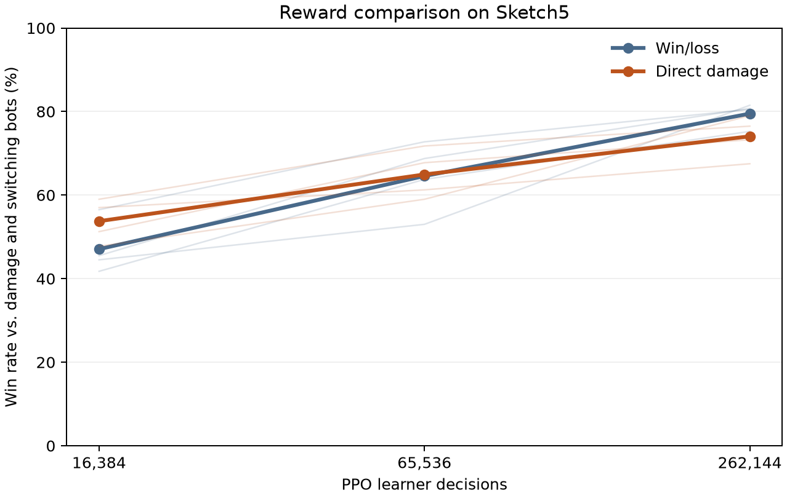

# Long training comparison on Sketch5

Eight PPO policies trained for 262,144 decisions on the same mixed training opponents as the short reward study. Each 65,536-step checkpoint came from the same uninterrupted run as its final checkpoint. The main score is the equally weighted mean win rate against the damage and switching bots.

| Decisions | Win/loss | Direct damage only | Damage gain (pp) | Seeds favoring damage |
| ---: | ---: | ---: | ---: | ---: |
| 16,384 | 47.06% | 53.75% | +6.69 | 4/4 |
| 65,536 | 64.56% | 64.94% | +0.38 | 2/4 |
| 262,144 | 79.50% | 74.06% | -5.44 | 0/4 |



Faint lines show the four individual training seeds. Bold lines are their means.

## Paired differences

Each entry is direct damage minus win/loss in percentage points for that seed.

| Training seed | 16,384 | 65,536 | 262,144 |
| ---: | ---: | ---: | ---: |
| 2 | +12.50 | +8.25 | -14.00 |
| 3 | +9.50 | +4.00 | -2.00 |
| 4 | +2.50 | -1.00 | -4.00 |
| 5 | +2.25 | -9.75 | -1.75 |

## Opponent breakdown

| Decisions | Reward | Random | Damage | Switching |
| ---: | --- | ---: | ---: | ---: |
| 65,536 | Win/loss | 96.88% | 61.25% | 67.88% |
| 65,536 | Direct damage only | 98.62% | 58.00% | 71.88% |
| 262,144 | Win/loss | 97.75% | 80.75% | 78.25% |
| 262,144 | Direct damage only | 97.88% | 70.25% | 77.88% |

## Evaluation blocks

Damage advantage in percentage points on the main score. Each block contains 100 evaluation seeds per opponent per checkpoint.

| Decisions | Seeds 10,000–10,099 | Seeds 10,100–10,199 |
| ---: | ---: | ---: |
| 65,536 | -1.00 | +1.75 |
| 262,144 | -8.12 | -2.75 |

## Protocol and verification

Training seeds were 2, 3, 4, and 5. All runs used the same Sun learner, two opponent teams, fixed leads, a uniform per-battle mixture of damage and switching opponents, and original PPO hyperparameters. Each checkpoint played 200 games against each of random, damage, and switching. Evaluation used stochastic actions and identical simulator seeds and opponent-team draws across rewards, budgets, and the earlier 16k study. Win rates count wins divided by scheduled games. Each training seed carries equal weight.

The two longer checkpoints produced 9,600 evaluation games with 7,658 wins, 1,942 losses, 0 ties and 0 truncations. All eight sets of 16k policy weights exactly matched their original Sketch5 counterparts. Sampling uncertainty and training variability remain, particularly with only four training seeds. These games measure performance on familiar teams and scripted opponents.

[Per-checkpoint scores](win-rates.csv) · [Raw evaluation records](evaluation-games.csv.gz) · [Checkpoint hashes and host](checkpoints.csv) · [Machine-readable comparison](summary.json)

Source runs and model weights are on Sketch5 at `/mnt/md0/jcliu/pokemon-battle-rl/project/runs/sketch5-long-v1`. The 16k comparison is archived in [the earlier reward study](../sketch5-rewards/README.md).

To repeat from the Sketch5 checkout with a fresh run directory:

```sh
.venv/bin/python scripts/long_rewards.py --output runs/long-repeat
.venv/bin/python scripts/analyze_long_rewards.py --runs runs/long-repeat --output results/long-repeat
```
