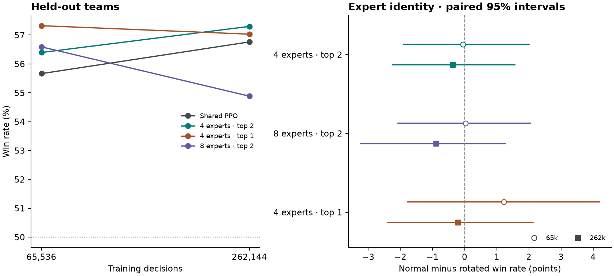

# Does longer PPO training make expert routing matter?

From 65,536 to 262,144 decisions, shared PPO gained 5.18 win-rate points on familiar matchups and 1.10 points on held-out teams. The four-expert top-2 model gained 4.15 and 0.90 points, respectively. On held-out teams its final lead over shared PPO was 0.54 points (paired 95% interval −4.98 to +5.66).

The router changed some opening choices. At 262k, rotating the four experts changed the most probable opening command on 8.2% of the matched boards. The learned assignment scored 0.37 points below the rotated assignment (95% interval −2.25 to +1.56). Doubling the bank to eight or activating just one of four also produced no clear held-out win-rate advantage at this budget.

## Win rate against frozen BC

Each entry gives the 65k and 262k actual win rates on the same roster and seed assignments. Each normal policy was scored in 2,048 games per familiar schedule and 4,096 held-out games across seeds 2–5 at each budget.

| Policy | Familiar vs familiar | Familiar vs unseen | Held-out forward | Held-out reverse | Held-out average |
|---|---:|---:|---:|---:|---:|
| Shared PPO | 70.21% → 75.39% | 60.79% → 62.35% | 48.34% → 50.00% | 62.99% → 63.53% | 55.66% → 56.76% |
| 4 experts, top 2 | 72.27% → 76.42% | 60.25% → 61.57% | 49.22% → 50.68% | 63.57% → 63.92% | 56.40% → 57.30% |
| 8 experts, top 2 | 72.07% → 77.00% | 58.25% → 59.67% | 47.07% → 47.71% | 66.11% → 62.06% | 56.59% → 54.88% |
| 4 experts, top 1 | 73.44% → 76.66% | 61.04% → 60.21% | 50.63% → 49.02% | 64.01% → 65.04% | 57.32% → 57.03% |

| 262k minus 65k, paired win-rate points (95% interval) | Familiar vs familiar | Familiar vs unseen | Both held-out directions |
|---|---:|---:|---:|
| Shared PPO | +5.18 (-0.59 to +11.04) | +1.56 (-4.98 to +8.50) | +1.10 (-3.88 to +6.37) |
| 4 experts, top 2 | +4.15 (-3.61 to +10.99) | +1.32 (-6.40 to +9.38) | +0.90 (-5.18 to +6.81) |
| 8 experts, top 2 | +4.93 (-0.49 to +10.45) | +1.42 (-5.91 to +8.98) | -1.71 (-6.27 to +2.54) |
| 4 experts, top 1 | +3.22 (-1.61 to +8.40) | -0.83 (-7.52 to +6.35) | -0.29 (-5.40 to +4.44) |

## Routing and expert count

Normal minus rotated measures how much the learned slot-to-expert mapping helps. Normal minus backbone-only measures whether the trained expert heads collectively help. Positive values favor the normal checkpoint. Parentheses give paired 95% intervals in percentage points.

| Policy | Identity at 65k | Identity at 262k | Change in identity effect | Experts vs backbone at 65k | Experts vs backbone at 262k |
|---|---:|---:|---:|---:|---:|
| 4 experts, top 2 | -0.05 (-1.90 to +2.00) | -0.37 (-2.25 to +1.56) | -0.32 (-3.00 to +2.34) | -0.07 (-2.03 to +1.88) | -0.54 (-2.61 to +1.66) |
| 8 experts, top 2 | +0.02 (-2.08 to +2.05) | -0.88 (-3.25 to +1.27) | -0.90 (-3.59 to +1.88) | -0.49 (-2.66 to +1.54) | -0.39 (-2.71 to +1.81) |
| 4 experts, top 1 | +1.22 (-1.78 to +4.20) | -0.20 (-2.39 to +2.12) | -1.42 (-5.42 to +2.54) | +1.10 (-1.17 to +3.30) | +0.29 (-1.86 to +2.29) |

| Held-out comparison, candidate minus reference | At 65k | At 262k |
|---|---:|---:|
| 4 experts, top 2 vs shared PPO | +0.73 (-4.20 to +5.86) | +0.54 (-4.98 to +5.66) |
| 8 experts, top 2 vs 4 experts, top 2 | +0.20 (-4.98 to +5.52) | -2.42 (-7.64 to +2.39) |
| 4 experts, top 1 vs 4 experts, top 2 | +0.93 (-4.22 to +7.13) | -0.27 (-5.30 to +4.79) |

## Expert usage and opening decisions

Effective expert count is the exponential entropy of expert selection frequencies, computed for each seed on held-out games and then averaged. Always selecting the same two experts gives 2. Uniform use of eight gives 8. The opening probe uses the exact joint distribution of the two legal commands on 128 identical held-out opening boards per checkpoint. Total variation is reported as a percentage. It is zero for identical distributions.

| MoE and budget | Effective experts | TV after rotation | Top joint command changed by rotation | TV after removing residuals | Top joint command changed by removal |
|---|---:|---:|---:|---:|---:|
| 4 experts, top 2, 65k | 3.62 | 3.6% | 6.8% | 3.3% | 5.7% |
| 4 experts, top 2, 262k | 3.71 | 4.6% | 8.2% | 3.5% | 7.6% |
| 8 experts, top 2, 65k | 6.56 | 3.9% | 4.9% | 3.2% | 4.3% |
| 8 experts, top 2, 262k | 7.03 | 4.8% | 6.2% | 3.5% | 4.1% |
| 4 experts, top 1, 65k | 3.03 | 4.9% | 8.4% | 3.6% | 6.1% |
| 4 experts, top 1, 262k | 3.29 | 4.9% | 7.2% | 3.3% | 6.2% |

[Matched opening-board probabilities and command changes](opening-actions.csv)

## Held-out results by training seed

| Seed | Shared PPO | 4 experts, top 2 | 8 experts, top 2 | 4 experts, top 1 |
|---|---:|---:|---:|---:|
| 2 | 56.5% → 57.5% | 55.4% → 57.6% | 58.1% → 55.6% | 59.3% → 56.2% |
| 3 | 53.7% → 54.3% | 54.7% → 58.2% | 54.7% → 56.2% | 55.3% → 54.3% |
| 4 | 57.1% → 57.6% | 59.3% → 54.4% | 56.4% → 55.5% | 56.7% → 58.6% |
| 5 | 55.3% → 57.6% | 56.2% → 59.0% | 57.1% → 52.3% | 58.0% → 59.1% |

The study contains 114,688 model-game evaluations including 20,480 prior archived observations, plus 160 replay checks. [Score counts and intervals](scores.csv) · [All paired effects](effects.csv) · [Per-pair outcomes](per-pair.csv) · [Per-game archive](games.csv.gz) · [Routing frequency by roster and seed](expert-usage.csv) · [Checkpoint lineage](checkpoints.csv) · [Replay checks](replayed.csv)

## Methods

The shared and four-expert top-2 models are exact continuations of the [65k experiment](../sketch5-mb-roster-ppo/README.md). The original exports contained weights only. We reconstruct the first 65,536 steps, require every tensor to equal the archived checkpoint, and continue the same optimizer and live battles for 196,608 additional decisions. For fault recovery, each job saves the model, Adam state, random streams, active battles and training logs every 16,384 decisions. A separate recovery test checks the next actions, optimizer updates and model tensors after restart. [Locked protocol](protocol.json) · [Trainer](../../scripts/mb_roster_ppo.py)

Each seed trains four independent roster streams against the frozen released VGC-Bench BC policy with open team sheets. Both sides use its native learned preview throughout training and evaluation. Every arm starts with its in-battle action distribution equal to the released BC policy. The reward is +1/0/−1 for win/draw/loss. Each PPO update collects 64 decisions per roster with the same rollout, update and sampling settings as the original experiment. Seeds are 2, 3, 4 and 5. Each roster receives 65,536 training decisions per seed at the final checkpoint.

All experts are 256 → 128 → 214 residual action heads. The four/top-2 and eight/top-2 arms normalize gate weights over the two selected experts. For four/top-1, the selected expert has unit forward weight. To train the discrete router with PPO, the backward pass uses the derivative of its selected full-softmax probability. Eight/top-2 changes the size of the bank at fixed active count. Four/top-1 changes active count at fixed bank size and uses the single-expert gradient estimator. Both capacity controls train from the same BC initialization through both budgets. Expert workloads, active parameters and compute can differ across arms.

Normal evaluation uses the original 16 battles per roster pair, eight in each seat. Each policy plays the four roster assignments below. For the headline held-out rate we average the two held-out directions equally. We replayed training checkpoints against the same frozen opponent, teams, simulation seeds, action seeds and previews. The paired intervals resample training seed, both roster axes, and battle seeds within seat using 6,000 draws. The original normal shared and MoE scores and original rotated MoE scores at 65k come from the matched, audited prior run.

The expert-identity test keeps a trained gate and its weights frozen and passes each selected gate slot to the next expert cyclically. We report normal minus rotated win rate. To test growth in routing sensitivity, we pair the change in that difference from 65k to 262k on the same games. In the residual-removal test we set all expert corrections to zero and play the same fine-tuned backbone. Expert usage records how often each slot is selected. A companion opening probe pairs both policies on exactly the same board and compares the probability of each legal joint command of the two active Pokémon. A 262k comparison with the frozen control or the 65k comparison estimates performance on this roster pool, which has been used in prior evaluations.

## Team matrix

| Schedule | Our roster | Frozen BC opponent roster |
|---|---|---|
| Training and familiar evaluation | MC461-MB, MB537, MB51, MB45 | MB501, MB245, MB269, MB387, MB106, MB90, MB40, MB102 |
| Familiar team against unseen opponent roster | MC461-MB, MB537, MB51, MB45 | MB481, MB335, MB259, MB558, MB163, MB562, MB149, MB337 |
| Held-out forward | MB516, MB216, MB99, MB444 | MB481, MB335, MB259, MB558, MB163, MB562, MB149, MB337 |
| Held-out reverse | MB481, MB335, MB259, MB558, MB163, MB562, MB149, MB337 | MB516, MB216, MB99, MB444 |

In training, each roster stream draws an opponent roster uniformly from the eight listed and alternates seats by episode. Each evaluation row crosses every own roster and opposing roster, 16 games per pairing per checkpoint, with eight in each seat. The same frozen BC opponent pilots every opposing roster. Both players choose lineups from all six with the released BC preview in every battle. “Held-out” refers to our PPO training. These rosters have appeared in prior evaluations. [Six Pokémon and move sheets for all rosters](../sketch5-mb-reward-factorial/team-matrix.md) · [Roster hashes](../sketch5-mb-reward-factorial/protocol.json)
