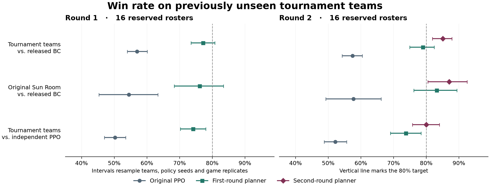

# Learning to predict opponent replies for model-based RL

Our first policy won 80.71% on development and 77.17% on its independent 16-roster test. We retired that test, kept the original development matrix, and reserved another 16 teams before scoring any new method. Each reserved roster shares at most three species with any roster previously used in the project. [First confirmation](../sketch5-mb-policy-iteration/confirmation/README.md) · [Second-round protocol](protocol.json)

We froze the three-step reply planner after it won 1,742 of 2,048 development games (85.06%, 95% interval 80.76%–89.06%). Across the four pilot seeds it scored 83.98 / 84.77 / 85.74 / 85.74%. All 49 deployment and evaluation assets were fingerprinted before the reserved battles. [Frozen configuration and six-way selection](confirmation/candidate.json)

The frozen second-round policy won **6,969 of 8,192 (85.07%, 95% interval 81.86%–87.85%)** on its new reciprocal test. The same-schedule gain over the first-round policy was +6.13 points (+3.45 to +9.13).

| Frozen evaluation | Original sampled PPO | First-round planner | Second-round planner (95% interval) | Gain vs. original PPO (95% interval) |
|---|---:|---:|---:|---:|
| Reciprocal vs. BC | 57.41% | 78.94% | 85.07% (81.86–87.85) | +27.66 (+23.24 to +32.18) |
| Original Sun Room vs. BC | 57.71% | 83.20% | 87.01% (80.47–92.48) | +29.30 (+21.68 to +37.30) |
| Reciprocal vs. independent PPO | 52.14% | 73.75% | 80.00% (75.79–84.06) | +27.87 (+23.41 to +32.07) |

The second policy reached 80% with 13 of 16 assigned rosters. It improved on the first-round planner with 16 of 16. The primary rates for pilot seeds 2–5 were 84.96 / 84.28 / 85.50 / 85.55%. Group A as learner and Group B as learner scored 87.13 / 83.01%.

We checked all 52,224 game records, including starting fours, both seats, terminal outcomes and simulator seeds. The SHA-256 of the game archive is `a624469d7a98d679f6ed6168cdb95872a0e82bf511afb4bb6af6cd0086219fb7`. [Frozen deployment assets](confirmation/candidate.json) · [Raw games](confirmation/games.csv.gz) · [Every matchup](confirmation/matchups.csv) · [Paired effects and intervals](confirmation/results.csv)

Primary score for each assigned tournament team (512 games per policy)

| Assigned team | Original PPO | First-round planner | Three-step planner |
|---|---:|---:|---:|
| MB324 | 269/512 (52.54%) | 410/512 (80.08%) | 429/512 (83.79%) |
| MB542 | 219/512 (42.77%) | 417/512 (81.45%) | 443/512 (86.52%) |
| MB236 | 320/512 (62.50%) | 420/512 (82.03%) | 451/512 (88.09%) |
| MB147 | 363/512 (70.90%) | 450/512 (87.89%) | 465/512 (90.82%) |
| MB119 | 362/512 (70.70%) | 413/512 (80.66%) | 438/512 (85.55%) |
| MB564 | 371/512 (72.46%) | 413/512 (80.66%) | 450/512 (87.89%) |
| MB241 | 318/512 (62.11%) | 413/512 (80.66%) | 454/512 (88.67%) |
| MB178 | 254/512 (49.61%) | 425/512 (83.01%) | 439/512 (85.74%) |
| MB288 | 325/512 (63.48%) | 403/512 (78.71%) | 444/512 (86.72%) |
| MB502 | 207/512 (40.43%) | 333/512 (65.04%) | 372/512 (72.66%) |
| MB234 | 378/512 (73.83%) | 448/512 (87.50%) | 475/512 (92.77%) |
| MB226 | 253/512 (49.41%) | 363/512 (70.90%) | 401/512 (78.32%) |
| MB276 | 325/512 (63.48%) | 416/512 (81.25%) | 442/512 (86.33%) |
| MB280 | 191/512 (37.30%) | 332/512 (64.84%) | 397/512 (77.54%) |
| MB87 | 233/512 (45.51%) | 401/512 (78.32%) | 439/512 (85.74%) |
| MB436 | 315/512 (61.52%) | 410/512 (80.08%) | 430/512 (83.98%) |

## Empty-item input and sensitivity

MB502's Talonflame uses Acrobatics and legally carries no item. The first-round preview reader rejected the simulator's empty field. Before reading any second-round win rates we validated the reader's existing no-item representation on a separate training roster, recorded the adapter hash and resumed the full schedule. The conversion applies only to the public tuple used to generate hypothetical sheets. Both planners then used the original roster and weights. The sampled PPO control directly accepted the empty item. [Recorded input correction](confirmation/itemless-input.json)

| Evaluation | Against other teams | Against the itemless sheet | All scheduled games if every affected game counts as a loss |
|---|---:|---:|---:|
| primary | 6,510/7,680 (84.77%) | 459/512 (89.65%) | 79.47% |
| custom | 828/960 (86.25%) | 63/64 (98.44%) | 80.86% |
| transfer | 6,117/7,680 (79.65%) | 437/512 (85.35%) | 74.67% |

## Development

| Method | Wins out of 2,048 | Win rate (95% interval) | Difference vs. first-round planner (points) |
|---|---:|---:|---:|
| adaptive-belief-es | 1,653 | 80.71% (75.44–85.64) | +0.00 (+0.00 to +0.00) |
| coordinate | 1,734 | 84.67% (79.79–88.72) | +3.96 (-1.08 to +8.94) |
| coordinate-critic | 1,717 | 83.84% (78.91–88.48) | +3.12 (-1.71 to +8.30) |
| reply | 1,676 | 81.84% (76.46–86.43) | +1.12 (-3.27 to +5.42) |
| reply-critic | 1,711 | 83.54% (78.52–87.94) | +2.83 (-1.76 to +7.18) |
| reply-deep | 1,742 | 85.06% (80.76–89.06) | +4.35 (-0.34 to +9.42) |
| reply-wide | 1,699 | 82.96% (77.49–87.50) | +2.25 (-2.54 to +6.79) |

We fixed six candidate configurations before the first complete four-seed result. The highest development win count qualifies at 1,680 of 2,048 wins (82%). A fixed order resolves ties. Every development comparison uses the incumbent’s assigned rosters, simulator seats, seeds and both submitted lineups. Intervals resample training seeds, both team axes and game replicates within seat. [Selection rule](selection.json)

## What the policy learns and simulates

All arms use the same four PPO battle pilots, trained mechanics preferences, terminal win/loss/draw reward and 196-game public lineup planner as the first candidate. We changed how the bot evaluates the moves it could play next.

- **Neural opponent responses.** For each public matchup, simulate 48 BC team previews across four hypothetical private stat spreads. Condition possible reserves on the Pokémon already revealed. Construct an opponent-perspective embedding for each hypothetical world using guessed stats and selected reserves. Three of each four worlds sample the released actor's predicted moves. The fourth samples the earlier mechanics-based reply model. Each possible move is judged by the learned value after Showdown resolves the joint turn.
- **Search width and depth.** Compare four actions under four worlds, eight actions under eight worlds, and three-step lookahead. The first step uses the modeled BC response. Further steps use the mechanics-based continuation policy.
- **Factored joint-action search.** Hold one partner's move fixed while testing up to nine commands for the other. Combine the most promising commands for both partners, then compare up to eight joint finalists on eight fresh modeled worlds.
- **World value learning.** Fit a separate residual state-value network from final returns in 1,120 training battles per seed. The collector sees the fully specified training world, which matches the information available inside a hypothetical simulation. At deployment its input is the sampled world. The contest opponent's actual private state is inaccessible to this model.

Across 16 training fixtures, changing both the true hidden reserves and private stats with the public board fixed produced identical hypothesized reserves, response logits and selected commands in both seats. [Intervention records](public-input-audit.csv)

Median move-selection times on the same 58 decisions from eight training-roster games were incumbent 215 ms, reply-deep 942 ms. These timings used the shared Sketch5 host. [Median and 95th percentile by method](move-latency.csv) · [Cached and uncached preview timing](preview-latency.csv)

On 282 training-roster decisions, a sampled neural response matched the actual BC command, including its target and Mega choice, on 40.29% of Pokémon slots. The old response model matched 24.38%. Exact joint-action agreement was 14.89% and 5.50%, respectively. [Per-decision predictions](reply-predictions.csv)

On 32 opening positions, the modeled reserve probabilities had a Brier score of 0.256. Assigning 50% to each of the four unseen Pokémon scored 0.250. Lower is better. [Reserve forecasts and checked outcomes](reserve-predictions.csv)

## Exact team matrix

- Training learner pool (28) — MC461-MB, MB537, MB51, MB45, MB503, MB56, MB156, MB190, MB306, MB374, MB76, MB239, MB314, MB232, MB17, MB497, MB177, MB388, MB346, MB19, MB31, MB277, MB567, MB498, MB248, MB270, MB64, MB506.
- Training opponent pool (20) — MB501, MB245, MB269, MB387, MB106, MB90, MB40, MB102, MB319, MB365, MB13, MB434, MB429, MB551, MB205, MB539, MB300, MB165, MB466, MB342.
- Development A — MB566, MB482, MB561, MB296.
- Development B — MB252, MB475, MB380, MB140, MB330, MB291, MB549, MB463.
- Second confirmation A — MB324, MB542, MB236, MB147, MB119, MB564, MB241, MB178.
- Second confirmation B — MB288, MB502, MB234, MB226, MB276, MB280, MB87, MB436.
- The learner plays every A team against every B team, then the two sides exchange rosters. The new reciprocal test plays 16 games per direction per seed, alternating seats. The original Sun Room team separately plays all 16 tournament sheets. The independent opponent is shared PPO seed 2 at 262,144 steps with native BC preview. [Sun Room import](../../teams/reg-mb-original/sun-room.txt)

The roster exclusions cover our own training and model selection. The released behavior-cloning checkpoint provides the common starting point for the pilots and uses its upstream replay data. These results measure performance in the pinned Showdown simulator.
