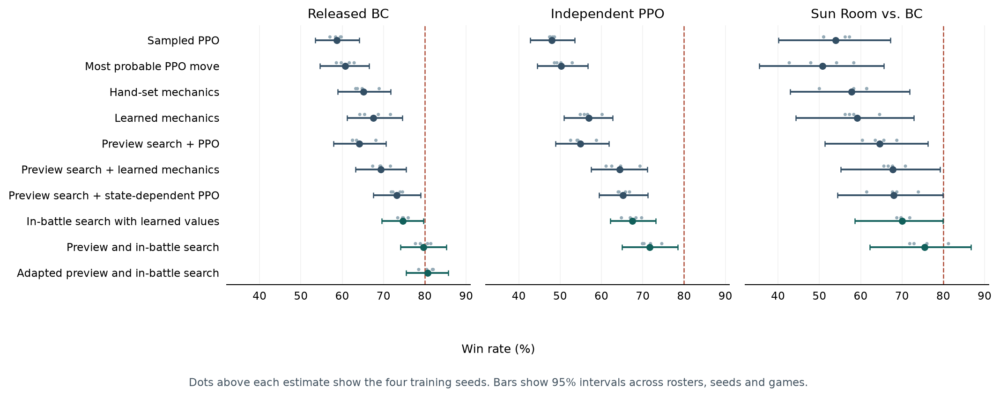

# Learning battle decisions against VGC-Bench

The first policy to pass the 80% development gate won **1,653 of 2,048 games (80.71%, 95% interval 75.44%–85.64%)**. It selected a lineup using the 196-game public matchup planner, then used the same frozen one-step value search in battle. It won 81.05% in the forward direction and 80.37% in reverse. Its improvement over the simpler 64-game preview with the identical battle policy was 1.03 points (−1.86 to 4.30). We froze the four pilots and the 41 inference assets before opening the separate 8 × 8 confirmation matrix. [Frozen configuration](confirmation/candidate.json) · [Development comparisons](paired-effects.csv)

Public preview search followed by in-battle value search won **1,632 of 2,048 reciprocal development games (79.69%, 95% interval 74.07%–85.16%)**. It won 816 of 1,024 in each direction. The four pilots scored 77.73%, 78.91%, 81.45% and 80.66%. The paired gain over sampled PPO was 21.00 points (13.96–28.12). It gained wins with all 12 assigned rosters. Its lowest assigned-roster result was 73 of 128 with MB463 and its highest was 120 of 128 with MB330. The promotion threshold is 1,639 wins.

On our original Sun Room team it won 290 of 384 games (75.52%, interval 62.24%–86.72%). It gained 21.61 points over the baseline on those same matchups (8.85–34.64). Its 64-game preview took 24 to 44 seconds on four uncached training matchups on Sketch5. The in-battle decision took a median 139 ms. [Preview timings](preview-latency.csv) · [Move timings](move-latency.csv)

With no retraining, the same policy won 1,468 of 2,048 against the separate shared PPO battle opponent (71.68%, interval 64.99%–78.52%). Sampled PPO won 983 of those games (48.00%). The paired gain was 23.68 points (14.50–33.30). The lineup planner continued to model the released BC opponent during this transfer test.

We are trying to raise the reciprocal win rate against the released, sampled Regulation M-B behavior-cloned opponent to 80%. Our starting point is the four seed-matched 16-roster PPO pilots with four experts and top-two routing. They won 59.67% on the previous roster matrix. On the new development matrix the same pilots won 1,202 of 2,048 games (58.69%, crossed 95% interval 53.47%–64.11%). Choosing the most probable legal joint action won 1,244 (60.74%). The paired gain was 2.05 percentage points (−3.42 to +8.06). Both policies used native BC preview. [Audited scores](development.csv) · [Every team matchup](matchups.csv)

With native BC preview, one-step in-battle search won 1,530 of 2,048 development games (74.71%, 95% interval 69.53%–79.69%). At each eligible turn it simulates up to four legal joint commands under four samples of the opponent's hidden information. It backs up a position value learned from terminal outcomes. Against its 67.53% parent, the paired gain was 7.18 points (0.29–13.38). It won 74.80% in the forward direction and 74.61% in reverse. Expanding to eight commands and resampling the finalists won 1,575 games (76.90%). Using a mixture of one-, two- and three-step predictions won 1,553 (75.83%). The paired gains over one-step search were 2.20 points (−3.12 to 7.37) and 1.12 points (−2.83 to 5.47), respectively. [All completed four-seed results](scorecard.md) · [Paired comparisons](paired-effects.csv) · [Model weights](checkpoints.csv)

With the original Sun Room roster, that same planner and native BC preview won 269 of 384 games (70.05%, interval 58.59%–79.95%). The baseline won 207, a paired gain of 16.15 points (6.25–27.08). In 16 training-fixture interventions we kept opposing leads fixed, switched both actual hidden reserves, and also changed the reserves' private stats. The observation, forecasts at one and three steps, and wider-search command stayed identical in both simulator seats. [Private-information audit](public-planning-audit.csv)

The in-battle planner changed the parent policy's preferred joint command about 2.85 times per game on its own development trajectories. In one prespecified replay per ordered matchup, it changed at least one decision in 58 of 64 games. Of 193 changed slot commands, 29 retargeted the same move, 36 changed an attack to a status move and 36 made the reverse change. Playing only the first changed command and then reverting to the parent won 37 of 64 games. The parent won 44 and the full planner won 46 on this sample. On MB566 against MB330, changing Follow Me to Protect on turn one flipped one loss to a win. Its partner Mega Evolved and used Heat Wave in both games. The sample as a whole favors judging search over a full game. [Matched interventions](first-change-replays.csv) · [Command changes](changed-commands.csv)

Group-relative PPO reached 60.84% after 1,024 training games per seed and 61.08% after 4,096 when taking the most probable legal command. The corresponding sampled policies scored 58.11% and 58.20%. For the mechanics-aware policy, another 16,384 full-network PPO decisions yielded 66.26% with native preview. One-step planning with the learned position value gave a larger observed improvement. A warmed move decision on Sketch5 took a median 17 ms for learned mechanics, 139 ms for one-step planning, 307 ms for multi-step planning and 451 ms for wider planning. These wall times include observation encoding on 16 training games per policy. [Latency measurements](move-latency.csv)

With learned mechanics weights and a simulated preview search, the pilots won 1,421 of 2,048 development games (69.38%, 95% interval 63.18%–75.49%). The paired gain over sampled PPO was 10.69 points (2.83–18.55). Replacing this battle pilot with the state-dependent tactical PPO while keeping exactly the same chosen lineups won 1,499 games (73.19%). Their paired difference was 3.81 points (−2.00 to 10.06).

The learned mechanics policy with simulated previews won 1,319 of 2,048 against the separately trained shared PPO opponent (64.40%, interval 57.52%–71.09%). The original sampled pilot won 983 (48.00%), a paired gain of 16.41 points (8.25–25.49). The preview planner modeled the released BC opponent in both evaluations. On our original Sun Room team, the same policy won 260 of 384 (67.71%, interval 55.21%–79.17%), up from 207 (53.91%). These are simulator results on the development matrix.

The combined policy improved on sampled PPO with every one of the 12 learner rosters, both against BC and against the independent PPO opponent. Matchup difficulty still varied. Against BC it won 54 of 128 games when assigned MB463 and 107 of 128 when assigned MB330. It reached 80% in 22 of the 64 ordered matchups and won fewer than half in 11. Each ordered matchup had 32 games across the four training seeds. [Per-matchup records](matchups.csv)

On the exact historical 4,096-game matrix behind the 59.67% result, the learned mechanics policy with native preview won 2,724 (66.50%). Adding simulated previews produced 2,878 wins (70.26%). The paired gain over the historical baseline was 10.60 points (3.32–17.82), with gains at every seed. [Historical replication](historical.csv)

## Methods

- **Frozen controls.** Compare the sampled battle pilot, sampling with joint temperature 0.5, and taking the most probable legal joint command. Each command contains both active Pokémon's actions. We enumerate the published conditional legality mask before choosing.
- **Monte Carlo policy improvement.** Pick one state per training game and try up to four distinct joint commands. For each command, play two continuations to win, loss or draw. Commands share the hidden world and continuation seeds within a replicate. Replaying the prefix must recover the identical player observation and action mask. Fit a joint-action value model to return differences within each state. Evaluate two prespecified weights (2 and 8) on the predicted return advantage added to the frozen joint log probability. This lets the model choose a switch or a support move whenever it predicts a better terminal result. The model receives player-visible features at deployment.
- **Mechanics-aware policy search.** Add a weighted sum of 16 features to the frozen joint log probability, including likely knockouts, speed control, switches, allied damage and defensive moves. Fit the weights by perturbing them in matched pairs and playing complete games for terminal reward. Each seed uses 24 updates with eight perturbation directions and four matched games per sign. Evaluate the initial hand-set weights and learned weights separately. Damage is an input to this agent, while match outcome determines its training return.
- **Planning at preview.** For a visible matchup, construct modeled opponent rosters from publicly shown species, moves, abilities and items. Guess private spreads and use independent simulator and opponent random seeds. Screen eight lineups with 64 simulated games using successive halving. The battle pilot then chooses its most probable joint move. This method spends extra simulation time per distinct public matchup. None of those simulations uses the actual opposing four, private spreads, paired evaluation seed or scored-game outcomes. A check changes opposing private spreads and permutes their roster slots while preserving the public planning input.

- **Group-relative battle PPO.** Start from each seed's best frozen parent, run four independent battle trajectories with identical lineups, foe, seat and simulator seed, then update the entire battle actor. The advantage averages GAE and a discounted terminal return centered on the other three trajectories. Training gives the agent both roster directions. Three quarters of groups face the released BC policy and one quarter face another seed's prior MoE. Native BC still chooses both fours. Checkpoints at updates 16 and 64 use 1,024 and 4,096 new training battles per seed.
- **Offline lineup value.** Reuse the 16,384 training-only battles per pilot from the earlier preview study. Fit a ridge action-value model to terminal outcome and lineup-feature differences within each matched quartet. Select the ridge penalty on folds that hold out both learner and opponent rosters inside the earlier training pool. Rank all 90 lead-pair and reserve-pair combinations at deployment.
- **Opening-turn planning.** Keep native preview and compare up to three legal opening commands. For each, simulate three independent continuations using the public opposing leads, modeled hidden spreads and freshly drawn reserves. After the first decision, the frozen pilot chooses the most probable move. The game driver verifies that the planner leaves the scored opponent's random generator intact.

- **Bootstrapped action values.** Reconstruct the exact same 2,240 training states and alternative actions. Compare a small model of tactical feature values fitted to terminal returns with one fitted to a mix of one- and three-step critic backups and terminal returns. The deployment policy ranks legal joint actions by the PPO prior and these learned values.
- **State-dependent tactical PPO.** Initialize from the 16 learned mechanics weights. Let PPO adjust the weights at each position based on turn, remaining material, speed, available attack pressure and forced switches. Training uses only terminal outcomes and a mix of GAE and matched-trajectory advantages.
- **Endgame planning.** When neither player has a reserve, sample hypothetical one-turn outcomes on an independent Showdown process reconstructed from the public position. Estimate the value of each resulting position using a model fitted to training-game terminal outcomes. This is an approximate model that must infer opposing spreads and responses. Earlier turns use the learned mechanics policy.

- **Full-battle belief-state planning.** Sample hidden opposing reserves from the publicly listed six, conditioning on all revealed Pokémon. Use the trainer's private information only for its own four. Simulate plausible opponent replies on an independent copy of the rules engine and rank legal joint commands by a learned estimate of the resulting win probability. The value model sees only training-roster games. Candidate projections can approximate hidden spreads, remaining effect durations and the opponent's policy. The battle falls back to the learned mechanics policy where the projections cannot score matched choices.

- **Multi-step value learning.** For the same candidate moves, roll each hypothetical game forward up to three joint move requests. Fit the mixture of one-, two- and three-step value estimates using two real continuations per candidate on separate training games. Track its prediction error on training rosters excluded from the fit in each fold. Both deployment and horizon selection keep the development and confirmation outcomes out of the training targets.

- **Wider one-step search.** Screen up to eight joint commands across four hypothetical worlds. Favor commands that change a different active Pokémon's action when filling the four extra slots. Evaluate four finalists across eight independent private-world draws, then rank them using the pooled value estimates and the same policy prior. The maximum cost is 64 hypothetical joint transitions per eligible decision. Compare against four commands and four worlds with the same trained value and native previews.

- **Full-network tactical PPO.** Initialize from the pilot and its learned mechanics weights. Compute a properly normalized probability over legal joint commands, correcting for second-position legality conditional on the first. Give PPO gradients to the underlying battle network and critic. Evaluate at 16,384 and 65,536 additional decisions per seed.
- **Distilling search into PPO.** On every fourth student decision, ask the frozen public one-step planner to score its shortlisted actions. Normalize their estimated win values plus the policy prior into a soft target. Add a cross-entropy loss for the student's relative probabilities on those actions. The student samples every actual game command and PPO still learns from terminal wins, draws and losses. Compare to ordinary tactical PPO at 16,384 student decisions with the same four seeds and native BC previews. Report the additional modeled transitions used for training. Deployment uses the student and its trained mechanics weights without game-tree search.
- **Public-matchup policy search.** Starting from the fixed 64-game preview planner, independently simulate 132 more battles per public matchup. Compare six candidate lineups, adapt four tactical weight directions using mirrored return differences, then compare three finalists on fresh internal random seeds and private stat samples. The prior for opposing spreads uses only the 48 training sheets. Freeze all selected parameters before any scored encounter.

## Evaluation

We locked roster hashes before scoring. The main development experiment has four training seeds (2, 3, 4, 5), 32 team pairs, both roster directions and eight games per direction per seed. Half the games put our agent in each seat. Each scored selector uses the same simulator seeds and native BC opponent. For battle-only changes we also verify both players started with identical fours. Report each direction, each training seed, per-matchup performance and paired confidence intervals. The interval resamples policy seed, both team axes and game replicates within seat.

| Role | Exact team IDs |
|---|---|
| Training, learner pool | MC461-MB, MB537, MB51, MB45, MB503, MB56, MB156, MB190, MB306, MB374, MB76, MB239, MB314, MB232, MB17, MB497, MB177, MB388, MB346, MB19, MB31, MB277, MB567, MB498, MB248, MB270, MB64, MB506 |
| Training, opponent pool | MB501, MB245, MB269, MB387, MB106, MB90, MB40, MB102, MB319, MB365, MB13, MB434, MB429, MB551, MB205, MB539, MB300, MB165, MB466, MB342 |
| Development A | MB566, MB482, MB561, MB296 |
| Development B | MB252, MB475, MB380, MB140, MB330, MB291, MB549, MB463 |
| Untouched confirmation A | MB351, MB50, MB111, MB142, MB428, MB559, MB553, MB309 |
| Untouched confirmation B | MB438, MB459, MB425, MB95, MB89, MB268, MB170, MB548 |
| Custom-team development | Our Sun Room roster against each of the 12 development teams |

Every listed team in group A plays every team in group B and vice versa for the reciprocal scores. Battle-only methods keep native preview on both sides. Transfer uses the independent 4-team shared PPO checkpoint at 262,144 steps and seed 2. Its preview still comes from the published BC actor. The transfer opponent was excluded from all training populations. The primary target is general play across rosters. The new team has its own score. We only advance to the 8 × 8 confirmation matrix once a fixed configuration reaches 80% on four-seed validation. Then we also rerun the historical reciprocal matrix, audit individual matchups, and test against a separate battle opponent.

## Original team

Torkoal and Oranguru can combine Trick Room, Eruption and Instruct. Venusaur provides a fast sun lead. Mega Mawile gives the slow mode a physical attacker. Scrafty contributes Fake Out and Intimidate, and Sinistcha brings redirection and a second Trick Room setter. The pinned simulator validated all six sets. The six shared at most three species with any roster from our earlier experiments and at most four with any of the 545 tournament rosters we checked. We kept its sheet out of training and fixed it before viewing its scores. [Importable team sheet](../../teams/reg-mb-original/sun-room.txt) · [Format, hashes and partitions](protocol.json)
