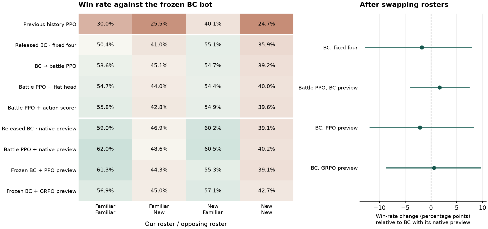

# Can PPO post-training beat VGC-Bench’s behavior-cloned player in Regulation M-B?

**The strongest roster-balanced point estimate came from battle PPO with the original BC preview. It won 48.1% against the frozen BC player, compared with 46.5% for the unmodified BC player on the same schedule.** The paired gain was +1.7 percentage points (95% interval -4.0 to +7.4). At this 4,096-decision budget, the result leaves the size and direction of the improvement uncertain. [Reciprocal scores](reciprocal.csv)

On the original MC461 development schedule, untouched BC won 365/768 games (47.5%) with the first four, and 354/768 (46.1%) with its native preview. Plain battle PPO with the first four won 401, 397, 400 and 351 games per 768 across the four seeds, averaging **50.4%**. Its paired change from untouched BC with the same four was +2.9 points (95% interval -2.2 to +8.0). The earlier 65k history agent averaged 38.7% in its original greedy-action test. [MC461 comparisons](development-rates.csv) · [Previous experiment](../sketch5-vgcbench-bc/README.md)

## Familiar and unseen teams

Columns identify familiarity of the learner’s roster and the opponent’s roster during this round of training. The frozen reference appears once per battle seed. Trained results average four model seeds. Each model played 256 battles per cell.

| Learner | Familiar / familiar | Familiar / unseen | Unseen / familiar | Unseen / unseen |
|---|---:|---:|---:|---:|
| Previous full-history PPO | 30.0% | 25.5% | 40.1% | 24.7% |
| Released BC, fixed four | 50.4% | 41.0% | 55.1% | 35.9% |
| BC + battle PPO, fixed four | 53.6% | 45.1% | 54.7% | 39.2% |
| Battle PPO + flat head | 54.7% | 44.0% | 54.4% | 40.0% |
| Battle PPO + structured head | 55.8% | 42.8% | 54.9% | 39.6% |
| Released BC, native preview | 59.0% | 46.9% | 60.2% | 39.1% |
| Battle PPO, native BC preview | 62.0% | 48.6% | 60.5% | 40.2% |
| Frozen BC, PPO preview | 61.3% | 44.3% | 55.3% | 39.1% |
| Frozen BC, GRPO preview | 56.9% | 45.0% | 57.1% | 42.7% |

**Battle mechanics.** Across the 32 matchups where both rosters were unseen, PPO on the unmodified BC architecture gained 3.2 points against untouched BC with fixed lineups (95% interval -5.1 to +11.8). Adding the shared move–target scorer changed the result by +0.4 points relative to native battle PPO (95% interval -8.2 to +8.3). In 109 first-slot move choices across 74 opening boards where either opponent was legal and type multipliers differed, mean conditional probability of the higher-multiplier target was 52.8% for native PPO and 53.0% for the structured head. HP, abilities and the partner’s planned action can make either target preferable. [Opening target probe](target-summary.csv) · [Paired effects](paired-effects.csv)

**Team preview.** GRPO got the highest designated-roster win rate in the unseen/unseen cell, at 42.7%. Its margin over the preview PPO control was +3.6 points (95% interval -11.1 to +20.3). Once the same pilots also played the opposite rosters, GRPO won 47.1% and PPO won 44.3%. Across 16 seed/learner-roster combinations, PPO kept one lineup for all eight opposing rosters in 14 cases and GRPO did so in 14. Both heads had only 384 training battles per seed. [Lineup choices by opponent](preview-choices.csv) · [Per-training-seed scores](per-seed.csv)

**Roster strength.** The released policy with native preview piloted both sides in the control. It won 100/256 games on the four designated learner rosters and 138/256 on the eight opposing rosters when roles were reversed. With PPO in battle and the original preview, those directional scores were 40.2% and 56.1%. Team assignment changes the apparent strength of the same policy. For a follow-up, train native battle PPO on a larger roster pool, rotate which side pilots each team, and use reciprocal performance on a new locked set as the primary measure. [Role-swap results](reciprocal.csv)

All 38,912 scored games ran on Sketch5. They comprise 30,720 roster-matrix games, 4,608 MC461 development games and 3,584 additional reciprocal games. The audits checked the roster hashes, side and seed schedules and matched opposing lineups. An independent run reproduced both seats of a selected matchup for each of the 30 evaluated configurations (60 games). All 25 existing project tests passed on Sketch5. Copies of all 20 trained checkpoints and their training records are in `runs/sketch5-mb-posttraining-pilot` in the local checkout. Their hashes match the Sketch5 originals. [Replay checks](reproduced.csv) · [Checkpoint manifest](checkpoints.csv)

## How the experiments work

The opponent in every game is the released VGC-Bench behavior-cloned (BC) policy. It samples both its lineup and its in-battle commands. Every game uses open team sheets and the pinned upstream Regulation M-B simulator. The goal is head-to-head play against this checkpoint. The official VGC-Bench population evaluation is a separate protocol. [VGC-Bench paper](https://arxiv.org/abs/2506.10326) · [Frozen opponent and simulator](../sketch5-vgcbench-mb/protocol.json)

**Battle PPO.** All three arms start from copies of the same released BC weights. Its actor and critic each have a three-layer, four-head, width-256 Transformer over the twelve Pokémon in the current state. The input includes move, item and ability embeddings. The native actor produces move, target and switch logits for both active Pokémon, with joint legality enforced after selecting the first command. We fine-tune the entire network. The flat control adds a head over twelve concatenated Pokémon representations and the first command. The structured head shares a scorer across legal candidates. It sees the user, move, target or switch-in, move modifier and board context. It scores the second Pokémon’s command conditional on the first candidate’s representation. Both added heads start with zero output, so all three models begin with the same action distribution. This tests the decision head while holding the pretrained representation and input information constant. The historical full-battle Transformer appears as a separate reference. [PPO paper](https://arxiv.org/abs/1707.06347) · [Model and updates](../../scripts/mb_policy.py)

Each arm gets 4,096 learner decisions per training seed, alternates battle seats, samples four learner rosters and eight opposing rosters, and brings the first four on its own roster. Wins pay +1, losses −1 and intermediate decisions zero. PPO uses 256-step rollouts, three epochs, minibatches of 32, Adam at 0.00003, a 0.2 clip, discount 0.99, GAE λ = 0.95 and an entropy coefficient of 0.005. Training seeds are 2 through 5. The earlier 65k policies used a different initialization, training roster distribution and budget. [Protocol](protocol.json) · [Learning curves by update](training.csv) · [Saved checkpoint hashes and paths on Sketch5](checkpoints.csv)

**Preview PPO and GRPO.** These train only the lineup selector. Both use the same frozen, unmodified BC battle pilot and the same small attention network over six public species per side, represented by base stats and types. The head chooses among 90 lineups, each with an unordered lead pair and unordered reserve pair in canonical slot order. For each of 32 training matchups, each optimizer samples six lineups with replacement and plays each on two matched simulator seeds, one per seat. That gives 384 games per training seed per optimizer. PPO subtracts a learned matchup value from each return. The GRPO-style update normalizes the six returns within the matchup. Both use a clipped policy update and entropy bonus. Learned heads deploy their highest-scoring lineup. The released native preview samples its ordered selections. [Original GRPO formulation](https://arxiv.org/abs/2402.03300) · [Preview training](../../scripts/mb_preview.py) · [All preview rollouts](preview-rollouts.csv.gz)

**Evaluation.** Each cell crosses four learner rosters with eight opposing rosters, for eight games per pair, split evenly between seats. Every arm sees the same simulator seeds and opposing lineups. All battle pilots sample actions. Familiar and unseen refer to the pilot’s PPO or preview training pools. The released checkpoint’s own pretraining data could overlap with a roster. The manifest selects fresh M-B rosters by a seeded hash order, validates legality, and limits each new roster to at most three shared base species with any previously accepted roster or historical development/training roster in the exclusion list. The original 12-team MC461 schedule stays separate. [Roster selection](../../scripts/lock_mb_pilot.cjs) · [Paired game records](matrix-games.csv.gz) · [Per-team matchups](per-matchup.csv)

The primary condition is unseen learner and unseen opponent rosters. The roster-swap analysis is exploratory. It reverses the pilot assignments on the same 32 roster pairs while keeping the physical teams in their original simulator seats. We compare paired changes with a 6,000-draw bootstrap that resamples learner rosters, opposing rosters, training seeds and games within seat. The intervals reflect the small roster pools and four trained seeds. The native-preview battle PPO combination uses the frozen released preview at inference. [Paired matrix effects](paired-effects.csv) · [Reciprocal outcomes](reciprocal-games.csv.gz) · [Reproduction commands](../../docs/vgcbench.md)
