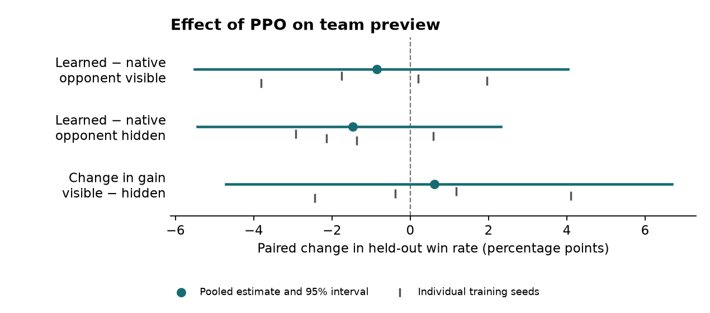

# PPO for team preview with a frozen battle policy

The learned preview picker won 2,409 of 4,096 held-out games (58.81%). The original BC preview won 2,444 (59.67%) with the same battle pilots. The paired difference was −0.85 percentage points (95% interval −5.52 to +4.03). Two seeds improved and two declined. For this opponent and roster pool, the result supports keeping the original preview with the frozen battle policy.

All four preview adapters trained on 16,384 battles on Sketch5. Each used the matching frozen battle pilot from the 16-team, 262,144-decision top-2 MoE study. Each selector played 4,096 held-out games across training seeds 2–5. The native baseline reproduced all 4,096 archived lineups, opponent lineups, outcomes and battle lengths.

| Preview picker | Forward | Reverse | Held-out wins | Held-out rate (95% interval) |
|---|---:|---:|---:|---:|
| Native BC | 51.90% | 67.43% | 2444 / 4096 | 59.67% (55.10 to 64.28) |
| BC + preview PPO | 52.25% | 65.38% | 2409 / 4096 | 58.81% (54.91 to 63.11) |
| Native BC, opponent hidden | 50.49% | 63.13% | 2327 / 4096 | 56.81% (50.85 to 62.21) |
| BC + preview PPO, opponent hidden | 48.68% | 62.01% | 2267 / 4096 | 55.35% (49.93 to 60.84) |

| Matched held-out difference (percentage points) | Estimate (95% interval) | Seed 2 | Seed 3 | Seed 4 | Seed 5 |
|---|---:|---:|---:|---:|---:|
| Learned minus native | -0.85 (-5.52 to +4.03) | -1.76 | +0.20 | +1.95 | -3.81 |
| Learned minus native with opponent hidden | -1.46 (-5.44 to +2.32) | -2.93 | +0.59 | -2.15 | -1.37 |
| Change in gain when opponent is visible | +0.61 (-4.71 to +6.69) | +1.17 | -0.39 | +4.10 | -2.44 |
| Visible minus hidden for learned picker | +3.47 (-1.81 to +9.25) | +2.44 | +3.42 | +3.42 | +4.59 |

## Lineup choices

Each change compares the learned and native pickers under the same visibility and preview sampling seed. Lead-pair and four-member changes ignore order within the respective sets.

| Opponent at preview | Ordered lineup changed | Lead pair changed | Four members changed | Wins gained | Wins lost |
|---|---:|---:|---:|---:|---:|
| Visible | 64.3% | 41.1% | 48.6% | 524 | 559 |
| Hidden | 53.3% | 31.6% | 39.1% | 406 | 466 |

We also enumerated all 360 possible ordered lineups on each of the 64 held-out matchups. For each of 12 learner rosters and four seeds, we held our own preview board fixed and changed the opposing roster. The four Pokémon in the learned picker's most probable lineup changed in 46 of those 48 cases. The corresponding counts were 48 for native BC and zero for either blinded picker. This measures sensitivity to the opponent separately from the win-rate comparison. For example, on MB516, seed 2's preferred lineup led Gliscor and Sneasler against both MB481 and MB335. It kept Gyarados in back and changed the other reserve from Delphox to Sinistcha. [Per-matchup lineup distributions](preview-distributions.csv) · [Sensitivity by roster and training seed](matchup-sensitivity.csv)

## Team matrix

Every training matchup received 128 battles per seed, split evenly between seats. Every held-out pair played 16 games in each direction per selector and seed.

| Schedule | Our teams | Frozen BC opponent teams |
|---|---|---|
| Training | MC461-MB, MB537, MB51, MB45, MB503, MB56, MB156, MB190, MB306, MB374, MB76, MB239, MB314, MB232, MB17, MB497 | MB501, MB245, MB269, MB387, MB106, MB90, MB40, MB102 |
| Held-out forward | MB516, MB216, MB99, MB444 | MB481, MB335, MB259, MB558, MB163, MB562, MB149, MB337 |
| Held-out reverse | MB481, MB335, MB259, MB558, MB163, MB562, MB149, MB337 | MB516, MB216, MB99, MB444 |

## Method

At each native preview phase, the frozen BC actor reads the public board and produces its 256-dimensional actor representation. A 64-unit tanh layer and a zero-initialized output layer add six legal-slot offsets to each of the two positions. The native masks enforce four distinct Pokémon. Both trained and native selectors sample ordered lead and reserve pairs. A separate scalar value head reads the initial matchup. The roster bank and BC battle opponent match the previous study.

Each group samples four lineups independently against the same opponent preview, simulator seed, seat and battle sampling seeds. Their terminal rewards are +1, 0 and −1 for win, draw and loss. PPO uses the joint log probability of all four picks and clips the ratio at 0.2. Its baseline averages the predicted matchup value and the mean return of the other three lineups in the group. Each update uses 128 games with four epochs, minibatches of 64 and an entropy coefficient of 0.002. Only the adapter and preview value head receive updates.

For the blinded control we zero all six opposing Pokémon tokens before either the native actor or the adapter sees them. The opposing BC picker and both in-battle policies retain normal information. The change in gain compares learned minus native win rate with and without this mask. Masking is an inference-time intervention on a normally trained picker. Paired intervals resample training seed, both roster axes and game seeds within seats (6,000 draws). These teams have appeared in earlier evaluations. The study measures one frozen opponent.

[Pilot and full team sheets](../sketch5-mb-team-diversity/README.md) · [Locked protocol](protocol.json) · [Win rates](scores.csv) · [Paired effects](effects.csv) · [Per-team scores](per-team.csv) · [Per-matchup scores](per-matchup.csv) · [Training updates](training.csv) · [Lineup changes](lineup-summary.csv) · [Game records](games.csv.gz) · [Replay checks](replays.csv) · [Checkpoint hashes](checkpoints.csv)
