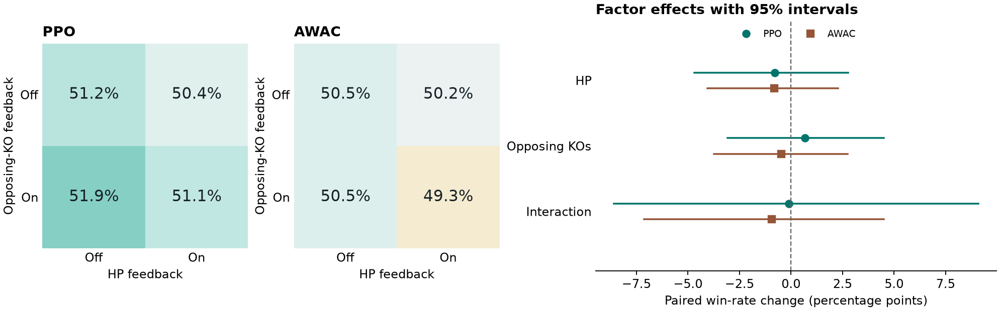

# Do intermediate HP and knockout signals improve M-B battle play?

At 4,096 training decisions per seed, PPO with opposing-KO feedback alone had the highest held-out win rate (51.9%). It gained 0.73 percentage points over unshaped PPO, with a paired 95% interval from −4.88 to +6.64. It also lost 22 fewer games to sweeps across 2,048 battles. Both intervals include zero. HP feedback lowered the observed win rate in all four direct comparisons. AWAC averaged 1.01 points below PPO across reward settings. For a longer training run, the clearest comparison is KO-only PPO against unshaped PPO.

## Reward ablation

The entries are win rates on teams held out of post-training, averaged over four training seeds and both roster assignments. Each entry pools 2,048 games. The opponent is the frozen VGC-Bench BC bot. Both players use the original BC preview to pick their four Pokémon in evaluation.

| Opposing-KO feedback | PPO · HP off | PPO · HP on | AWAC · HP off | AWAC · HP on |
|---|---:|---:|---:|---:|
| Off | 51.17% | 50.44% | 50.54% | 50.20% |
| On | 51.90% | 51.07% | 50.54% | 49.27% |

The untouched BC control scored 254/512 (49.6%) on the same reciprocal schedule. Each control game is counted once. [Scores and absolute intervals](scores.csv) · [All model seeds](per-seed.csv)

| Paired effect in win-rate points (95% interval) | PPO | AWAC |
|---|---:|---:|
| HP main effect | -0.8 (-4.7 to +2.8) | -0.8 (-4.1 to +2.3) |
| opponent KO main effect | +0.7 (-3.1 to +4.5) | -0.5 (-3.7 to +2.8) |
| HP x KO interaction | -0.1 (-8.6 to +9.1) | -0.9 (-7.1 to +4.5) |

Across the four reward settings, AWAC minus PPO was -1.0 (-4.0 to +1.8) points. These intervals resample both training seeds and roster matchups. [All contrasts and interaction estimates](effects.csv)

## Wins and loss severity

| Algorithm | Feedback | Familiar win % | Held-out forward win % | Held-out reverse win % | Sweep losses / all held-out games | Mean opponents alive in a loss | Mean opponent team HP left in a loss |
|---|---|---:|---:|---:|---:|---:|---:|
| PPO | No intermediate feedback | 65.9 | 43.2 | 59.2 | 154/2048 (7.5%) | 2.34 | 34.0% |
| PPO | HP only | 66.8 | 42.6 | 58.3 | 148/2048 (7.2%) | 2.32 | 33.3% |
| PPO | Opposing KOs only | 67.5 | 43.7 | 60.2 | 132/2048 (6.4%) | 2.31 | 33.8% |
| PPO | HP and opposing KOs | 66.9 | 42.7 | 59.5 | 148/2048 (7.2%) | 2.33 | 33.1% |
| AWAC | No intermediate feedback | 61.7 | 41.9 | 59.2 | 144/2048 (7.0%) | 2.30 | 33.7% |
| AWAC | HP only | 64.9 | 40.9 | 59.5 | 144/2048 (7.0%) | 2.30 | 33.6% |
| AWAC | Opposing KOs only | 64.7 | 43.6 | 57.5 | 141/2048 (6.9%) | 2.29 | 33.5% |
| AWAC | HP and opposing KOs | 63.2 | 40.9 | 57.6 | 149/2048 (7.3%) | 2.33 | 33.7% |

For KO-only feedback versus none, the paired change in sweep-loss rate was -1.1 (-3.6 to +1.4) points with PPO and -0.1 (-2.5 to +2.1) with AWAC. A negative change means fewer battles ended in a sweep loss. [Paired sweep effects](sweep-effects.csv)

The primary evaluation covers 16,896 held-out games, including the frozen control. Together with 8,448 familiar games, there are 25,344 scored battles. The audit matched both previews, rosters, seats and battle seeds. All eight runs within each training seed reproduced the same initial 256 actions and outcomes. All four unshaped PPO policies matched the previous pilot’s model tensors exactly. A fresh evaluation process reproduced 66 scored games including both seats for each model and the frozen control. An independent retraining of AWAC with both rewards at seed 2 reproduced all 130 exported tensors. All 30 project tests passed on Sketch5. [Retraining check](retrained-check.json) · [Checkpoints](checkpoints.csv) · [Replay checks](reproduced.csv)

## Team matrix

| Schedule | Our learner | Frozen BC opponent |
|---|---|---|
| Training and familiar evaluation | MC461-MB, MB537, MB51, MB45 | MB501, MB245, MB269, MB387, MB106, MB90, MB40, MB102 |
| Held-out forward | MB516, MB216, MB99, MB444 | MB481, MB335, MB259, MB558, MB163, MB562, MB149, MB337 |
| Held-out reverse | MB481, MB335, MB259, MB558, MB163, MB562, MB149, MB337 | MB516, MB216, MB99, MB444 |

Each training battle samples the two rosters independently from their listed pools. Each evaluation row crosses every learner roster with every opponent roster. Each evaluation checkpoint plays eight games per pair per direction. The slot-by-slot team sheets, move sets and individual pairing scores are in the [full team matrix](team-matrix.md).

## Methods

All eight conditions used copies of the same released human behavior-cloned VGC-Bench Transformer. Each received exactly 4,096 environment decisions per seed (2, 3, 4 and 5) against a separate frozen copy. The two sides used the pinned M-B simulator and open team sheets. Each training episode independently sampled our roster from four options and the opponent’s from eight. Our learner brought slots 1–4. The opponent chose its four with its frozen preview. All evaluation arms used the original BC preview on both sides and sampled in-battle actions. [Protocol](protocol.json) · [Exact roster sheets, assignments and wins per pair](team-matrix.md)

**Rewards.** A win pays +1, a draw 0 and a loss −1. The two potential functions are net HP advantage and the fraction of the opponent’s four Pokémon that have fainted. Net HP advantage is the sum of opposing HP fractions depleted minus our HP fractions depleted, divided by four. Unseen slots count as full health until observed. For each enabled potential Φ, the step reward adds 0.25 × (0.99 Φ(next) − Φ(current)). Terminal potentials are zero. A KO therefore produces a distinct step even if the last hit removes very little HP. With both enabled the coefficients add. The discounted sum of shaping over each complete episode equals minus its starting weighted potential, so a sweep loss and a close loss retain the same underlying terminal outcome. We measure both outcomes separately. [Reward implementation](../../src/pokemon_rl/rewards.py) · [Potential-based reward shaping](https://people.eecs.berkeley.edu/~russell/papers/icml99-shaping.pdf)

**Optimizers.** Native PPO uses the previous pilot’s settings (256-step rollouts, three passes, 32 decisions per minibatch, learning rate 0.00003, clipping 0.2 and GAE λ = 0.95). AWAC uses the same actor initialization, action mask, online decision budget, collection cadence and 24 actor updates per block. Both start each seed with the same first 256 decisions from the unmodified BC actor. AWAC builds its replay buffer entirely from those transitions and subsequent training games. It trains twin action-value heads on frozen BC critic features, using the lower target Q for a sampled legal next action and Polyak target updates (0.01). The actor uses advantage-weighted log likelihood, with four sampled alternative actions to estimate the baseline, temperature 0.3 and weights capped at 20 before minibatch normalization. The Q-head learning rate is 0.0003. The compute per gradient update differs between optimizers. [AWAC implementation](../../scripts/mb_awac.py) · [AWAC paper](https://arxiv.org/abs/2006.09359)

**Evaluation and uncertainty.** Each checkpoint plays 256 familiar games, 256 held-out games and the same 256 held-out matchups with rosters exchanged. Each schedule crosses four rosters with eight, eight games per pair, evenly split across simulator seats. In reverse, physical rosters stay in the same seats while the pilots switch. The held-out rosters were used in the earlier pilot’s evaluation and remain disjoint from this training pool. This experiment uses fresh simulator and action-sampling seeds. The primary score averages both held-out directions. The HP main effect averages the HP gain over both KO settings. The KO effect averages over both HP settings. Their interaction is the extra change with both enabled beyond the sum of their individual changes. Paired 95% percentile intervals use 6,000 bootstrap draws over training seeds, both roster axes and seat-stratified battle seeds, keeping the two directions paired. A sweep loss means we lost while all four opponents were still alive. Surviving at partial HP counts as alive. [Paired effects](effects.csv) · [Score and sweep counts](scores.csv) · [Per-seed scores](per-seed.csv)

**Reproduction.** The [training metrics](training.csv) include the magnitude of each feedback component and the fraction of each AWAC minibatch drawn from earlier rollouts. The [checkpoint manifest](checkpoints.csv) identifies the scored battle policies and their hashes. The export is an inference checkpoint. Reproduction commands are in the [benchmark guide](../../docs/vgcbench.md). [Scored games](games.csv.gz) · [Training outcomes](training-games.csv.gz) · [Independent replay checks](reproduced.csv)
