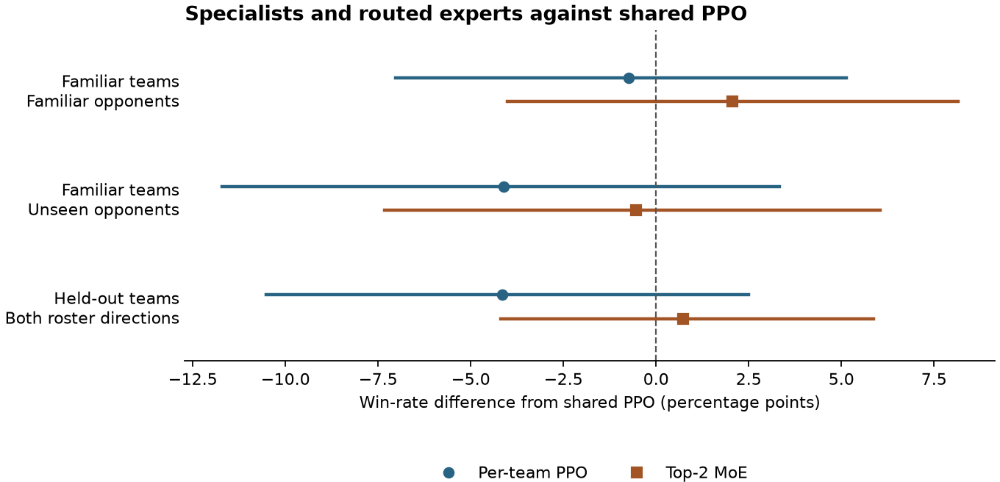

# Shared PPO, per-team PPO and top-2 MoE in VGC-Bench M-B

Top-2 MoE had the highest held-out win rate (56.4%), followed by shared PPO (55.7%) and per-team PPO (51.5%). MoE gained 7.0 points over frozen BC (paired 95% interval +1.8 to +12.3), but its 0.7-point edge over shared PPO had an interval of −4.2 to +5.9. Against unseen opponents on familiar teams, shared PPO led at 60.8%. Rotating the four expert identities changed only two net wins in 4,096 held-out games. Shared PPO is the simpler deployment choice from this comparison.

## Win rates

| Battle policy | Familiar team and opponent | Familiar team, unseen opponent | Held-out forward | Held-out reverse | Held-out average |
|---|---:|---:|---:|---:|---:|
| Released BC control | 60.55% | 50.98% | 40.62% | 58.20% | 49.41% |
| Shared PPO | 70.21% | 60.79% | 48.34% | 62.99% | 55.66% |
| Per-team PPO | 69.48% | 56.69% | 42.53% | 60.50% | 51.51% |
| Top-2 MoE PPO | 72.27% | 60.25% | 49.22% | 63.57% | 56.40% |

All rates score wins against frozen BC. The held-out average weights the two roster directions equally. [Win counts and 95% intervals](scores.csv)

| Paired change in win rate, percentage points (95% interval) | Familiar team and opponent | Familiar team, unseen opponent | Held-out average |
|---|---:|---:|---:|
| Per-team PPO minus Shared PPO | -0.7 (-7.0 to +5.1) | -4.1 (-11.7 to +3.3) | -4.2 (-10.5 to +2.5) |
| Top-2 MoE PPO minus Shared PPO | +2.1 (-4.0 to +8.2) | -0.5 (-7.3 to +6.1) | +0.7 (-4.2 to +5.9) |
| Top-2 MoE PPO minus Per-team PPO | +2.8 (-3.7 to +9.4) | +3.6 (-3.4 to +10.6) | +4.9 (-2.0 to +10.8) |
| Shared PPO minus Released BC control | +9.7 (+0.6 to +19.9) | +9.8 (+1.8 to +17.9) | +6.2 (-0.7 to +12.5) |
| Per-team PPO minus Released BC control | +8.9 (+0.4 to +18.1) | +5.7 (-2.8 to +13.8) | +2.1 (-3.9 to +8.4) |
| Top-2 MoE PPO minus Released BC control | +11.7 (+2.7 to +22.9) | +9.3 (+0.9 to +17.5) | +7.0 (+1.8 to +12.3) |

## Per-seed held-out wins

| Training seed | Shared PPO | Per-team PPO | Top-2 MoE PPO |
|---|---:|---:|---:|
| 2 | 579/1024 | 529/1024 | 567/1024 |
| 3 | 550/1024 | 566/1024 | 560/1024 |
| 4 | 585/1024 | 500/1024 | 607/1024 |
| 5 | 566/1024 | 515/1024 | 576/1024 |

## Which experts ran on held-out teams?

The rows show the percentage of held-out decisions on which each expert ran. Each decision executes two experts, so each row sums to 200%. Expert indices are local to a trained checkpoint.

| Training seed | Expert 0 | Expert 1 | Expert 2 | Expert 3 | Decisions |
|---|---:|---:|---:|---:|---:|
| 2 | 72.0% | 64.2% | 33.5% | 30.4% | 10,116 |
| 3 | 58.4% | 43.5% | 19.8% | 78.3% | 9,995 |
| 4 | 12.9% | 84.8% | 50.2% | 52.1% | 10,041 |
| 5 | 71.5% | 19.4% | 50.1% | 59.0% | 9,779 |

After the main comparison, we repeated the 4,096 held-out MoE games with a fixed permutation of the trained experts. The gate and its weights kept their trained values. Gate slot 0 used expert 1, slot 1 used expert 2, slot 2 used expert 3 and slot 3 used expert 0. This changed wins from 2310/4096 (56.40%) to 2312/4096 (56.45%), a paired change of +0.05 points (95% interval -2.00 to +1.90). This exploratory check tests one fixed remapping of expert identities. [Routing-control outcomes](routing-control-games.csv.gz) · [Paired interval](routing-control-effect.csv)

## Per-team results against unseen opponent rosters

A practiced team is scored against all eight held-out opponent rosters. Each unseen team appears in the direction that assigned it to the learner.

| Our roster | Pool | Shared PPO | Per-team PPO | Top-2 MoE PPO |
|---|---|---:|---:|---:|
| MC461-MB | Practiced | 62.5% | 59.6% | 62.7% |
| MB537 | Practiced | 68.2% | 70.1% | 69.9% |
| MB51 | Practiced | 55.7% | 50.2% | 52.9% |
| MB45 | Practiced | 56.8% | 46.9% | 55.5% |
| MB516 | Held-out forward | 43.6% | 38.3% | 39.3% |
| MB216 | Held-out forward | 50.8% | 37.9% | 52.5% |
| MB99 | Held-out forward | 45.5% | 42.0% | 49.2% |
| MB444 | Held-out forward | 53.5% | 52.0% | 55.9% |
| MB481 | Held-out reverse | 71.9% | 68.4% | 70.3% |
| MB335 | Held-out reverse | 80.5% | 78.5% | 78.9% |
| MB259 | Held-out reverse | 63.7% | 49.6% | 61.7% |
| MB558 | Held-out reverse | 51.6% | 42.2% | 50.4% |
| MB163 | Held-out reverse | 55.1% | 57.4% | 60.2% |
| MB562 | Held-out reverse | 68.4% | 66.4% | 71.5% |
| MB149 | Held-out reverse | 50.4% | 54.7% | 50.4% |
| MB337 | Held-out reverse | 62.5% | 66.8% | 65.2% |

An independent process reproduced 78 sampled battles across all conditions and the frozen control. On 128 opening boards, the trained models each executed exactly the two experts selected by their router and matched a separate reconstruction of the action scores. The Sketch5 test suite passed all 31 tests. [Routing checks](routing-check.csv) · [Replay records](replayed.csv)

## Team matrix

| Schedule | Our roster | Frozen BC opponent roster |
|---|---|---|
| Training and familiar evaluation | MC461-MB, MB537, MB51, MB45 | MB501, MB245, MB269, MB387, MB106, MB90, MB40, MB102 |
| Familiar team against unseen opponent roster | MC461-MB, MB537, MB51, MB45 | MB481, MB335, MB259, MB558, MB163, MB562, MB149, MB337 |
| Held-out forward | MB516, MB216, MB99, MB444 | MB481, MB335, MB259, MB558, MB163, MB562, MB149, MB337 |
| Held-out reverse | MB481, MB335, MB259, MB558, MB163, MB562, MB149, MB337 | MB516, MB216, MB99, MB444 |

In training, each roster stream draws an opponent roster uniformly from the eight listed and alternates seats by episode. Each evaluation row crosses every own roster and opposing roster, 16 games per pairing per checkpoint, with eight in each seat. The same frozen BC opponent pilots every opposing roster. Both players choose lineups from all six with the released BC preview in every battle. “Held-out” refers to our PPO training. These rosters have appeared in prior evaluations. [Six Pokémon and move sheets for all rosters](../sketch5-mb-reward-factorial/team-matrix.md) · [Roster hashes](../sketch5-mb-reward-factorial/protocol.json)

## Training and specialist selection

Every architecture starts with VGC-Bench’s released behavior-cloned (BC) battle Transformer and fine-tunes the in-battle policy with PPO. Wins pay +1, draws 0 and losses −1. There is no intermediate reward. Every seed gets 65,536 decisions per approach, split into exactly 16,384 per learner roster. The four seeds are 2, 3, 4 and 5. The simulator, actor initialization, opponent, sampled evaluation actions, reward and frozen preview match across all arms. [Protocol](protocol.json) · [Trainer](../../scripts/mb_roster_ppo.py)

- **Shared PPO** trains one complete actor and critic on all four practiced rosters.
- **Per-team PPO** trains four independent copies of the actor and critic per seed. Each copy trains on one of the four rosters. At evaluation, a practiced team uses its matching checkpoint. An unseen team uses the specialist with the most shared base species across all six. Overlap in distinct moves breaks ties, followed by the listed training-roster order. The rule uses only public team sheets. The estimate on new rosters includes this deployment choice. [Specialist assignments and candidates](specialists.json)
- **Top-2 MoE** shares the pretrained actor and critic across rosters and adds four independent 256 → 128 → 214 action-score networks to the actor. On each decision, a learned linear router ranks experts from the actor’s current 256-dimensional representation of both teams and the board. Only the top two execute. Their softmax-weighted outputs are added to the pretrained action scores before the usual legal-action masks. The experts start with zero output, so all arms start with the same action distribution. PPO updates the router, routed experts and base network. There is no balancing or expert-label loss.

Each PPO update uses 256 learner decisions, three passes, minibatches of 32, Adam at 0.00003, clipping 0.2, discount 0.99, GAE λ 0.95 and entropy coefficient 0.005. Shared PPO and MoE collect 64 consecutive decisions from each of four independent battle streams per update. Each specialist collects 256 consecutive decisions from its single stream. The bootstrap and advantage calculation keep each battle trajectory separate. Each shared model receives 256 updates, and each specialist receives 64. The shared policy and each individual specialist have 2,941,335 model parameters. The routed policy has 3,184,371 (8.3% more).

## Evaluation and uncertainty

The familiar-roster evaluation is reported both against familiar opponents’ teams and against unseen opponents’ teams. For the held-out measure, each checkpoint plays every unseen pairing in both directions with physical teams kept in their original simulator seats. The headline score averages the two directions equally. Each trained condition contributes 2,048 games on each familiar schedule and 4,096 held-out games across four seeds. The untouched released BC control plays each unique game once. Win rate counts actual wins. Paired 95% percentile intervals resample training seeds, the two roster pools, and battles within seat, with the opposing assignment directions kept together. [Scored games](games.csv.gz) · [Per-seed scores](per-seed.csv) · [Per-matchup results](per-pair.csv) · [Paired effects](effects.csv)

The main comparison scored 26,624 battles. The expert-identity control added 4,096, for 30,720 scored battles in total. All 24 exported checkpoint hashes matched their Sketch5 originals, and an independent calculation from the raw games reproduced all 15 main paired win-rate contrasts it checked.

The per-decision expert counts are aggregated by roster, training seed and evaluation schedule. Each decision contributes two expert selections. Expert IDs are specific to the seed. [Expert usage](expert-usage.csv) · [Training updates](training.csv) · [Training games](training-games.csv.gz) · [Checkpoint hashes](checkpoints.csv) · [Independent replay checks](replayed.csv) · [Reproduction commands](../../docs/vgcbench.md)
