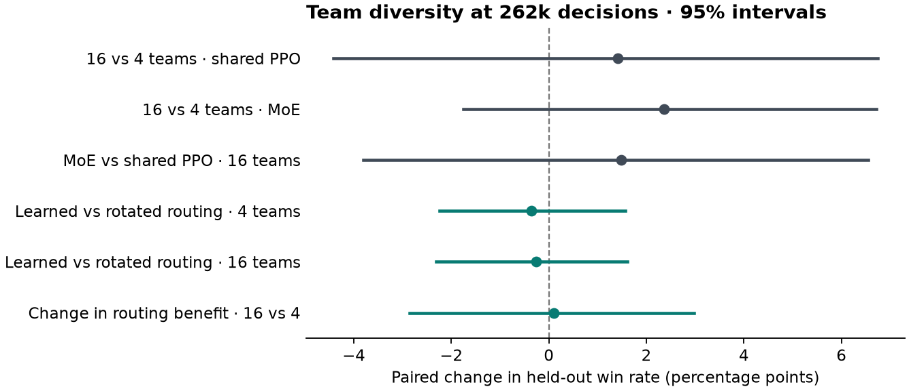

# Does a more diverse training roster make expert routing useful?

The four-expert top-2 policy scored higher after training on sixteen teams at every seed. Its held-out win rate rose from 57.30% to 59.67%, a gain of 97 wins in 4,096 matched games. The pooled gain was +2.37 percentage points (paired 95% interval −1.76 to +6.71). Shared PPO gained +1.42 points (−4.42 to +6.74). The intervals leave uncertainty about how well either gain would carry to other matchups.

Expert selection showed no measurable win-rate benefit. On the sixteen-team checkpoint, the learned assignment won 2,444 games, rotating the expert identities won 2,455, and disabling the expert heads won 2,447. The learned assignment scored 0.27 points below the rotation (−2.32 to +1.61). Expanding the roster pool changed the learned-versus-rotated difference by +0.10 points (−2.86 to +2.98). The jointly trained backbone therefore retained the observed performance when deployed on its own. This inference-time test leaves open whether training with expert heads helped shape that backbone.

## Win rates on held-out teams

Each entry uses the same 4,096 games across four training seeds, including 2,048 in each direction. The rotation and backbone conditions use the same MoE checkpoint as the normal condition.

| Learner teams | Policy | Forward | Reverse | Combined, wins / games | Combined win rate (95% interval) |
|---:|---|---:|---:|---:|---:|
| 4 | Shared PPO | 50.00% | 63.53% | 2325 / 4096 | 56.76% (51.86 to 61.87) |
| 4 | MoE | 50.68% | 63.92% | 2347 / 4096 | 57.30% (52.68 to 61.87) |
| 4 | MoE, rotated experts | 50.63% | 64.70% | 2362 / 4096 | 57.67% (53.17 to 62.11) |
| 4 | MoE, backbone only | 51.07% | 64.60% | 2369 / 4096 | 57.84% (53.47 to 62.28) |
| 16 | Shared PPO | 50.83% | 65.53% | 2383 / 4096 | 58.18% (53.59 to 63.16) |
| 16 | MoE | 51.90% | 67.43% | 2444 / 4096 | 59.67% (55.10 to 64.28) |
| 16 | MoE, rotated experts | 52.10% | 67.77% | 2455 / 4096 | 59.94% (54.96 to 64.70) |
| 16 | MoE, backbone only | 52.20% | 67.29% | 2447 / 4096 | 59.74% (54.83 to 64.48) |

## Paired differences

All values are percentage points. Intervals resample the same seeds, teams and battles across both conditions. Positive values favor the first condition.

| Held-out comparison | Difference (95% interval) | Seed 2 | Seed 3 | Seed 4 | Seed 5 |
|---|---:|---:|---:|---:|---:|
| 16 minus 4 teams (shared) | +1.42 (-4.42 to +6.74) | -1.37 | +6.45 | +0.29 | +0.29 |
| 16 minus 4 teams (moe) | +2.37 (-1.76 to +6.71) | +1.66 | +2.05 | +1.95 | +3.81 |
| MoE minus shared (4 teams) | +0.54 (-4.98 to +5.66) | +0.10 | +3.91 | -3.22 | +1.37 |
| MoE minus shared (16 teams) | +1.49 (-3.81 to +6.54) | +3.12 | -0.49 | -1.56 | +4.88 |
| Normal minus rotated (4 teams) | -0.37 (-2.25 to +1.56) | -0.49 | -0.88 | -0.10 | +0.00 |
| Normal minus rotated (16 teams) | -0.27 (-2.32 to +1.61) | +0.39 | -0.88 | -0.29 | -0.29 |
| Change in normal minus rotated with diversity | +0.10 (-2.86 to +2.98) | +0.88 | +0.00 | -0.20 | -0.29 |
| Normal minus backbone (4 teams) | -0.54 (-2.61 to +1.66) | -0.78 | -1.37 | -0.88 | +0.88 |
| Normal minus backbone (16 teams) | -0.07 (-1.90 to +1.73) | +0.88 | -0.39 | -0.29 | -0.49 |

The effective number of experts used on held-out decisions was 3.71 with four training teams and 3.80 with sixteen (maximum 4). This is the exponential of the entropy of selected expert frequencies, computed within each training seed and then averaged. The routing intervention above measures whether expert identity contributed to winning.

[Paired effects](effects.csv) · [Score counts and intervals](scores.csv) · [Per-matchup wins](per-pair.csv) · [Per-seed wins](per-seed.csv) · [Per-game outcomes](games.csv.gz) · [Routing counts](expert-usage.csv) · [Checkpoint hashes](checkpoints.csv) · [Training exposures](training-matchups.csv) · [Replay checks](replayed.csv)

## Results by the team we piloted

Win rates below use every opposing team in the indicated direction and all four seeds. The final column compares the same 16-team MoE checkpoint with its expert identities rotated. Per-team differences are descriptive.

| Direction | Our team | Games per condition | Shared, 4 → 16 teams | MoE, 4 → 16 teams | Normal minus rotated, 16 teams (points) |
|---|---|---:|---:|---:|---:|
| Forward | MB216 | 512 | 52.0% → 57.4% | 55.5% → 63.1% | +1.76 |
| Forward | MB444 | 512 | 53.9% → 53.1% | 53.7% → 54.3% | -0.78 |
| Forward | MB516 | 512 | 47.9% → 45.7% | 45.5% → 44.3% | -0.78 |
| Forward | MB99 | 512 | 46.3% → 47.1% | 48.0% → 45.9% | -0.98 |
| Reverse | MB149 | 256 | 49.6% → 50.8% | 49.6% → 54.7% | +1.95 |
| Reverse | MB163 | 256 | 61.3% → 60.2% | 60.5% → 62.1% | -2.73 |
| Reverse | MB259 | 256 | 66.0% → 59.4% | 60.9% → 65.2% | +0.78 |
| Reverse | MB335 | 256 | 76.6% → 82.8% | 76.6% → 80.5% | -1.95 |
| Reverse | MB337 | 256 | 58.2% → 66.4% | 62.1% → 70.7% | -0.78 |
| Reverse | MB481 | 256 | 75.8% → 77.3% | 76.6% → 77.0% | -0.78 |
| Reverse | MB558 | 256 | 52.0% → 52.7% | 50.8% → 55.9% | +1.95 |
| Reverse | MB562 | 256 | 68.8% → 74.6% | 74.2% → 73.4% | -1.17 |

## Team matrix

| Schedule | PPO rosters | Frozen VGC-Bench BC rosters |
|---|---|---|
| Four-team training baseline | MC461-MB, MB537, MB51, MB45 | MB501, MB245, MB269, MB387, MB106, MB90, MB40, MB102 |
| Sixteen-team training | MC461-MB, MB537, MB51, MB45, MB503, MB56, MB156, MB190, MB306, MB374, MB76, MB239, MB314, MB232, MB17, MB497 | MB501, MB245, MB269, MB387, MB106, MB90, MB40, MB102 |
| Held-out forward | MB516, MB216, MB99, MB444 | MB481, MB335, MB259, MB558, MB163, MB562, MB149, MB337 |
| Held-out reverse | MB481, MB335, MB259, MB558, MB163, MB562, MB149, MB337 | MB516, MB216, MB99, MB444 |

The larger pool expands learner coverage from 20 to 52 distinct base species. Of the 40 base species on the held-out teams, 14 occur on the original four learner teams and 25 occur on the expanded pool. [All six Pokémon on every team](rosters.md)

The 12 additions come from the pinned VGC-Bench Regulation M-B roster bank. We selected them by a fixed hash ordering before playing any games. Each has a legal team sheet, six Pokémon with four moves each, and at most three base species in common with any other addition, original training roster, held-out roster or reserved development roster. The twelve held-out teams were excluded from both sides of PPO training. They were used in earlier evaluations and their exposure during upstream behavior cloning is unknown. [Roster file hashes and protocol](protocol.json) · [Roster selection](../../scripts/lock_mb_diversity.cjs)

## Training and evaluation

All eight sixteen-team runs completed on Sketch5. MoE seed 2 resumed from its full 163,840-decision checkpoint after a simulator timeout and reached 262,144 decisions. The analysis pairs 16,384 new game records with 16,384 archived four-team records and includes 32 replay checks.

Both networks start from the released BC battle policy. Shared PPO fine-tunes its native actor and critic. The MoE fine-tunes the same backbone plus four residual action heads, each 256 → 128 → 214. The learned gate selects two experts per decision and normalizes their weights. The frozen BC preview chooses the four Pokémon from six for both sides in every training and evaluation game. Battle actions are sampled, team sheets are open, and rewards are +1/0/−1 for win/draw/loss.

Each architecture receives 262,144 decisions per seed with seeds 2, 3, 4 and 5. Each original learner team received 65,536 decisions per seed in the four-team baseline. In the new run, 16 learner teams each receive exactly 16,384. Each roster has its own live battle, opponent sampling stream and alternating seat. A seeded shuffle visits all 16 rosters in each block of four PPO updates. Each update still collects 64 consecutive decisions from each of four active battles. At the end of each rollout we bootstrap the value of its own next state. Adam, the PPO settings, rollout length, total interaction budget and opposing roster distribution match the baseline. [Previous four-team experiment](../sketch5-mb-long-ppo/README.md) · [Trainer](../../scripts/mb_roster_ppo.py)

For each checkpoint and routing condition, we play all 32 pairings in both directions. Each pairing has 16 games, eight per seat, for 1,024 games per training seed. The headline rate is the average of the two directions and counts draws as non-wins. The matchup, simulation seed, action-sampling seed, seat and both BC previews match the four-team archive. We resample training seeds, both roster axes and battle seeds within seats together across comparisons, using the original 6,000-draw paired percentile bootstrap.

The primary intervention holds the fine-tuned network and gate fixed and cyclically reassigns the four expert identities. Normal minus rotated estimates the contribution of the learned assignment relative to that permutation. We also remove all expert residuals to evaluate the fine-tuned backbone, and compare the MoE with independently trained shared PPO. The difference between the 16-team and four-team routing effects tests whether training diversity changed the value of routing. [Reproduction commands](../../docs/vgcbench.md)
