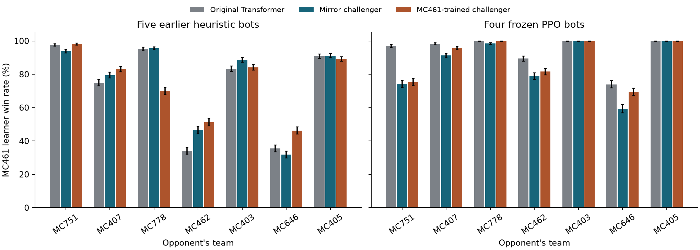

# MC461 against the previous bots on seven opposing teams

**The original Transformer won 20,770/25,200 games (82.42%), the mirror challenger won 20,177 (80.07%), and the MC461-trained challenger won 20,402 (80.96%).** All three used exactly the same MC461 lineup. The mirror challenger trailed its parent by 2.35 percentage points, with a paired 95% interval of −2.69 to −2.02. The MC461-trained challenger trailed by 1.46 points (−1.86 to −1.06). [Paired differences](paired.csv)

| Opposing team | Original Transformer | Mirror challenger | MC461-trained challenger |
| --- | ---: | ---: | ---: |
| MC751 | **97.36%** | 85.11% | 88.06% |
| MC407 | 85.36% | 84.72% | **88.83%** |
| MC778 | **97.39%** | 96.94% | 83.31% |
| MC462 | 58.67% | 60.92% | **64.78%** |
| MC403 | 90.75% | **93.72%** | 91.19% |
| MC646 | 52.58% | 44.06% | **56.56%** |
| MC405 | 94.83% | **95.00%** | 94.00% |
| **Overall** | **82.42%** | **80.07%** | **80.96%** |

Every team row contains 3,600 games per learner, equally weighted across nine opposing bots. The original champion's previous 99.08% result used twelve bot–team combinations on Balance, Sun, MC463 and MC751. This experiment assigns the seven original test rosters to the opposing bots. [Earlier fixed-lineup league](../sketch5-fixed-league/README.md)

The changes depend on the opponent policy. Against the five heuristics, the mirror challenger improved by 2.23 points (paired 95% interval 1.73–2.73). Against the four frozen PPO rivals, it lost 8.08 points (−8.51 to −7.65). The MC461-trained challenger gained 1.53 points against the heuristics and lost 5.20 points against the PPO rivals.

| Opponent group | Original Transformer | Mirror challenger | MC461-trained challenger |
| --- | ---: | ---: | ---: |
| Five heuristics | 73.09% | **75.32%** | 74.62% |
| Four frozen PPO bots | **94.08%** | 86.00% | 88.88% |



Across only the five opposing rosters absent from recent training, the original scored 85.40%, the mirror challenger 86.26%, and the MC461-trained challenger 84.42%. The mirror challenger's largest overall regressions were on MC751 and MC646, both familiar from counter-training. Its strength against the frozen Transformer on those teams carried over unevenly to different pilots using the same teams. [Scores for all seven and the five unseen rosters](summary.csv)

## Matchups

Every learner used **MC461**, with Meowstic-F and Kommo-o leading and Indeedee-M and Sneasler in back. The opponents piloted MC751, MC407, MC778, MC462, MC403, MC646 and MC405, the seven teams in the original tournament test split. [Our fixed team](../../teams/reg-mc-regionals/MC461.txt) · [Opponent roster split](../../teams/reg-mc-regionals/split.csv)

The main comparison is the original 99.08% league-champion Transformer against the single mirror challenger that scored 94.65% in the counter-training experiment. We also evaluated the single challenger trained exclusively on MC461. All three are 1.75M-parameter full-history Transformers. They used the exported frozen weights, greedy action selection and the same simulator and published move lists. [Checkpoint and team hashes](manifest.json)

Each opponent team was piloted by the damage, switching, setup, random and tactical heuristics, plus each of the four frozen PPO rivals from the original league. Those rivals originally trained on Balance, Sun, MC463 and MC751. This test gives them each of the seven opposing rosters, which changes the lineups most of them trained with. The results include both the five-heuristic group and the four-PPO group. [Opponent identities](manifest.json)

Each learner played 400 fresh battle seeds against every bot–team combination, with 200 starts on each simulator side. The three learners shared the same schedule, giving 25,200 games per learner and 75,600 games in total. Aggregate win rates weight all nine bots and seven teams equally. Ties and cutoffs count as non-wins. Team preview selected the first four Pokémon and the first two led, matching the prior experiments.

MC646 and MC751 were reused in recent counter-training, and the original champion already faced MC751 in its league. The companion five-team summary excludes both. The seven-team table remains the primary requested comparison. [All aggregate scores](summary.csv)

Win-rate intervals use Wilson 95% intervals. Differences use paired game outcomes, with variance computed within each opposing team, bot and simulator-side group. These intervals measure battle randomness for the selected frozen policies. The test uses one checkpoint per policy condition. [Paired effects](paired.csv)

## Reproduction

All games ran on Sketch5. The raw per-matchup files and frozen evaluation manifest are in `runs/sketch5-mc461-vs-seven-v1`. The audit verifies that MC461 appears as the learner team in every row, that the opponent assignments match the manifest, that every expected seed and side appears once per learner, and that model and roster hashes agree. [All games](games.csv.gz)

Twelve games were replayed independently with identical recorded outcomes, turns, teams and sides. These checks covered all three policies, both simulator sides and heuristic and PPO opponents. [Replay verification](replay-check.json)

```sh
.venv/bin/python scripts/evaluate_mc461_transfer.py \
  --runs runs/mc461-seven-repeat --output results/mc461-seven-repeat --jobs 32
```

To regenerate the summary and figure from existing completed cells, add `--analyze-only`.
