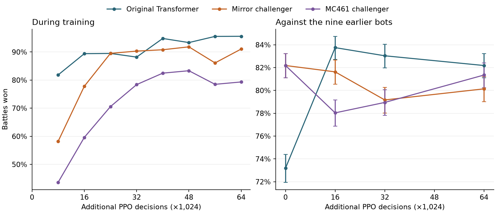

# What further PPO training buys the MC461 player

All 42 training jobs in the previous counter-training experiment finished on Sketch5. We examined the trajectories that produced the original league champion and the two single-network challengers. We also trained four new policies on Sketch5 to test opponent mixing. All evaluation tables here give the learner MC461.

## Where the earlier runs improved

Each cell below contains the win rate over 5,040 matched battles against the nine earlier bots playing the seven tournament test rosters. The original run started from the tournament Transformer. Both challengers started from the original run's final weights. During training the mirror challenger played the same team as its opponent. The fixed challenger always played MC461.

| Training run | Start | 16,384 decisions | 32,768 | 65,536 |
| --- | ---: | ---: | ---: | ---: |
| Original league Transformer | 73.19% | **83.75%** | 83.04% | 82.18% |
| Mirror challenger | 82.18% | 81.63% | 79.17% | 80.14% |
| Fixed-MC461 challenger | 82.18% | 78.04% | 78.95% | 81.35% |

The earlier original checkpoint beat its final checkpoint by 1.57 percentage points on this field (paired 95% interval 0.78 to 2.35). The selected final original had been optimized for an earlier league. Its win rate during training rose from 81.8% in the first 8,192 decisions to 95.6% in the last 8,192. The mirror challenger's training win rate rose from 58.2% to 91.1%, and the fixed challenger's rose from 43.6% to 79.3%. Training uses sampled learner actions.

The fixed challenger learned a real response to the frozen defenders. Its win rate against them went from 21.9% at initialization to 75.0%, 82.8%, and 91.6% at successive checkpoints. On the broader field its 65,536-step result was still below its starting point. For a more precise estimate at that endpoint, the earlier 25,200-game evaluation found 80.96% for the fixed challenger against 82.42% for its parent (paired difference −1.46 points, 95% interval −1.86 to −1.06). [Earlier full evaluation](../sketch5-mc461-vs-seven/README.md)



The left panel groups completed episodes by 8,192-decision windows. The right panel shows greedy evaluation with equal weight on each bot and team. Its error bars are Wilson 95% intervals over battle outcomes. Each line follows one training seed. [Training windows](training-curves.csv) · [Evaluation scores](scores.csv)

## Controlled opponent-mixture pilot

Every pilot started from the same original champion, used the same full-history Transformer, kept MC461 and received 8,192 PPO decisions with terminal win/loss reward. We matched training seeds, learning rate (0.0002) and the five opposing rosters across conditions. The control played the frozen defender assigned to each roster. The mixture sampled that defender for half of its games in expectation, four earlier heuristic bots for a quarter, and four earlier PPO bots for a quarter. It actually faced defenders in 52.0% and 48.4% of completed games. [Observed training exposure](pilot-exposure.csv)

| Training seed and opponents | Nine earlier bots | Five defender matchups |
| --- | ---: | ---: |
| Starting champion | 82.18% | 21.9% |
| 547, defenders only | 83.17% | 57.6% |
| 547, mixture | 81.77% | 56.9% |
| 557, defenders only | 62.26% | 58.9% |
| 557, mixture | 74.15% | 62.8% |

Against the nine earlier bots, mixing changed win rate by −1.41 points on training seed 547 (paired 95% interval −2.19 to −0.63) and +11.88 points on seed 557 (+10.90 to +12.87). Against the five defender matchups, the differences were −0.7 points (−2.15 to +0.75) and +3.9 points (+1.68 to +6.12). The intervals quantify battle-seed variation for each pair of trained models. With two training seeds, the variability across future runs remains uncertain. [Paired differences](paired.csv)

The sharpest regression was visible even on a roster absent from the pilot's opponent pool. Against the nine bots on MC778, the parent won 97.5% of 720 games, the defender-only policy trained with seed 557 won 50.4%, and its mixed counterpart won 71.8%. On the five rosters absent from counter-training, the same three policies scored 85.67%, 68.17%, and 77.22%. [Game records](games.csv.gz) · [Five-roster scores](scores.csv)

### Does greedy action selection explain the drop?

We replayed the first 40 seeds per bot–roster pairing with the learner sampling legal actions from its policy and the opposing bots unchanged. On these 2,520 games per policy, the seed-557 defender-only model trailed the parent by 20.24 points under greedy play and 19.96 points under sampled play. The mixed model's deficits were 7.82 and 6.55 points. The weaker seed lost ground under both action-selection rules. [Sampled and greedy scores](sampling-scores.csv) · [Matched effects](sampling-effects.csv) · [Sampled games](sampled-games.csv.gz)

## Which RL experiment to run next

Keep the current Transformer, MC461 lineup and terminal reward fixed. Cross **opponent mix** (defenders only or 50% earlier bots) with **PPO learning rate** (the current 0.0002 or 0.00005). Use the same four or more training seeds in every condition and score checkpoints at 0, 4k, 8k, 16k, 32k and 65k decisions. The pilot motivates testing smaller updates, but it did not vary learning rate. Track the change in action probabilities from the parent on a fixed set of battle positions to see when the policies diverge.

Use a separate validation pool to pick checkpoints. One operational rule is to maximize defender wins among checkpoints within two percentage points of the parent's broad validation win rate. Declare that tolerance before training. Report both scores per seed and compare the chosen models once on new opposing rosters and a previously unused opposing policy. If the goal extends to piloting unfamiliar teams, add a second final test in which the learner also changes rosters. Every learner in the present evaluation played MC461.

A further experiment could periodically add a frozen copy of the current policy to the training pool and sample opponents according to validation matchup results. Keep the fixed mixture as the control so we can tell whether the adaptive league buys anything. Training approximate best responses to a population of opponents is the idea behind policy-space response oracles. [Lanctot et al., NeurIPS 2017](https://papers.neurips.cc/paper_files/paper/2017/hash/3323fe11e9595c09af38fe67567a9394-Abstract.html)

## Evaluation design

The broad field contains five heuristics and four frozen PPO bots. Each one plays each of the seven opposing rosters on the first 80 battle seeds from the existing 400-seed schedule, alternating simulator sides. Three endpoint scores reuse archived games. The five defender matchups contain 200 games each, on the corresponding fixed-lineup confirmation schedule. Defenders use the adapted Transformer on MC463, MC646, MC751, and MC781, and the original champion on MC461. Frozen neural players use their highest-probability legal joint action in this evaluation. The audit checks learner and opponent assignments, checkpoint hashes, matched seeds and sides, and disjointness from the seven trajectory logs examined here. All 84,560 greedy evaluation outcomes were decisive. [Checkpoints and hashes](manifest.json)

MC646 and MC751 were used as opposing rosters during counter-training. The seven-team field has been evaluated repeatedly, and eight of its nine bot identities enter the pilot mixture. It measures retention and transfer across bot–team pairings. A new experiment needs separate training and validation matchups and previously unused final rosters and opposing bots to support a claim about generalization.

## Reproducing the experiment on Sketch5

The training script requires a new run directory. The evaluation scripts use the archived model paths in the manifest and the named pilot directory. The evaluator can reuse completed matchup cells.

```sh
.venv/bin/python scripts/pilot_opponent_mixture.py --runs runs/sketch5-mixture-pilot-v1
.venv/bin/python scripts/evaluate_mixture_pilot.py --jobs 32
.venv/bin/python scripts/probe_pilot_sampling.py --jobs 32
```
