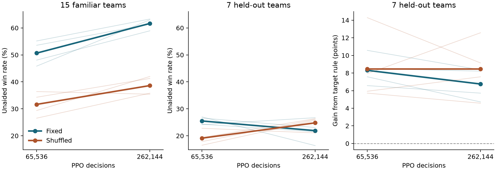

# Fixed versus shuffled move slots in full-history PPO

Fixed slots produced the strongest play on familiar teams in their published layout. Shuffling helped on unseen teams when their move lists were randomized at evaluation. On unseen teams in published order, the comparison changed direction between checkpoints and the 262k advantage varied by training seed. The targeting diagnostics still show room for improvement with either policy.

## Unaided win rates

| PPO decisions | Training move order | Familiar, published order | Held-out, published order | Familiar, fresh random order | Held-out, fresh random order |
| ---: | --- | ---: | ---: | ---: | ---: |
| 65,536 | Fixed | 50.66% | 25.50% | 29.99% | 17.84% |
| 65,536 | Shuffled | 31.65% | 19.13% | 32.34% | 20.64% |
| 262,144 | Fixed | **61.66%** | 21.91% | 30.08% | 16.59% |
| 262,144 | Shuffled | 38.63% | 24.80% | **34.67%** | **23.84%** |

On the seven held-out rosters in published order, shuffled training trailed by 6.38 percentage points at 65k (paired 95% interval −11.61 to −1.14). At 262k, it led by 2.89 points (−5.15 to +10.94). The four paired differences were +10.00, +3.00, −0.43 and −1.00 points. The clearest transfer gain came when each evaluation battle randomized the move order. At 262k shuffled training gained **7.25 points** on held-out teams in that setting (+3.98 to +10.52), with gains on all four seeds. [Paired comparisons](paired.csv)

On the familiar rosters in published order, fixed training gained 11.00 points between 65k and 262k (+4.11 to +17.89). At 262k its advantage over shuffled training was **23.03 points** (+14.69 to +31.38). Rotating those familiar moves one slot dropped the fixed policy from 61.66% to 28.54%. The shuffled policy went from 38.63% to 36.57%. Move position still affected which opening the shuffled model chose, even when rearranging moves had little effect on average wins. [Win rates by evaluation variant](summary.csv) · [Opening action distributions under rotation](opening-order.csv)



## A random familiar team

The preselected team was Eden Batchelor's **MC460**, with Dragonite and Floette leading and Sneasler and Rillaboom in back. The 262k policies had each played this roster in **2,056–2,247 completed training battles**. At 65k, fixed training won 286/800 games (35.75%) and shuffled training won 128/800 (16.00%). At 262k, fixed training won **551/800 (68.88%)** and shuffled training won **252/800 (31.50%)**. All four scores use the published move order. [Team export](../../teams/reg-mc-regionals/MC460.txt) · [Exposure by seed](training-exposure.csv)

We replayed the MC460 comparison on Sketch5 with 100 fresh battle seeds (8,642,000–8,642,099) per opponent and training seed. At 65k, fixed won 274/800 (34.25%) and shuffled won 125/800 (15.63%). At 262k, fixed won 533/800 (66.63%) and shuffled won 240/800 (30.00%). These games used the published move order and the same frozen checkpoints. [Fresh scores by training seed and opponent](mc460-fresh-seeds.csv)

Across all 15 familiar teams the 262k fixed policies won a majority of games on **10 teams**. Their win rates ranged from 3.38% on MC697 to 90.25% on MC461. The shuffled policies exceeded 50% on three familiar teams. A single-team performance claim therefore depends heavily on which roster the bot pilots, even after extensive training on all of them. [All 22 teams by checkpoint](per-team.csv)

## Did shuffling improve unaided targeting?

At 262k on held-out teams, fixed training selected the higher type multiplier in **48.73%** of eligible direct attacks and shuffled training in **48.38%** (mean of the four seed rates). The paired difference was −0.34 points (−17.76 to +17.08). These decisions arise on different trajectories, so we also scored target preferences on identical opening boards. On that controlled probe, fixed scored 48.90% and shuffled 50.18% (difference +1.28 points, −4.34 to +6.89). Direct ally targeting was numerically lower with shuffling, 0.60% versus 1.54% of damaging orders. [Per-seed action metrics](per-seed.csv) · [Matched type probe](type-probe.csv)

Changing eligible targets with the frozen type rule increased 262k held-out wins from **21.91% to 28.66%** for fixed training (+6.75 points), and from **24.80% to 33.27%** for shuffled training (+8.46 points). The rule still added wins for both policies. The experiment supports improved tolerance of unfamiliar move layouts, with no clear improvement in selecting the better-typed foe unaided. [Matched intervention results](summary.csv)

## Experiment

We trained eight full-history PPO policies on Sketch5. For each training seed (2–5), the two policies started with identical parameters. Each used the same 1.75M-parameter Transformer, terminal win/loss reward and learning rate. Teams were sampled uniformly from the same 15 regional tournament rosters. The same sequence of episode seeds selected the learner roster, opponent roster and opponent style. The damage and switching bots appeared with equal probability and piloted Balance or Sun. The checkpoints at 65,536 and 262,144 decisions came from the same uninterrupted training trajectory in each condition.

In the shuffled condition we independently permuted each learner Pokémon's move list at the start of each episode and kept that order for the rest of the battle. Fixed training used the published move lists. The simulator drew its randomness from a separate stream. The course ruleset, available moves, Pokémon stats and order of the team stayed the same. Team preview always selected the first four Pokémon, so the measured skill is piloting those four in battle.

Every checkpoint played the same 100 battle seeds from the earlier evaluation against **each** opponent style on **each** of the 15 familiar and seven held-out learner rosters. Each roster therefore has 800 battles across the four training seeds per condition. Equal weighting across the 15 familiar rosters estimates the win rate when handed a uniformly random team from training. Before viewing the shuffled outcomes, a uniform draw with NumPy RNG seed 67920 selected **MC460** for an individual example. [Roster split and player names](../../teams/reg-mc-regionals/split.csv) · [Training exposure by roster](training-exposure.csv)

### Evaluation

- **Unaided wins** use the published move order. Both allies' moves, targets, switches and Mega choices come from the frozen policy.
- **Rotated wins** shift each Pokémon's four moves over by one slot. The same weights play the same game seeds with all the same named moves available.
- **Random-order wins** give both conditions the same fresh per-Pokémon permutation on each evaluation seed. This tests the distribution used in shuffled training.
- **Target-rule wins** start from the published move order. The existing rule keeps the selected move and Mega choice but redirects eligible direct attacks away from an ally or toward a foe with a strictly higher type multiplier. The gain over unaided play measures how many wins this rule adds on the same schedule.
- **Unaided target choices** count direct ordinary attacks with two legal opposing targets, different multipliers, and the same partner order. We record the fraction going to the higher multiplier on the policy's own trajectories. The 18-case type probe separately tests the same move on matched opening boards with the opponents' visible type features swapped. Preferring the same slot regardless of the types scores 50% on that probe. A battle target's value can also depend on HP, abilities, threats and the partner's action. [Target-rule specification](../sketch5-action-diagnosis/README.md) · [Type-probe design](../sketch5-policy-size/README.md)

There are 5,600 held-out and 12,000 familiar battles per training condition, budget and evaluation variant, for 281,600 evaluation games in total. The same battle seeds recur across comparisons. Intervals use paired per-seed differences and a t interval with three degrees of freedom. They describe variation across the four training seeds for these particular teams and opponents. We checked the initialization tensors, training schedule, team hashes, every evaluation schedule, the fixed 65k trajectory against the archived run and all archived held-out control outcomes. [Paired effects](paired.csv) · [Per-seed results](per-seed.csv) · [All games](games.csv.gz)

## Reproduction

On Sketch5 the raw training logs, weights, and evaluations are in `runs/sketch5-move-slots-v1`. The fixed 65k control is evaluated from the earlier policy-size archive. The audit verifies that its policy tensors and training prefix match the new 262k fixed run at 65k. From the project checkout, use fresh output directories.

```sh
run=runs/move-slot-repeat
.venv/bin/python scripts/train_move_slots.py --runs "$run"
.venv/bin/python scripts/evaluate_move_slots.py --runs "$run" --steps 65536
.venv/bin/python scripts/evaluate_move_slots.py --runs "$run" --steps 262144
.venv/bin/python scripts/analyze_move_slots.py --runs "$run" --output results/move-slot-repeat
```
