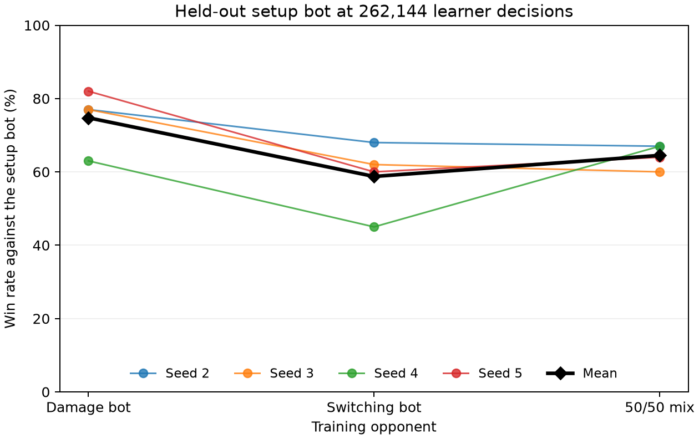

# Which training opponent transfers best to the setup bot?

All twelve final PPO policies trained for 262,144 learner decisions on Sketch5 with a terminal win/loss reward. The primary outcome was the mean win rate against the held-out setup bot, with equal weight for each training seed.

| Training opponent | Seed 2 | Seed 3 | Seed 4 | Seed 5 | Mean | SD across seeds |
| --- | ---: | ---: | ---: | ---: | ---: | ---: |
| Damage bot | 77% | 77% | 63% | 82% | **74.75%** | 8.18 pp |
| 50/50 mix | 67% | 60% | 67% | 64% | **64.50%** | 3.32 pp |
| Switching bot | 68% | 62% | 45% | 60% | **58.75%** | 9.78 pp |

Damage-bot training led the mix by 10.25 percentage points and switching-bot training by 16.00 points. Seed 4 was the exception, with the mix winning 67 games to the damage-trained policy’s 63. The mix beat switching-bot training by 5.75 points on average, with two of the four paired differences favoring the mix.



## Paired differences against setup

| Comparison | Seed 2 | Seed 3 | Seed 4 | Seed 5 | Mean difference |
| --- | ---: | ---: | ---: | ---: | ---: |
| Mix minus damage bot | -10 pp | -17 pp | +4 pp | -18 pp | -10.25 pp |
| Mix minus switching bot | -1 pp | -2 pp | +22 pp | +4 pp | +5.75 pp |

## Performance by opponent

| Training opponent | Random | Damage | Switching | Mean vs. damage and switching |
| --- | ---: | ---: | ---: | ---: |
| Damage bot | 97.25% | 92.25% | 75.75% | 84.00% |
| Switching bot | 99.00% | 83.75% | 83.00% | 83.38% |
| 50/50 mix | 97.50% | 85.75% | 82.75% | 84.25% |

## Setup bot by roster

The learner always played Sun. Each checkpoint faced the setup bot on Balance in 56 games and on Sun in 44 games. Balance leads Gyarados and Gardevoir, which can use Dragon Dance and Calm Mind. Sun leads Charizard and Garchomp and has Swords Dance on Scizor in back.

| Training opponent | Setup on Balance | Setup on Sun |
| --- | ---: | ---: |
| Damage bot | 64.29% | 88.07% |
| Switching bot | 38.84% | 84.09% |
| 50/50 mix | 52.23% | 80.11% |

In the first three saved setup replays for each checkpoint, the Balance bot used a boosting move in all 12 games. The Sun bot used Swords Dance in 14 of 24 games. These 36 replays cover three unique battle seeds.

In a separate scripted head-to-head check, the damage bot using the learner's Sun team beat the switching bot in 70/100 games. The switching bot using Sun won 48/100 against the damage bot on the same schedule. Training opponents differ in strength as well as behavior.

## Protocol and verification

- The eight single-opponent policies were trained from scratch. The four 50/50 policies were the final win/loss checkpoints from the [long reward experiment](../sketch5-long-rewards/README.md), verified by SHA-256. Across their completed training battles, the mixed runs drew the damage bot 67,201 times (49.9%) and the switching bot 67,600 times.
- All conditions used the same masked feedforward PPO architecture, optimizer settings, teams, simulator revision and fixed leads. The budget was measured in learner decisions. Final checkpoints were fixed before evaluating the held-out bot.
- Each checkpoint played 100 stochastic-policy games per opponent, using evaluation seeds 500,000–500,099. Simulator seeds and team draws matched across all twelve checkpoints. The 1,200 setup games yielded 792 wins, 408 losses, 0 ties and 0 truncations. All opponents together yielded 4,800 games, with 0 ties and 0 truncations. Rates count wins per completed battle.
- The setup bot prioritizes legal self-boosting moves and otherwise uses the damage heuristic. This tests transfer to one related scripted policy on two familiar rosters. The four independent training seeds determine how much evidence there is about retraining variability.

[Per-checkpoint scores](win-rates.csv) · [Paired battle records](evaluation-games.csv.gz) · [Checkpoint hashes and training episode counts](checkpoints.csv) · [Summary statistics](summary.json)

Raw logs, replays, and specialist weights are under `/mnt/md0/jcliu/pokemon-battle-rl/project/runs/sketch5-diversity-v1` on Sketch5. The mixture weights are under the sibling `sketch5-long-v1` directory.

To repeat from the project checkout on Sketch5 with the verified mixture checkpoints, use a fresh output directory. Omit `--reuse-mixture-from` to retrain all twelve policies.

```sh
.venv/bin/python scripts/opponent_diversity.py --output runs/diversity-repeat \
  --reuse-mixture-from runs/sketch5-long-v1
.venv/bin/python scripts/analyze_opponent_diversity.py --runs runs/diversity-repeat \
  --output results/diversity-repeat
```
