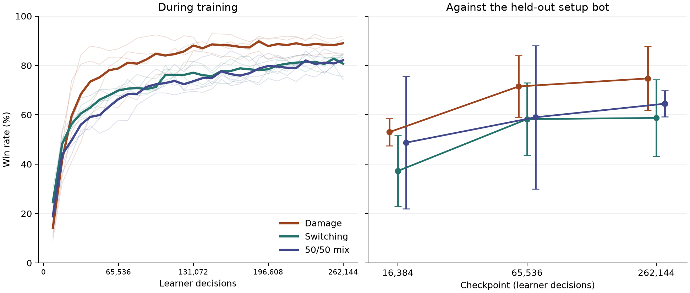

# Learning curves and matched losses against the setup bot

All policies used terminal win/loss reward. “Damage-trained” and “mixed” describe the scripted opponents used for training. Each comparison matches the training seed, evaluation seed, opponent roster, simulator initialization and policy sampling seed.

## When the policies improved



The left panel shows win rate during training against each policy’s own opponent distribution. Thin lines show seeds 2–5, and bold lines give their equally weighted means. Each point covers completed games ending in a nonoverlapping window of 8,192 learner decisions. In the right panel, each checkpoint played the same 100 setup battles per seed. The error bars are pointwise 95% intervals across training seeds. Lines connect measured checkpoints.

| Training opponent | 16,384 steps | 65,536 steps | 262,144 steps | Final 95% CI across training seeds |
| --- | ---: | ---: | ---: | ---: |
| Damage bot | 53.00% | 71.50% | 74.75% | 61.73 to 87.77% |
| 50/50 mix | 48.75% | 59.00% | 64.50% | 59.22 to 69.78% |
| Switching bot | 37.25% | 58.25% | 58.75% | 43.19 to 74.31% |

The damage-trained lead over the mix was 4.25 points at 16,384 decisions, 12.50 at 65,536, and 10.25 at 262,144. Over the first and last training windows, damage training rose from 14.23% to 89.00%, the mix from 18.89% to 82.10%, and switching from 24.63% to 80.73%. Those training rates depend on the opponents each policy faced.

At the final checkpoint, the paired damage-minus-mix differences were +10, +17, −4 and +18 percentage points. Their mean was **+10.25 points** with a 95% interval across training seeds of **-5.89 to 26.39 points**. With four training seeds, the direction under retraining is uncertain.

Each interval above uses a two-sided Student t interval across four independent training initializations (3 degrees of freedom), conditional on the fixed evaluation schedule. For a separate question, holding these exact agents fixed and resampling the 100 shared battle seeds produced a paired 95% bootstrap interval of **4.50 to 15.75 points** for the final gap. Each of 25,000 bootstrap draws kept every policy and training seed together for a given battle seed. The two intervals describe distinct sources of variation. Per-checkpoint Wilson intervals describe 100 battles for a single policy. All reported intervals are pointwise.

[Training windows](training-windows.csv) · [Win-rate intervals for all evaluated opponents](win-rate-intervals.csv) · [Paired difference intervals](paired-intervals.csv) · [Per-checkpoint Wilson intervals](checkpoint-intervals.csv) · [Early setup games](early-setup-games.csv.gz)

## Where the extra wins came from

| Setup bot roster | Both won | Damage won, mix lost | Mix won, damage lost | Both lost | Net extra wins for damage |
| --- | ---: | ---: | ---: | ---: | ---: |
| Balance | 82 | 62 | 35 | 45 | +27 |
| Sun | 129 | 26 | 12 | 9 | +14 |
| **All 400 pairs** | **211** | **88** | **47** | **54** | **+41** |

Against Balance, Gyarados and Gardevoir only used boosting moves on turn one whenever they acted. The mix opened by Protecting Garchomp in 166 of 224 games. That Protect never blocked a move. The damage-trained policy never opened with Garchomp protecting and switched it to Scizor in 166 games. Scizor could then threaten Gardevoir with priority Bullet Punch.

By the end of turn two, the damage-trained policy had knocked out an opponent in **220/224** Balance games, versus **183/224** for the mix. Balance completed 631 boosting moves in those two turns against damage training and 753 against the mix. A use counts once when the log records a positive stat change, even if several stats rose. Neither learner lost a Pokémon in the first two turns on Balance.

The Sun mirror had a different opening threat. Damage training opened with Garchomp’s Rock Slide in 173/176 games versus 115/176 for the mix. Across the requested 88 discordant pairs on both rosters, damage scored an opposing KO by turn two in **88/88**, versus **61/88** for the mix. Across the 47 pairs with the opposite result, both policies achieved an early KO in 39/47. These are descriptive replay counts, including pairs selected by their final outcome.

## Changing the opening

For each of the 400 scenarios, we substituted the other policy’s sampled first-turn joint command, including switches, targets and Mega Evolution. The recipient then chose every subsequent action. We preserved its random sampling sequence by sampling and discarding its native opening. Actions can change which random events occur later in the battle.

| Policy choosing later actions | Its own opener | Other policy’s opener |
| --- | ---: | ---: |
| Damage-trained | 299/400 (74.75%) | 252/400 (63.00%) |
| Mix-trained | 258/400 (64.50%) | 232/400 (58.00%) |

Borrowing the specialist’s opener rescued **43 of the 88** target losses. Over all 400 games it turned 60 mixed losses into wins and 86 mixed wins into losses. Copying the opening in isolation therefore reduced the mix’s win rate by 6.5 points. The advantage depended on how an opening and subsequent decisions worked together. Training exposure and opponent difficulty also differed between the two regimes.

## Four replay comparisons

Cases 1–3 are the earliest target pair for the indicated seed and roster (Balance, Sun, Balance). Case 4 is the earliest target pair with identical opening commands across all seeds. The examples explain particular paths to a loss. The full outcome table above includes both directions.

**Training seed 2, battle 500,015, Balance.** **Bringing Scizor in before the boosts paid off.** Damage training switched Garchomp to Scizor on turn one. On turn two, Bullet Punch knocked out Gardevoir and Charizard’s Air Slash knocked out Gyarados. The mix opened with Garchomp protecting, then missed Gardevoir with Rock Slide on turn two. Gyarados got its second Dragon Dance and knocked out Garchomp and Charizard on successive turns. The specialist also benefited from a late critical hit on Tyranitar. The mix won when given the specialist’s opener in this scenario. [Damage log](examples/seed-2-battle-500015-balance/damage.log) · [Mix log](examples/seed-2-battle-500015-balance/mixture.log) · [Damage replay](examples/seed-2-battle-500015-balance/damage.html) · [Mix replay](examples/seed-2-battle-500015-balance/mixture.html)

**Training seed 3, battle 500,000, Sun.** **Protect was valuable in the Sun mirror.** The damage-trained policy protected Charizard while Garchomp’s Rock Slide knocked out the opposing Charizard. The mix switched Garchomp to Scizor. The opponent’s Rock Slide knocked out the mix’s Charizard before it attacked. The opposing Charizard then knocked out Scizor with Flamethrower on turn two. Giving the mix the damage-trained opener still led to a loss. [Damage log](examples/seed-3-battle-500000-sun/damage.log) · [Mix log](examples/seed-3-battle-500000-sun/mixture.log) · [Damage replay](examples/seed-3-battle-500000-sun/damage.html) · [Mix replay](examples/seed-3-battle-500000-sun/mixture.html)

**Training seed 4, battle 500,012, Balance.** **The target choice mattered after the opening.** Damage-trained Garchomp used Earthquake on turns one and two, knocking out Gardevoir on the second. On turn four, damage-trained Rotom aimed Thunderbolt at boosted Gyarados and knocked it out with a critical hit. Mixed-policy Rotom aimed at Tyranitar. It eventually knocked out Tyranitar, but Gyarados stayed in and used Waterfall against Scizor and Rotom. Both variants with swapped openings lost this scenario. [Damage log](examples/seed-4-battle-500012-balance/damage.log) · [Mix log](examples/seed-4-battle-500012-balance/mixture.log) · [Damage replay](examples/seed-4-battle-500012-balance/damage.html) · [Mix replay](examples/seed-4-battle-500012-balance/mixture.html)

**Training seed 5, battle 500,030, Sun.** **The same opening led to different turn-three choices.** Both policies traded Charizards to Rock Slide on turn one and doubled into the opposing Rotom on turn two. On turn three, the specialist kept Garchomp in and finished Rotom with Dragon Claw. The mix switched Garchomp to Scizor and missed Will-O-Wisp on the opposing Garchomp. The opposing Rotom survived until turn four and knocked out the mix’s Rotom first. Both policies retained their original outcomes when identical opening commands were substituted. [Damage log](examples/seed-5-battle-500030-sun/damage.log) · [Mix log](examples/seed-5-battle-500030-sun/mixture.log) · [Damage replay](examples/seed-5-battle-500030-sun/damage.html) · [Mix replay](examples/seed-5-battle-500030-sun/mixture.html)

[All 88 paired replay logs and submitted commands (ZIP)](damage-win-mix-loss-replays.zip) · [All 800 game-level replay measurements](replay-events.csv.gz) · [Matched outcomes](paired-outcomes.csv) · [Early-turn counts](early-game-counts.csv) · [Opening swaps by subgroup](opening-swap-counts.csv)

## Reproduction on Sketch5

The frozen evaluation code was `2b6803a`. We verified all 12 archived final checkpoint hashes, reproduced all 800 final damage/mix records including outcome and battle length, and matched the saved commands and event logs for the original first three battles of each policy after excluding wall-clock timestamps. The archived mixed runs retained their early checkpoints. For the specialists we reconstructed 65,536-step prefixes and matched every common training episode and every PPO update’s loss, step count and outcome counts to the original logs. The early setup evaluations were retrospective and did not select checkpoints or change any agent.

Run the following from the project checkout on Sketch5. `engine` is a separate checkout of `2b6803a` with the pinned simulator cache available at `.cache`. The source study directories are `runs/sketch5-diversity-v1` and `runs/sketch5-long-v1`.

```sh
engine=/path/to/original-evaluation-checkout
raw=runs/setup-analysis-repeat
.venv/bin/python scripts/reconstruct_setup_games.py --engine "$engine" --output "$raw"
PYTHONPATH="$engine/src:scripts" .venv/bin/python scripts/swap_setup_openings.py --engine "$engine" --runs "$raw"
.venv/bin/python scripts/setup_learning_curves.py --runs "$raw" --output "$raw/report"
.venv/bin/python scripts/compare_setup_replays.py --runs "$raw" --output "$raw/report"
```
