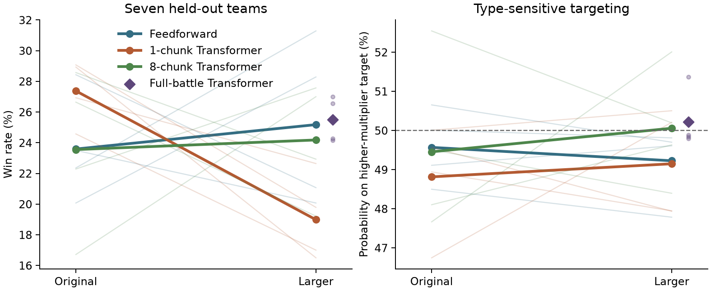

# Scaling Pokémon battle policies at 65,536 decisions

We widened the feedforward PPO policy and the one- and eight-chunk Transformers. We also trained the wider Transformer on the full history of each battle. The sixteen new policies trained from scratch on Sketch5. The original models are the 65,536-step controls from the [decision-history experiment](../sketch5-transformer-rosters/README.md).

## Results

| Policy | Original win rate | Larger win rate | Larger model, type-targeting score |
| --- | ---: | ---: | ---: |
| Feedforward PPO | 23.59% | 25.18% | 49.23% |
| Transformer, current decision | 27.38% | 18.98% | 49.15% |
| Transformer, latest eight decisions | 23.55% | 24.18% | 50.06% |
| Transformer, whole battle so far | — | **25.50%** | 50.22% |

The full-battle model won 1,428 of 5,600 held-out games. Against the same-width one-decision model it gained 6.52 percentage points, with a gain on all four training seeds (paired 95% interval +4.13 to +8.90). Against the eight-decision model the gain was 1.32 points with two wins and two losses across seeds (−4.65 to +7.29). It finished 0.32 points above the larger feedforward model (−6.05 to +6.69).

During full-history evaluation, 2,862 of 5,600 battles (51.1%) reached a ninth decision. This made older information available for 8,788 of 50,574 decisions (17.4%). The longest prefix seen at evaluation contained 35 decisions. Because these policies trained separately, their actions can differ even in the opening, when the available context is identical.

Widening the feedforward policy raised its mean held-out win rate from 23.59% to 25.18%. Two of four seeds improved, and the paired 95% interval for the change was −11.50 to +14.68 percentage points. Widening the one-chunk Transformer reduced its win rate from 27.38% to 18.98% on the same schedule. All four seeds declined (mean −8.39 points, paired interval −13.80 to −2.99). The eight-chunk Transformer's mean rose from 23.55% to 24.18%.

On the type-targeting test every model averaged between 48.81% and 50.22%, close to the 50% score of a policy whose targeting is insensitive to the type swap. The opening-board test gave every Transformer one actual decision token. The battle results showed no corresponding clear improvement in sensitivity to target typing on these 18 examples.



## Models and battle schedule

| Architecture | Original width | Larger width | Original parameters | Larger parameters |
| --- | ---: | ---: | ---: | ---: |
| Feedforward | 128 | 528 | 320,951 | 1,734,951 |
| One-chunk Transformer | 64 | 256 | 230,839 | 1,748,023 |
| Eight-chunk Transformer | 64 | 256 | 230,839 | 1,748,023 |
| Full-battle Transformer | — | 256 | — | 1,748,023 |

Widths were chosen before training. Within each architecture and context length only hidden width changed. Each feedforward encoder has two tanh layers. Each Transformer has two pre-normalized blocks, four attention heads, and a feedforward sublayer twice the model width. A token contains the visible board and the learner's previous action pair. With a single token the attention distribution has only one entry. The eight-chunk model can attend across the latest eight learner decisions in the same battle. All three large Transformers started from identical parameter tensors within each seed. The feedforward policy receives the current board. All policies use masked joint-action heads and the same terminal win/loss objective.

The full-battle version (`--transformer-chunks full`) sees decisions 1 through *t* before acting at decision *t*, including forced switches. History resets at a new battle and survives PPO rollout boundaries. Positions and causal masks grow with the prefix. PPO shuffles intact prefixes and pads them within each minibatch so that it can recompute the action probabilities using the history actually available when the action was chosen. Attention heads are parallel computations over that shared prefix. [Observed history lengths](full-history-lengths.csv)

We held training experience fixed at 65,536 decisions for each of seeds 2–5. We sampled from 15 tournament learner rosters and a 50/50 per-battle mix of the damage and switching bots playing Balance or Sun. We evaluated the frozen policies on seven tournament rosters withheld from training, reusing 100 battle seeds per roster and opponent style. The same seven rosters were evaluated in earlier experiments. [Roster split](../../teams/reg-mc-regionals/README.md)

Each model has 5,600 scheduled games. We checked the simulator, team hashes, checkpoint configurations, training episode matchup draws, evaluation battle seeds and opponent rosters. The original checkpoints and all archived win counts matched the published comparison. Paired 95% intervals use the four training seeds and are conditional on these teams and opponents.

## Type-effectiveness diagnostic

We took the opening boards for the seven held-out rosters facing each of the two opponent rosters. For the learner's first active Pokémon, we identified standard, non-Mega damaging move orders that could target either opponent and had a different type-chart multiplier against the two. This produced 18 board–move pairs spanning all seven rosters and eight attack types.

For each pair we asked a frozen policy to score the two legal targets for that same move. We repeated the query with only the opposing Pokémon's visible type vectors exchanged. All other features, including HP, positions and base stats, stayed fixed. We measured the conditional probability assigned to the higher-multiplier target in each orientation, weighted the orientations equally, and averaged over the 18 pairs. A policy that always targets the same slot for a given move scores 50%, and consistently following the type advantage scores 100%.

The swapped inputs are synthetic and can give a species an unusual typing. The diagnostic measures sensitivity to the type chart in a targeting choice. Actual move value can also depend on abilities, damage ranges, threats and the ally's action. Battle win rate measures transfer under the full simulator.

[Win rates and probe scores](summary.csv) · [Paired win-rate differences](paired-differences.csv) · [Per-seed wins](per-seed.csv) · [Per-team wins](per-roster.csv) · [Team and opponent results](per-roster-opponent.csv) · [All games](evaluation-games.csv.gz) · [Type-probe pairs](type-probe.csv) · [Per-seed probe scores](type-probe-per-seed.csv) · [Paired probe differences](type-probe-differences.csv) · [Checkpoint hashes](checkpoints.csv)

## Reproduction

On Sketch5 the new weights, logs and replays are under `/mnt/md0/jcliu/pokemon-battle-rl/project/runs/sketch5-policy-size-v1`. The analysis also reads the original feedforward and Transformer archives in `runs/sketch5-finetune-v1` and `runs/sketch5-transformer-v1`. From the project checkout, use fresh output directories.

```sh
.venv/bin/python scripts/transformer_rosters.py train --study size --output runs/size-repeat
.venv/bin/python scripts/transformer_rosters.py evaluate --study size --output runs/size-repeat --jobs 12
.venv/bin/python scripts/analyze_policy_size.py --runs runs/size-repeat --output results/size-repeat
```
