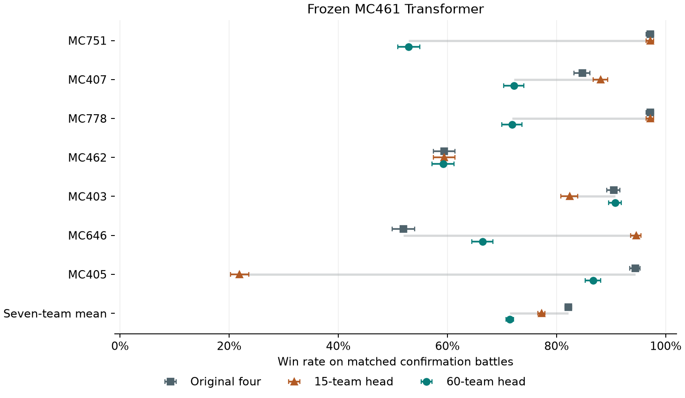

# Does training on 60 tournament teams improve MC461’s preview picks?

**The 60-roster head avoided the old MC405 pick and won 86.72% there, up from 21.88%. Across all seven held-out rosters its win rate fell to 71.43%. The original four won 82.18%, and the previous 15-roster head won 77.24%.** The expanded head trailed the original four by 10.75 percentage points (paired 95% interval −11.35 to −10.16) and the previous head by 5.81 points (−6.40 to −5.22). [Matched differences](paired.csv)

| Preview policy | Seven-team wins / 16,128 | Seven-team win rate | MC405 wins / 2,304 | MC405 win rate |
| --- | ---: | ---: | ---: | ---: |
| Original first four | 13,254 | **82.18%** | 2,175 | **94.40%** |
| Previous 15-roster head | 12,457 | 77.24% | 504 | 21.88% |
| Expanded 60-roster head | 11,520 | 71.43% | 1,998 | 86.72% |
| Expanded head with training-selected fallback | 12,568 | 77.93% | 2,175 | **94.40%** |

### What changed on MC405

The previous head led Kommo-o / Charizard and brought Sneasler / Kingambit. The new head led Meowstic-F / Kommo-o, bringing Indeedee-M / Kingambit. That recovered 64.84 points (paired 95% interval +63.33 to +66.36). The original lineup brings Sneasler in Kingambit’s place and still won 7.68 points more (+6.60 to +8.77). The head predicted only a 1.8-point advantage for the swap, below the fallback’s 10-point cutoff. The fallback therefore reproduced the original lineup and all 2,304 of its battle outcomes. [Lineup choices and model predictions](team-choices.csv)

The expansion exposed the head to Ceruledge for the first time and covered all six species on MC405. Three new rosters shared four species with it, while the closest original training roster shared three. The sweep cannot attribute the improvement to any particular species or example.

### Where the overall score went

| Opposing team | 60-roster head leads | 60-roster head reserves | Original four | 15-roster head | 60-roster head | With fallback |
| --- | --- | --- | ---: | ---: | ---: | ---: |
| MC751 | Meowstic-F + Kingambit | Indeedee-M + Sneasler | 97.2% | 97.2% | 52.9% | 52.9% |
| MC407 | Kommo-o + Indeedee-M | Sneasler + Charizard | 84.7% | 88.1% | 72.2% | 84.7% |
| MC778 | Meowstic-F + Indeedee-M | Kommo-o + Sneasler | 97.1% | 97.1% | 71.8% | 97.1% |
| MC462 | Meowstic-F + Indeedee-M | Kommo-o + Sneasler | 59.4% | 59.4% | 59.2% | 59.4% |
| MC403 | Meowstic-F + Indeedee-M | Sneasler + Kingambit | 90.5% | 82.4% | 90.8% | 90.5% |
| MC646 | Indeedee-M + Charizard | Meowstic-F + Sneasler | 51.9% | 94.6% | 66.4% | 66.4% |
| MC405 | Meowstic-F + Kommo-o | Indeedee-M + Kingambit | 94.4% | 21.9% | 86.7% | 94.4% |

MC751 was the largest new regression. The expanded head replaced Kommo-o with Kingambit in the opening pair. It predicted a 10.8-point gain over the original four, narrowly clearing the fallback cutoff, but wins fell from 97.2% to 52.9%. On MC778 it brought the original four and moved Indeedee-M into the opening pair in Kommo-o’s place. That change alone dropped the win rate from 97.1% to 71.8%. The fallback used the original lineup on five teams and changed it on MC751 and MC646. [Held-out effects by roster](paired.csv)



On the 45 added rosters, leaving each roster out of its own fit gave the expanded head 3,482/4,860 wins (71.65%), ahead of the previous head’s 66.48% and the original four’s 66.52%. These are development scores from the folds that selected the training duration. On the six benchmark rosters other than MC405, the expanded head trailed the previous head by 17.59 points. The training-roster improvement did not carry over to this benchmark. [Validation on the added rosters](new-roster-validation.csv) · [Confirmation win rates](win-rates.csv)

## Experiment

MC461 used the original full-history league Transformer for every move, switch and target. We froze that checkpoint and changed the amount of data available to the team-preview head. The primary comparison uses the original first four and the previous 15-roster preview head on the same battles. MC405's previous result motivated the question. This experiment reuses the seven benchmark rosters, so it measures performance on a known benchmark.

**Training teams.** The original dataset supplies 15 regional top-eight rosters with all 90 MC461 lineups already evaluated. We added 45 distinct rosters from the same eight regionals by expanding eligibility to top-64 placements. We excluded any addition duplicating an original or previously accepted roster’s unordered base-species six or unordered playable four. Each set passed Showdown validation. Partial team cores can recur in both splits. The added rosters were selected using placements, completeness, legality, and duplicate checks. [New roster credits and pastes](../../teams/reg-mc-preview-expanded/source.json)

**Matched training data.** Every lineup faces the same nine pilots on 12 seeds per opposing roster and pilot. The first two Pokémon in the lineup lead and the last two start in reserve, with source order within each pair. Opposing bots keep their original first four and opening pair, as in the previous experiment. Each training roster supplies 9,720 battle outcomes. The fit uses 145,800 original games plus 437,400 new games, with equal weight on all 60 rosters. The head sees the opponent’s six public species, in sorted order, before either player commits their choice. [Training targets](training-sweep.csv) · [Public training previews](training-previews.csv) · [New battle outcomes](new-sweep-games.csv.gz)

Two added teams, MC631 and MC765, revealed a setup-bot error on the forced recharge after Sylveon used Hyper Beam. The bot now treats a move with no target as ineligible for its self-boost bonus. For moves with a target, the score uses the same self-target and spread-target comparisons as before. We retried the failed matchups on their assigned seeds and verified all 90 lineups for every roster. The project suite passed all 23 tests on Sketch5, including a forced-recharge regression test.

**Model selection.** We used the same architecture, optimization settings, fit seed, and candidate training durations as in the 15-roster experiment. For each of 60 training folds, we withheld one roster, fit the head on the other 59, and scored its chosen lineup on the omitted roster. The primary head uses the epoch count that maximized these cross-validation wins and was refit on all 60 rosters. It always chooses its highest-scoring lineup. A secondary policy falls back to the original four when the predicted win-rate advantage is below a threshold. Training-only cross-validation selected 180 epochs and a 10-percentage-point fallback threshold. Across validation folds, the head's picks won 4,620/6,480 games, the fallback won 4,651, and always using the original four won 4,258. The model weights and rule were locked before confirmation. [Cross-validation by roster](cv.csv) · [Fallback threshold comparison](fallback-cv.csv) · [Selection lock](selection-lock.json)

**Confirmation.** The original four, the previous head, the expanded head, and its fallback variant each face all nine pilots on all seven held-out opposing rosters. Each bot–roster cell uses 256 matched simulator seeds, half on each side. This yields 2,304 games per roster and 16,128 per policy. The seed schedule is distinct from the preview training sweeps and from logged simulator seeds used to train the frozen actor. Paired 95% intervals measure battle randomness within roster, opposing pilot and side. A separate bootstrap resamples the seven roster-level differences to show sensitivity to the particular teams evaluated. Ties and cutoffs count as non-wins. [Game records](confirmation-games.csv.gz) · [Paired comparisons](paired.csv) · [Roster sensitivity](roster-sensitivity.csv)

## Reproduction

All training battles, preview-head fits, and evaluations ran on Sketch5. The frozen archive of original 15-roster cells is under `runs/sketch5-preview-v1`. The following commands reproduce the expansion with a new run directory. [Run manifest](manifest.json) · [Expanded preview weights](preview-head.pt)

```sh
run=runs/preview-expanded-repeat
.venv/bin/python scripts/expand_preview.py --root "$run" --jobs 40
.venv/bin/python scripts/fit_expanded_preview.py train --root "$run" --jobs 8
.venv/bin/python scripts/fit_expanded_preview.py confirm --root "$run" --jobs 40
.venv/bin/python scripts/report_expanded_preview.py --root "$run" --out results/preview-expanded-repeat
```
