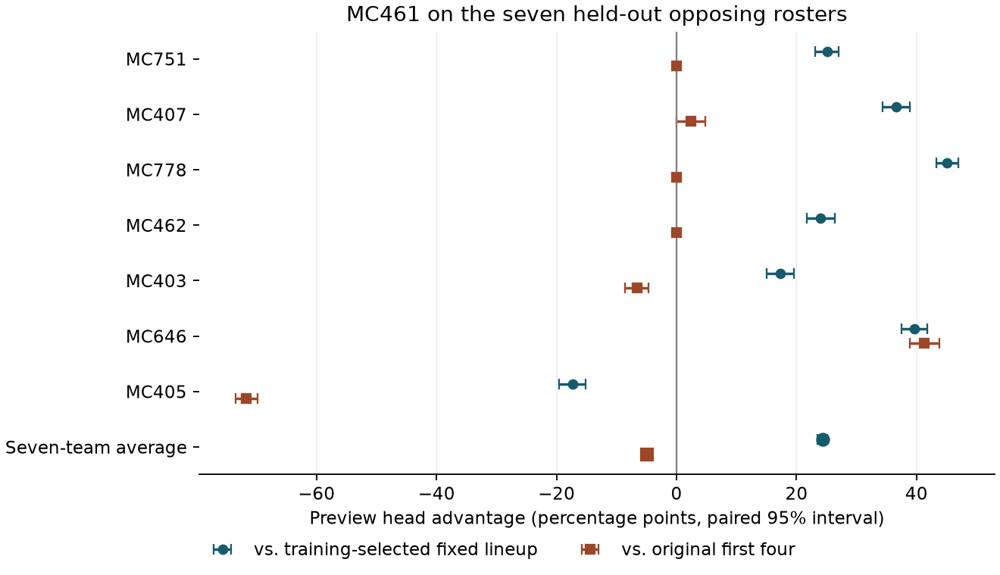

# Choosing MC461’s leads and back pair at team preview

**The learned preview head won 6,233 of 8,064 held-out games (77.29%).** It beat the lineup selected on the 15 training rosters by 24.36 percentage points (paired 95% interval 23.53 to 25.18) and trailed the original first four by 4.94 points (−5.56 to −4.31). The original first four also ranked first among all 90 constant lineups in the separate seven-roster sweep. [All fixed lineups by split](fixed-lineup-rankings.csv) · [Paired comparisons](paired.csv)

| Preview policy | 15 training rosters, fresh seeds | Seven held-out rosters, fresh seeds |
| --- | ---: | ---: |
| Learned preview head | 83.07% | 77.29% |
| Best constant lineup on training rosters | 70.96% | 52.94% |
| Original first four | 62.38% | **82.23%** |
| Uniform random lineup | 50.70% | 56.19% |
| Per-roster winner selected in its own sweep | 88.26% | **96.11%** |

The training-selected constant lineup led Indeedee-M / Sneasler and kept Kingambit / Charizard in back. Its training sweep score was 1,151/1,620 (71.05%). The original four led Meowstic-F / Kommo-o with Indeedee-M / Sneasler in back. In the held-out sweep their score was 627/756 (82.94%), the highest of all constant choices. The per-roster winner uses prior games on that specific roster. Its 7,750/8,064 wins illustrate the benefit available from identifying strong matchup picks. [Confirmation scores](confirmation-scores.csv)

The learned head outscored the training-selected lineup on six of seven rosters. Its largest gain over the original four came on MC646, where it led Kommo-o / Charizard and brought Sneasler / Kingambit in back (94.27% versus 52.95%). It chose the same four against MC405 and fell from the original lineup’s 95.05% to 23.35%. With the damage bot piloting MC405, the learned pick lost all 128 confirmation games while the original won 113. The selector was fitted to 15 distinct opposing roster inputs even though training included 145,800 battle outcomes. [Per-roster choices](matchup-guide.csv) · [Battle records](confirmation-games.csv.gz)



## Which leads and reserves worked against each team?

The tables give one highest-scoring lineup from each roster's 90-lineup sweep and its win rate in 1,152 independent confirmation games. The final column gives the learned head's win rate in those same matchups. A dagger marks ties for the highest screening score. Canonical slot order breaks ties. Other close finishes are possible even where the screening winner is unique. [Every lineup ranked by roster](lineup-rankings.csv) · [Strongest back pair for every lead pair](best-back-by-lead.csv) · [Learned head’s actual leads and reserves on all 22 teams](matchup-guide.csv)

### Held-out rosters

| Opposing roster | Sweep-winning leads | Sweep-winning reserves | Confirmed winner | Learned head |
| --- | --- | --- | ---: | ---: |
| MC751 | Meowstic-F + Kommo-o | Indeedee-M + Sneasler | 97.6% | 97.6% |
| MC407 † | Kommo-o + Indeedee-M | Sneasler + Kingambit | 99.8% | 88.0% |
| MC778 † | Meowstic-F + Kommo-o | Indeedee-M + Sneasler | 96.2% | 96.2% |
| MC462 | Kommo-o + Charizard | Meowstic-F + Indeedee-M | 89.1% | 57.2% |
| MC403 † | Meowstic-F + Kingambit | Indeedee-M + Sneasler | 99.9% | 84.5% |
| MC646 | Kommo-o + Indeedee-M | Sneasler + Charizard | 95.1% | 94.3% |
| MC405 | Meowstic-F + Kommo-o | Indeedee-M + Sneasler | 95.1% | 23.4% |

### Training rosters

| Opposing roster | Sweep-winning leads | Sweep-winning reserves | Confirmed winner | Learned head |
| --- | --- | --- | ---: | ---: |
| MC650 | Indeedee-M + Sneasler | Kingambit + Charizard | 76.2% | 72.0% |
| MC463 | Meowstic-F + Kommo-o | Indeedee-M + Sneasler | 99.0% | 99.0% |
| MC648 | Indeedee-M + Charizard | Meowstic-F + Kingambit | 97.0% | 97.0% |
| MC460 | Meowstic-F + Indeedee-M | Sneasler + Kingambit | 83.8% | 73.4% |
| MC649 | Kommo-o + Indeedee-M | Sneasler + Charizard | 99.4% | 87.5% |
| MC461 | Meowstic-F + Kingambit | Indeedee-M + Sneasler | 97.7% | 97.7% |
| MC408 | Sneasler + Charizard | Kommo-o + Kingambit | 95.9% | 78.2% |
| MC779 † | Meowstic-F + Kommo-o | Indeedee-M + Sneasler | 98.5% | 98.8% |
| MC442 | Kommo-o + Indeedee-M | Meowstic-F + Charizard | 98.7% | 91.8% |
| MC554 | Indeedee-M + Sneasler | Kingambit + Charizard | 93.1% | 86.1% |
| MC781 † | Kommo-o + Charizard | Sneasler + Kingambit | 40.9% | 40.9% |
| MC780 | Meowstic-F + Indeedee-M | Sneasler + Kingambit | 91.5% | 91.5% |
| MC697 † | Kommo-o + Indeedee-M | Sneasler + Charizard | 91.0% | 87.8% |
| MC647 | Kommo-o + Charizard | Meowstic-F + Indeedee-M | 78.6% | 63.7% |
| MC439 | Indeedee-M + Charizard | Sneasler + Kingambit | 82.6% | 80.7% |

The suite passed all 22 project tests on Sketch5. A separate simulator check verified all 90 parties on both sides and reproduced 18 archival games with the original lineup. Across all five confirmation methods, the 19,387 repeated entries with identical lineup, matchup, seed, and side reproduced both outcome and game length. [Simulator checks](preview-checks.json)

## What changed in the simulator

Showdown receives both team-preview choices before either player sees the opposing leads. The selector receives the opponent's six public species in sorted order. It sees no opposing moves, items, team file, team ID, bot identity, selected four, or lead order. Kingambit and Charizard can now enter battle for MC461. The original league champion plays every subsequent turn greedily with its weights frozen. [MC461 roster](../../teams/reg-mc-regionals/MC461.txt) · [Frozen model and simulator hashes](manifest.json)

There are 15 choices for the lead pair and six choices for the back pair. Within each pair we keep the original roster order, so each of the 90 choices always maps to the same left/right and reserve positions. Opponents field their published first four with the first two leading. Each roster gets equal exposure to damage, switch, setup, random, tactical, and the four frozen PPO bots from the earlier benchmark. The sweep measures MC461’s response to these opponent openings. Opponents choosing their own four would change the problem.

## Training and evaluation

1. **Sweep the 15 training rosters.** Each of the 90 lineups plays all nine opposing bots on 12 matched seeds per bot and roster, alternating simulator sides. This yields 108 games per roster–lineup combination and 145,800 games in total. The best fixed lineup maximizes wins across all 15 rosters. Its score uses 1,620 games per candidate. Ties use the first lineup in canonical slot order.
2. **Fit the preview head.** Each lineup’s fraction of wins supplies a target for a one-step expected-win model. The attention layer receives six learned MC461 slot embeddings and six opposing species tokens. Opposing features contain public species identity, public base stats and types. Unseen species retain their stats and types. The head pools the two leads and the two reserves separately, combines them with the opposing team representation, and scores each lineup. We fit the grouped Bernoulli loss for 30, 90 and 180 epochs and choose the duration by leaving out one training roster at a time. The deployed head selects the lineup with the highest predicted win rate. Its weights, training data hash, and the best fixed lineup were locked before any test-roster sweep games. [Training-only cross-validation](training-cv.csv) · [Selection lock](selection-lock.json) · [Playable head](preview-head.pt)
3. **Sweep the seven held-out rosters.** A separate 68,040 games give descriptive rankings for every lineup. The strongest observed lineup per roster is a hindsight benchmark. Its sweep result is optimistic because it was selected from 90 candidates. The learned and fixed policies receive no updates from these games.
4. **Confirm on independent battle seeds.** The learned head, training-selected fixed lineup, original lineup, uniformly random lineup, and each roster’s sweep winner each play 128 fresh games per opposing bot and roster. Each learner gets 1,152 games per roster and 8,064 on the seven held-out rosters. We also confirm all five methods on the 15 training rosters. The evaluator checks the frozen checkpoint, submitted choices, opposing pilots, sides and seed schedules. The three experiment phases have disjoint simulator seeds. One confirmation simulator seed also occurred during the historic frozen champion's league training.

The paired 95% intervals compare the same roster, opposing pilot, battle seed, and simulator side. They describe battle randomness conditional on the evaluated policies and rosters. The supplementary roster bootstrap resamples the seven team-level differences with equal weight. With only seven selected tournament rosters, that sensitivity analysis has limited precision. The seven are held out from preview fitting and selection. The existing project has used these rosters in other experiments, and the frozen champion previously faced MC751. The design measures generalization of this preview head for MC461.

## Reproduction

All battles, fitting, and confirmation ran on Sketch5. The individual compressed matchup files are under `runs/sketch5-preview-v1`. Run the stages in order with a new run directory when reproducing. [Sweep battles](sweep-games.csv.gz) · [Confirmation battles](confirmation-games.csv.gz) · [Paired differences](paired.csv)

```sh
run=runs/preview-repeat
.venv/bin/python scripts/preview_sweep.py train --root "$run" --jobs 40
.venv/bin/python scripts/preview_head.py train --root "$run"
.venv/bin/python scripts/preview_sweep.py test --root "$run" --jobs 40
.venv/bin/python scripts/preview_head.py winners --root "$run"
.venv/bin/python scripts/preview_sweep.py confirm --root "$run" --jobs 40
.venv/bin/python scripts/report_preview_sweep.py --root "$run" --out results/preview-repeat
```
