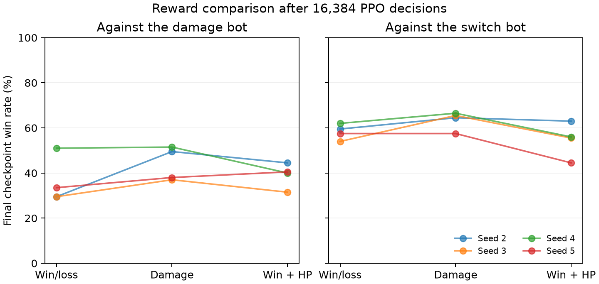

# Four-seed reward comparison on Sketch5

Direct damage increased the mean win rate against the damage and switching bots by **6.69 percentage points** over terminal win/loss. It improved the combined score on all four fresh training seeds. Win/loss plus HP advantage averaged **0.13 points below** terminal win/loss, with improvements on two seeds and declines on two.

| Training reward | Random bot | Damage bot | Switching bot | Mean of damage and switching |
| --- | ---: | ---: | ---: | ---: |
| Win/loss | 95.38% | 35.88% | 58.25% | 47.06% |
| Direct damage only | 96.63% | 44.00% | 63.50% | 53.75% |
| Win/loss plus HP advantage | 95.25% | 39.13% | 54.75% | 46.94% |

| Training seed | Win/loss | Direct damage | Win/loss plus HP | Direct damage gain | Win/loss plus HP gain |
| --- | ---: | ---: | ---: | ---: | ---: |
| 2 | 44.50% | 57.00% | 53.75% | +12.50 pp | +9.25 pp |
| 3 | 41.75% | 51.25% | 43.50% | +9.50 pp | +1.75 pp |
| 4 | 56.50% | 59.00% | 48.00% | +2.50 pp | −8.50 pp |
| 5 | 45.50% | 47.75% | 42.50% | +2.25 pp | −3.00 pp |



## Protocol

Sketch5 trained 12 PPO policies from scratch for 16,384 learner decisions each, using Python 3.12.10 and PyTorch 2.15.0+cpu. All used the same Sun team, fixed leads, the same two opponent rosters, and the pilot's uniform mixture of damage and switching behavior. Each policy played 200 games against each of three scripted opponents. The simulation seeds and team draws matched across all 12 policies. All 7,200 games finished with a win or loss. The four training seeds are the units for the paired comparisons. The original seed-1 pilot is excluded.

The direct reward credits the fraction of each opponent's max HP removed by a direct move hit. The HP-shaped reward adds the discounted change in our team's HP advantage to the terminal reward. The potential is our total remaining HP fractions minus the opponent's, divided by four, and is zero at a true terminal state. All policies are evaluated by actual wins.

## Where the gain held up

- **Fresh game seeds.** On the original development block (10,000–10,099), direct damage scored 53.5% against the two scripted training styles, compared with 47.5% for win/loss. On the fresh block (10,100–10,199), the scores were 54.0% and 46.6%. Both blocks use the same familiar rosters and opponent styles.
- **Early learning.** In the first 4,096 decisions, the mean training win rates were 16.7% for direct damage, 10.4% for win/loss, and 9.6% for win/loss plus HP. These are averages of four training-seed win rates.
- **Team matchup.** Direct damage scored 58.6% in Sun mirror matches and 49.5% against Balance across the damage and switching bots. Win/loss scored 49.1% and 45.3%, respectively. Lead choice and team familiarity are candidates for explaining this gap.

## Next experiments

1. **Measure how long the reward advantage lasts.** Start each run at the same initialization for each matched seed and evaluate at 16k, 64k, and 262k decisions. Compare direct damage and terminal win/loss on development games and against frozen opponents. This tests whether dense feedback mainly accelerates early learning or also improves the final bot.
2. **Train against stronger opponents.** For the course question, compare training against damage only, switching only, and the 50/50 mixture with one common reward. For a second experiment, replace half the mixed opponents with frozen earlier policies. Score each condition against a separate pool of frozen agents and the reserved setup bot once the protocol is fixed. Include head-to-head matches in both player positions on the same teams. [VGC-Bench](https://arxiv.org/abs/2506.10326)
3. **Let the policy pick its leads.** Keep the same four Pokémon and freeze the in-battle actor. Compare fixed, random, and learned leads chosen from team-preview species. Evaluate each method separately against Sun and Balance, then against new rosters. Expand to picking four of six if lead choice helps. This tests a concrete decision currently made for the bot.
4. **Try imitation before PPO.** Train an initial policy to predict expert actions from compatible doubles replays, then give it and a randomly initialized policy equal PPO interaction budgets. Compare imitation alone, PPO alone, and imitation followed by PPO on held-out teams. Check ruleset compatibility and reconstruct only information available to the player on each turn. [VGC-Bench](https://arxiv.org/abs/2506.10326)

## Data and reproduction

[Checkpoint scores](win-rates.csv), [every evaluation game](evaluation-games.csv.gz), [training windows](training-windows.csv), and [checkpoint hashes and execution host](checkpoints.csv). The raw directories and model weights are on Sketch5 under `/mnt/md0/jcliu/pokemon-battle-rl/project/runs/sketch5-rewards`. The run manifests record the simulator revision and exact team files.

From the project checkout on Sketch5, use a new output directory for a repeat:

```sh
.venv/bin/python scripts/replicate_rewards.py --jobs 6 --output runs/reward-repeat
.venv/bin/python scripts/analyze_rewards.py --runs runs/reward-repeat --output results/reward-repeat
```
