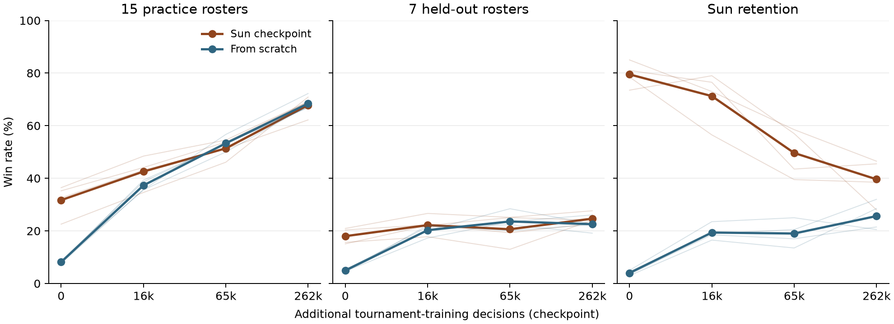

# Fine-tuning a Sun specialist on 15 tournament teams

We tested whether starting from a Sun-trained policy helps a bot learn to pilot other teams, and how much of its original Sun performance it keeps. The four fine-tuned policies started from their corresponding 262,144-step Sun checkpoints. The four controls started from random weights. Both groups practiced with the same 15 tournament rosters.

## Win rates

Each pair gives the **Sun-started / scratch** mean win rate. At zero tournament steps, the first policy is the original Sun specialist and the second is the untrained control.

| Tournament steps | 15 practice teams | 7 held-out teams | Original Sun team |
| ---: | ---: | ---: | ---: |
| 0 | 31.69% / 8.15% | 18.00% / 4.95% | 79.50% / 4.00% |
| 16,384 | 42.56% / 37.30% | 22.20% / 20.27% | 71.25% / 19.38% |
| 65,536 | 51.38% / 53.30% | 20.63% / 23.59% | 49.63% / 19.00% |
| 262,144 | 67.82% / 68.42% | 24.66% / 22.55% | 39.63% / 25.63% |

The final held-out difference favored the Sun start by **2.11 percentage points**. It led on all four training seeds, by 0.21 to 4.93 points, and on four of the seven held-out rosters. The paired 95% interval was **−1.07 to +5.29 points**. The advantage changed direction at the middle checkpoint, and the practice-team win rates finished within 0.60 points of one another.

The Sun-started policies lost **39.88 points** on their original team, keeping about half of their initial win rate. Every seed dropped, by 35.5 to 45.5 points (paired 95% interval for the mean change, −46.54 to −33.21). Their final Sun win rate was still 14.00 points above scratch on average, with three of four seed pairs in their favor. The final 245,760 tournament steps beyond the 16k checkpoint gained 25.26 points on the practice teams and 2.46 points on the held-out teams, while Sun lost another 31.63 points.



Faint lines show individual seeds. Markers are equally spaced by checkpoint.

## How we compared the policies

- All training and evaluation ran on Sketch5, using training seeds 2–5. Each fine-tuning run copied the entire masked PPO actor and critic into a new run with a fresh Adam optimizer. Both groups used the same network, learning rate (0.0003), terminal win/loss rewards and training schedule.
- At the start of each training battle we sampled the learner team uniformly from the 15 practice rosters and sampled a damage or switching bot with equal probability. The opponent piloted Balance or Sun. The learner never piloted Sun during tournament training. The simulator used the first four Pokémon in each roster, with the first two leading. [Team split and rosters](../../teams/reg-mc-regionals/README.md)
- We froze the policies at 0, 16,384, 65,536 and 262,144 additional learner decisions. At each checkpoint we evaluated on the 15 practice rosters, the same seven held-out rosters used in the previous transfer study, and the original Sun team. The held-out teams measure transfer to new learner rosters against familiar opponents. [Original transfer experiment](../sketch5-roster-transfer/README.md)
- Each policy played 100 battles per roster against each of the two bots. We paired the battle seeds, opponent roster draws and policy sampling seeds across checkpoints and training conditions. Each win rate includes all scheduled games and weights each roster, bot and training seed equally. Each cell covers 12,000 battles on practice teams, 5,600 on held-out teams or 800 on Sun.
- We reused the four archived 262,144-step scratch policies. To recover their earlier checkpoints, we repeated scratch training to 65,536 steps and compared every completed episode and PPO update with the originals. The two groups also received matching team, opponent and simulator draws over their shared training-episode prefixes.
- The evaluation includes 128,000 new games and 19,200 archived games at matching checkpoints and settings. It measures adaptation at equal *additional* tournament experience. The fine-tuned policies have 262,144 extra lifetime decisions from Sun pretraining at every row. Intervals in the paired results are pointwise 95% paired t intervals across the four training seeds, conditional on the fixed rosters, opponents and battle schedule.
- We verified all 147,200 scheduled outcomes against the per-battle records. The learners recorded 54,521 wins and 92,679 losses, with zero ties or truncations.

## Data and reproduction

[Mean win rates](learning-curve.csv) · [Paired differences and intervals](paired-differences.csv) · [Per-seed results](per-seed.csv) · [Per-roster and opponent results](per-roster-opponent.csv) · [Individual games](evaluation-games.csv.gz) · [Battle outcome counts](outcomes.json) · [Training roster counts](training-draws.csv) · [Checkpoint hashes](checkpoints.csv)

On Sketch5 the new checkpoints, logs and replays are under `/mnt/md0/jcliu/pokemon-battle-rl/project/runs/sketch5-finetune-v1`. The runner also reads the archived Sun checkpoints in `runs/sketch5-long-v1` and the original scratch runs and evaluations in `runs/sketch5-roster-v1`. With both archives available, run the following from the checkout using fresh output directories.

```sh
.venv/bin/python scripts/finetune_rosters.py train --output runs/finetune-repeat
.venv/bin/python scripts/finetune_rosters.py evaluate --output runs/finetune-repeat --jobs 12
.venv/bin/python scripts/analyze_roster_finetuning.py --runs runs/finetune-repeat \
  --output results/finetune-repeat
```
