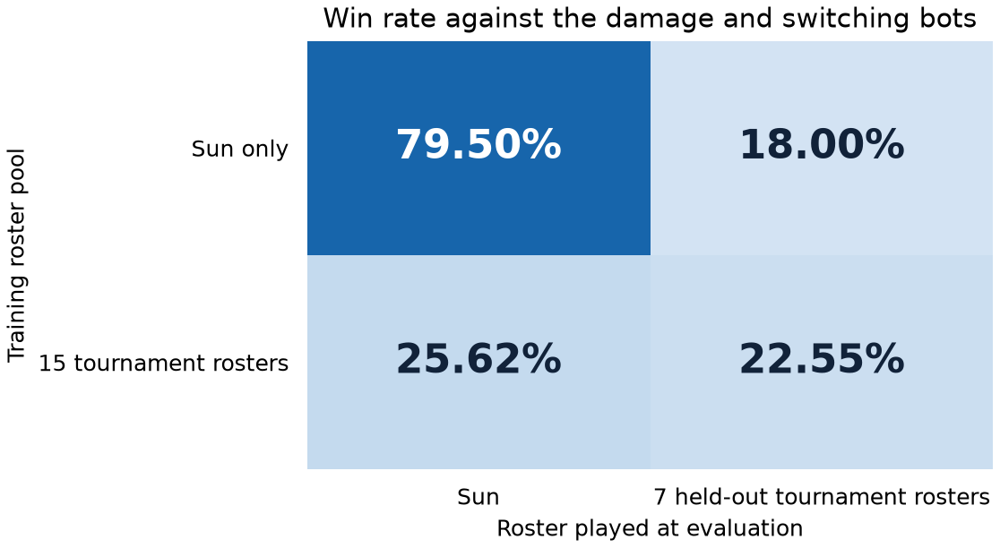

# Zero-shot transfer to a different learner team

We trained one masked PPO policy per seed with Sun and one with a roster sampled uniformly from 15 regional top-eight teams each battle. Every policy was frozen before evaluation. Each win rate averages the damage and switching opponents equally, then averages the four training seeds. The tournament column gives all seven held-out learner rosters equal weight.

| Learner team in training | Play Sun | Play held-out tournament teams |
| --- | ---: | ---: |
| Sun only | 79.50% | 18.00% |
| Tournament pool | 25.62% | 22.55% |
| Untrained initialization | 4.00% | 4.95% |

Tournament training raised the held-out win rate by 4.55 percentage points over Sun training. The advantage appeared on all four training seeds and on four of seven rosters. On Sun itself, the specialist led by 53.88 points. Both groups had the same total number of PPO decisions, so the generalist spread its practice across 15 rosters.



## Paired differences

Differences are in percentage points. Positive values favor the first policy listed.

| Evaluation and comparison | Seed 2 | Seed 3 | Seed 4 | Seed 5 | Mean |
| --- | ---: | ---: | ---: | ---: | ---: |
| New teams, tournament minus Sun | +4.07 | +6.71 | +5.14 | +2.29 | +4.55 |
| Sun, tournament minus Sun | -57.00 | -41.50 | -56.50 | -60.50 | -53.88 |
| New teams, Sun minus untrained | +9.86 | +11.14 | +16.29 | +14.93 | +13.05 |
| Sun, tournament minus untrained | +18.00 | +27.50 | +25.50 | +15.50 | +21.62 |

## Individual held-out rosters

Shared species counts overlap with the four used by the Sun specialist (Charizard, Garchomp, Rotom-Wash and Scizor), using Showdown base species. The table gives the mean over four policy seeds and two opponent styles.

| Regional finish | Playable four (unordered) | Shared with Sun | Sun-trained | Tournament-trained | Untrained |
| --- | --- | ---: | ---: | ---: | ---: |
| Kyle Livinghouse, Puebla (Champion) | Charizard, Kingambit, Sneasler, Whimsicott | 1 | 16.50% | 13.75% | 2.38% |
| Brady Smith, Baltimore (3rd) | Gengar, Incineroar, Politoed, Rillaboom | 0 | 10.50% | 8.75% | 1.12% |
| Ko Tsukide, Gdańsk (4th) | Charizard, Garchomp, Sneasler, Whimsicott | 2 | 14.75% | 23.88% | 4.00% |
| Sebastian Li, Frankfurt (Runner Up) | Farigiraf, Incineroar, Sneasler, Torkoal | 0 | 5.50% | 13.12% | 1.25% |
| Conner P., Baltimore (7th) | Arcanine, Gholdengo, Raichu, Staraptor | 0 | 15.38% | 14.12% | 3.25% |
| Toler Webb, Louisville (6th) | Archaludon, Farigiraf, Golisopod, Pelipper | 0 | 42.50% | 51.88% | 15.88% |
| hamanvgc, Baltimore (5th) | Ceruledge, Milotic, Rillaboom, Staraptor | 0 | 20.88% | 32.38% | 6.75% |

The Sun-trained policy outscored its untrained initialization on all seven held-out rosters. Across the five rosters with no playable species shared with Sun, the mean difference was +13.30 percentage points. The improvement is evidence that some learned battle decisions transferred even when the playable species changed. Identifying the decisions responsible would require a separate behavioral test.

## Protocol and checks

- All training and evaluation ran on Sketch5. Both training regimes used seeds 2–5, 262,144 learner decisions, terminal win/loss rewards, the same feedforward network and PPO settings, Sun and Balance opponent rosters, and a per-battle 50/50 mixture of the damage and switching bots.
- The four Sun checkpoints were reused from the [long reward study](../sketch5-long-rewards/README.md) and verified by hash. The four controls are actual pre-update weights from the tournament runs. Their tensors matched a fresh initialization at the corresponding seed. Simulator seeds, opponent-team draws and opponent styles matched between each pair of training runs over their common episode prefix.
- A held-out Mega Gengar team exposed a Showdown private request to choose again when a switch reveals Shadow Tag. The bridge now passes that revised request back to the affected player and preserves the other player’s choice. We replayed the failing turn and checked 40 separate smoke games on each held-out roster. Every scored policy used the same evaluation code at `6a7b158`. The four training processes completed on their original bridge. The revised bridge also reproduced the outcomes, turns and other recorded fields of 80 archived Sun evaluation games.
- At evaluation, every checkpoint received the same 100 fresh battle seeds (610,000–610,099) for each learner roster and opponent style. The simulator seeds, opponent roster and policy sampling seed matched across all checkpoints. The primary statistic is wins divided by scheduled games. Each Sun cell contains 800 battles, and each held-out cell contains 5,600 battles.
- All three policy groups together played 19,200 games: 3,421 wins, 15,779 losses, 0 ties, 0 truncations.
- Zero-shot refers to piloting a new exact roster. The generalist saw Sun on the opponent’s side, and both groups saw familiar species. All games used the first four from the paste with the first two leading. The two scripted opponents and their roster distribution stayed fixed. The seven test rosters and four policy seeds limit how broadly to generalize.

[Split and original team pastes](../../teams/reg-mc-regionals/README.md) · [Per-seed results](per-seed.csv) · [Per-roster results](per-roster.csv) · [Checkpoint-level scores](scores.csv) · [All games](evaluation-games.csv.gz) · [Training roster counts](training-draws.csv) · [Checkpoint hashes](checkpoints.csv)

The source runs, weights and replays are under `/mnt/md0/jcliu/pokemon-battle-rl/project/runs/sketch5-roster-v1` on Sketch5. To reproduce using the archived Sun checkpoints, use a fresh output directory.

```sh
.venv/bin/python scripts/roster_transfer.py --output runs/roster-repeat \
  --reuse-sun-from runs/sketch5-long-v1
.venv/bin/python scripts/analyze_roster_transfer.py --runs runs/roster-repeat \
  --reuse-sun-from runs/sketch5-long-v1 --output results/roster-repeat
```
