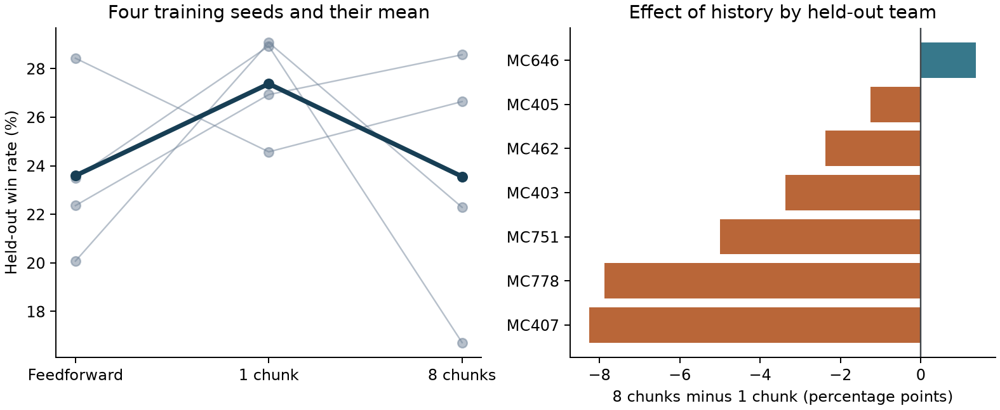

# Does a longer decision history help on unfamiliar teams?

We trained two Transformer PPO policies from scratch, one with access to the current decision and one with access to the latest eight decisions. Both trained for 65,536 learner decisions on the same 15 tournament teams. We compared them with our existing feedforward PPO policy on seven held-out tournament teams.

## Held-out win rates

| Policy | Wins / games | Overall | vs. damage bot | vs. switching bot |
| --- | ---: | ---: | ---: | ---: |
| Feedforward PPO | 1,321 / 5,600 | 23.59% | 17.50% | 29.68% |
| 1-chunk Transformer PPO | 1,533 / 5,600 | **27.38%** | 21.89% | 32.86% |
| 8-chunk Transformer PPO | 1,319 / 5,600 | 23.55% | 18.07% | 29.04% |

The one-chunk policy had the highest mean win rate against both bots. It beat feedforward PPO by 3.79 percentage points, winning three of the four seed comparisons. Its advantage over the eight-chunk model averaged 3.82 points and appeared on six of seven rosters. The eight-chunk model led on seeds 2 and 5 by 1.64 and 2.07 points. It trailed on seeds 3 and 4 by 6.79 and 12.21 points.

| Paired difference | Mean (percentage points) | 95% interval across seeds |
| --- | ---: | ---: |
| 8 chunks minus 1 chunk | −3.82 | −14.84 to +7.20 |
| 8 chunks minus feedforward | −0.04 | −8.88 to +8.81 |
| 1 chunk minus feedforward | +3.79 | −4.88 to +12.45 |

At this budget, extending the decision window produced no observed mean gain. Four training seeds leave substantial uncertainty about the size and direction of the effect. All 16,800 scheduled games completed with a win or loss.



## What the model sees

A chunk contains the learner's visible battle-state features and the two choices it made immediately before reaching that state. At the start of a battle, the previous-action fields contain a start symbol. Each new learner request, including a forced switch, creates a chunk. The longer window can therefore cover fewer than eight full turns. Windows reset between battles and continue across PPO rollout boundaries within a battle.

Both Transformers have 230,839 trainable parameters, two pre-normalized attention blocks, width 64, four heads, a feedforward width of 128, fixed sinusoidal encodings of decision age, and zero dropout. The most recent token feeds the masked joint-action policy and value head. A causal attention mask prevents each real token from seeing later decisions or right padding. During PPO updates we shuffle whole windows, keeping their internal order. The formation of a window and the previous-action fields are identical in both models.

The feedforward PPO control has 320,951 trainable parameters, two 128-unit hidden layers, and the current board features. Both Transformers also receive the learner's previous action pair. Comparing the two Transformers isolates access to additional history. Comparing either with feedforward PPO includes differences in input, architecture and parameter count.

## Training and evaluation

- All eight new training runs and all new evaluations ran on Sketch5. The two Transformers had identical initial parameter tensors within each training seed (2–5). All three policy groups used the same PPO hyperparameters, terminal win/loss reward, fixed 15-team training split, per-battle 50/50 mixture of damage and switching bots, and Sun or Balance as the opponent team. The seven evaluation rosters were excluded from training. [Team split](../../teams/reg-mc-regionals/README.md)
- We reused the four archived 65,536-step feedforward **scratch** checkpoints and their evaluations. The analysis checks their SHA-256 hashes and matches the archived win count for every training seed, learner team and opponent. It also checks all three training conditions against the same simulator, team hashes and shared per-episode matchup draws. [Feedforward training study](../sketch5-roster-finetuning/README.md)
- For each learned policy we played 100 evaluation seeds (610,000–610,099) per held-out team against each bot, using stochastic action selection. Simulator seeds, opponent roster draws and policy sampling seeds match across policies. Each group has 5,600 games, equally weighted by team, opponent style and training seed. Win rates use wins divided by all scheduled games. Paired differences use pointwise 95% t intervals across the four training seeds and describe this fixed evaluation schedule.

[Per-seed win rates](per-seed.csv) · [Per-team win rates](per-roster.csv) · [Paired differences and intervals](paired-differences.csv) · [Results by opponent](summary.csv) · [All team and opponent cells](per-roster-opponent.csv) · [Per-game outcomes](evaluation-games.csv.gz) · [Checkpoint hashes](checkpoints.csv)

## Reproduction

On Sketch5 the new checkpoints, simulator logs and replays are in `/mnt/md0/jcliu/pokemon-battle-rl/project/runs/sketch5-transformer-v1`. The comparison also reads the feedforward archive in `runs/sketch5-finetune-v1`. From the project checkout, use fresh output directories.

```sh
.venv/bin/python scripts/transformer_rosters.py train --output runs/transformer-repeat
.venv/bin/python scripts/transformer_rosters.py evaluate --output runs/transformer-repeat --jobs 12
.venv/bin/python scripts/analyze_transformer_rosters.py --runs runs/transformer-repeat \
  --output results/transformer-repeat
```
