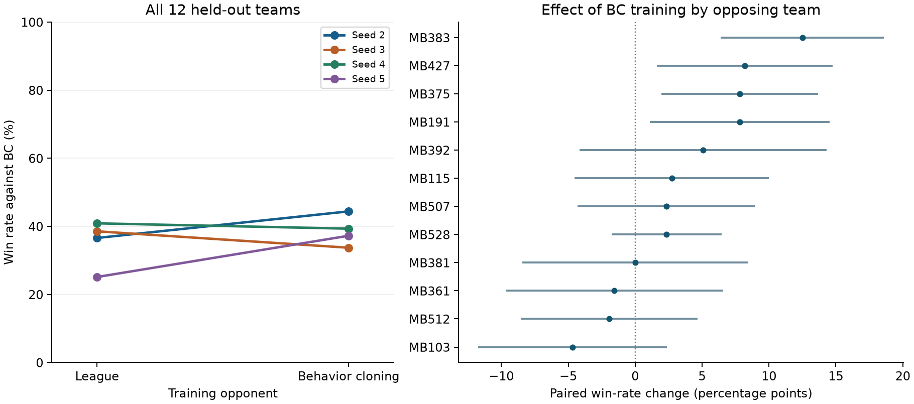

# Does training against VGC-Bench's behavior-cloned player transfer to new teams?

**At 65,536 decisions, PPO trained against the frozen behavior-cloned player won 1,188 of 3,072 games against that player on 12 held-out teams (38.67%). The previous league-trained PPO policies won 1,084 (35.29%).** This is a paired improvement of **3.39 percentage points** (95% interval +1.38 to +5.39 for these four models). Two of four training seeds improved. Mean win rates also rose against each of the three other benchmark opponents. [Matched effects](mean-changes.csv)

| Evaluation opponent | League-trained PPO, 65k | BC-opponent PPO, 65k | Paired change in points (95% interval) |
| --- | ---: | ---: | ---: |
| VGC-Bench behavior cloning | 35.29% | 38.67% | +3.39 (+1.38 to +5.39) |
| Random | 90.30% | 93.42% | +3.12 (+1.80 to +4.45) |
| Max base power | 42.15% | 45.57% | +3.42 (+1.30 to +5.54) |
| Simple heuristics | 28.55% | 31.32% | +2.77 (+0.70 to +4.83) |

### Which runs and matchups improved?

| Initialization seed | League PPO vs BC, wins / 768 | BC-opponent PPO vs BC, wins / 768 | Change in points |
| --- | ---: | ---: | ---: |
| 2 | 281 (36.6%) | 341 (44.4%) | +7.8 |
| 3 | 296 (38.5%) | 259 (33.7%) | −4.8 |
| 4 | 314 (40.9%) | 302 (39.3%) | −1.6 |
| 5 | 193 (25.1%) | 286 (37.2%) | +12.1 |

Seeds 2 and 5 accounted for the net gain. When treating the four training seeds as the sampling units, an approximate 95% Student t interval for the mean change spans −9.2 to +16.0 points (3 degrees of freedom). The narrower paired battle interval answers how reliably the evaluated checkpoints differ on this fixed benchmark. At 16,384 decisions the mean BC result was 35.29% versus 33.40%, a +1.89-point difference (paired 95% interval −0.02 to +3.80). [Per-seed results](paired-by-seed.csv)

Across opposing rosters, eight point estimates improved, one tied and three fell. The largest gain was against MB383 (+12.5 points, 95% interval +6.5 to +18.5). The largest drop was against MB103 (−4.7 points, −11.7 to +2.3). The BC-trained policies remained below 50% aggregate win rate against the BC opponent. [Per-roster results](mean-changes.csv)

## Experiment

Both arms used the M-B-legal MC461 variant. Meowstic-F and Kommo-o led, with Farigiraf and Sneasler in reserve. Four full-history Transformers started from the same four 262,144-decision tournament checkpoints used in the league study. We paired initialization seeds 2–5 with fine-tuning seeds 112–115 and gave each arm 65,536 M-B decisions. The PPO optimizer, learning rate, legal action mask, win/loss reward, training simulator and open team sheets matched the previous experiment. [Prior league study](../sketch5-vgcbench-mb/README.md) · [Learner team](../../teams/reg-mb-variant/MC461-MB.txt)

The previous arm sampled a damage heuristic, tactical heuristic or frozen PPO specialist, all with fixed opposing lineups. In the new arm the frozen VGC-Bench behavior-cloned bot piloted every opposing team, sampling its two lead Pokémon, two reserves and in-battle actions. The comparison measures the combined effect of that pilot and its preview strategy. PPO trained only the learner's battle policy. [BC adapter](../../src/pokemon_rl/vgcbench.py) · [Upstream checkpoint](https://huggingface.co/cameronangliss/vgc-bench-models/blob/204c76741829ca0681629e41382043c385850d5c/results/saves_bc/seed1/100.zip)

The training opponents used Balance, Sun, MC442 and MC751 in both arms. Compared with any of the 12 held-out teams, those four rosters shared at most one, two, three and three base species respectively. The full six and any possible selected four therefore differed across the split. The BC player itself was familiar at evaluation. The other three benchmark opponents test whether gains transfer to different pilots. [Locked protocol](protocol.json) · [Public evaluation teams](../../teams/vgcbench-mb-transfer/source.json)

## Evaluation

Each policy played each opponent on each held-out roster for 64 games, evenly split between the two seats, on the pinned VGC-Bench M-B simulator. The comparisons use the previous league study's opponent rosters, simulator seeds, action-sampling seeds and opposing draft choices. The learner acts greedily in evaluation. Each training seed contributes 768 games per opponent and checkpoint. The primary comparison is the four-seed mean win-rate change against the BC player at 65,536 decisions.

For the paired 95% intervals, we average the four training-seed differences on each matched battle, then estimate variation within opposing roster and seat. This preserves dependence between policies playing the same battle. The intervals describe game randomness on these fixed opponents, rosters and four trained models. The per-seed and per-roster results show variation across them. [Per-seed paired outcomes](paired-by-seed.csv) · [Mean paired changes](mean-changes.csv) · [Game records](games.csv.gz)

## Verification

The 31,143 completed BC training episodes matched the previous league run’s opposing roster and simulator seed at the same episode index for each training seed. No logged BC training simulator seed coincided with a held-out evaluation seed. The player chose between 61 and 118 distinct ordered lineups per training seed and opposing roster. The learner won 19.8% of its first 512 training games per seed in aggregate and 33.9% of its last 512. [Training audit](audit.json) · [Training windows](training-windows.csv)

The two scored checkpoints produced 24,576 new held-out battles, all completed wins or losses. All 64 replay checks reproduced the recorded choices, outcomes and ending turns. Opponent previews matched the archived control for every paired game. The four final exports preserve the exact policy tensors. [Replay samples](reproduced.csv) · [Exported models](weights/) · [Weight hashes](weights.csv) · [Reproduction commands](../../docs/vgcbench.md)
