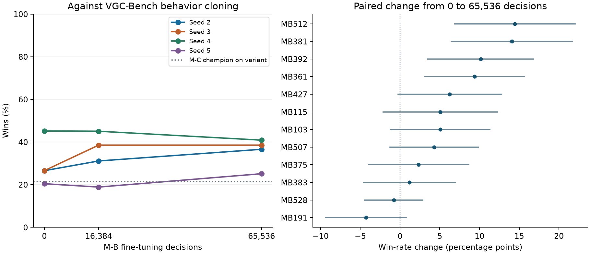

# Training an M-B-legal MC461 variant with PPO

**The M-B fine-tune improved win rate against VGC-Bench’s published behavior-cloned opponent from 29.69% to 35.29% across four PPO seeds.** The paired gain was **5.60 percentage points** (95% interval +3.78 to +7.41). Three seeds improved. The strongest initialization regressed and still finished ahead of the other three final policies. Giving the original M-C champion the legal variant directly yielded 164/768 wins (21.35%). [Game records](games.csv.gz) · [Paired effects](mean-changes.csv)

| Opponent on the 12 public M-B rosters | Before fine-tuning | 16,384 decisions | 65,536 decisions | Paired change from start, points (95% interval) |
| --- | ---: | ---: | ---: | ---: |
| Random | 88.8% | 88.8% | 90.3% | +1.5 (+0.1 to +3.0) |
| Max base power | 31.2% | 38.3% | 42.2% | +10.9 (+9.0 to +12.8) |
| Simple heuristics | 22.2% | 26.5% | 28.5% | +6.3 (+4.4 to +8.3) |
| Behavior cloning, learned preview | 29.7% | 33.4% | 35.3% | +5.6 (+3.8 to +7.4) |

### Where the gain came from

| Tournament initialization | Initial BC wins / 768 | 16k BC wins / 768 | 65k BC wins / 768 | Paired change, points |
| --- | ---: | ---: | ---: | ---: |
| Seed 2 | 204 | 239 | 281 | +10.0 |
| Seed 3 | 204 | 296 | 296 | +12.0 |
| Seed 4 | 347 | 346 | 314 | −4.3 |
| Seed 5 | 157 | 145 | 193 | +4.7 |

The largest four-seed mean gains against BC came on MB512 (+14.5 points) and MB381 (+14.1). Ten of the 12 roster point estimates improved. MB191 fell 4.3 points, with a paired interval of −9.4 to +0.8. Across the training league, the four runs won 19.6% of their first 512 training battles per seed and 69.6% of their last 512. Those are sampled training actions against familiar pilots and fixed opposing lineups. In cross-play, the published opponent selected its four and piloted teams outside the fine-tuning pool. [Training windows](training-windows.csv) · [Matchup changes](mean-changes.csv)

## Team and training

We kept MC461's Meowstic-F and Kommo-o leads. Farigiraf replaced Indeedee in the third slot, using the Armor Tail, Sitrus Berry and Trick Room set from the existing MC697 training roster. Sneasler kept its original moves and switched from Psychic Seed to White Herb. Kingambit and Charizard stayed in slots five and six. Both the project's simulator and the benchmark’s pinned M-B simulator accepted this roster, all four training rosters and all 12 evaluation rosters. The learner brought the listed first four throughout. [Legal variant](../../teams/reg-mb-variant/MC461-MB.txt) · [Original MC461](../../teams/reg-mc-regionals/MC461.txt) · [Farigiraf source](../../teams/reg-mc-regionals/MC697.txt)

We followed the previous fixed-team specialization recipe. Four full-history Transformers started from the matching 262,144-decision tournament weights (pretraining seeds 2–5). Each then trained for 65,536 decisions with a fresh optimizer (fine-tuning seeds 112–115), four attention heads, two blocks, width 256, terminal win/loss rewards, masked joint actions and a learning rate of 0.0001. The zero-step comparison uses those same starting weights on the legal team with open sheets. We separately tested the original M-C league champion on the variant without updating it. [Training script](../../scripts/train_vgcbench_mb.py) · [Original specialization recipe](../sketch5-fixed-league/README.md)

Training sampled four opponent rosters uniformly, then sampled one of three pilots per roster, drawn from a damage heuristic, a tactical heuristic and a frozen PPO specialist. Balance, Sun and MC751 carried over. The M-B-legal MC442 replaced MC463, with the same frozen specialist weights. Both sides brought their listed first four in training. In external evaluation the heuristic opponents chose random lineups and the behavior-cloned opponent used its learned preview. The four VGC-Bench opponents and 12 public rosters were excluded from M-B fine-tuning. [Training pool](../../teams/reg-mb-variant/training-pool.json) · [Team sources](../../teams/vgcbench-mb-transfer/source.json)

## What the benchmark measures

We used the benchmark's own pinned Showdown revision for evaluation and exchanged open team sheets before either side chose its lineup. Each candidate played the same 64 simulator seeds per roster and opponent, split equally between the two sides. Every candidate faced identical opponent preview choices on the matched games. Our Transformer played greedily, while the upstream behavior-cloned player sampled actions from its released policy. Tournament win rate and performance across arbitrary learner teams require different experiments. The official VGC-Bench AlphaRank procedure uses a larger population and multiple runs. [Locked protocol](protocol.json) · [Upstream evaluator](https://github.com/cameronangliss/vgc-bench/blob/d79f9532947ac114dce1dda2456a590afcd375b2/vgc_bench/eval.py) · [Benchmarked simulator](https://github.com/cameronangliss/pokemon-showdown/tree/913da3602a3aa1db79f9fdc5d5222eaf8d39569d)

Each seed's win rates use 768 games per opponent and checkpoint. For the four-seed mean change, we first averaged the four differences on each paired battle, then estimated sampling variance within roster and side. These 95% intervals condition on the 12 rosters and four training seeds. The per-seed and per-roster tables show how widely the effects varied. [Win rates and Wilson intervals](win-rates.csv) · [Individual paired changes](paired-changes.csv) · [Four-seed mean changes](mean-changes.csv)

## Verification and reuse

All 39,936 scored games finished with a win or loss, and the external players issued zero default orders. We reproduced eight complete records at each checkpoint stage, matching preview choices, seats, outcomes and finishing turns. The 3,072 distinct evaluation seeds did not overlap the logged simulator seeds from the parent and fine-tuning trajectories. All four exported policies contain the exact final policy tensors. Running the standalone evaluator with the seed-2 export reproduced all 3,072 of its final game records. [Export replay check](export-replay.json) [Audit](audit.json) · [Checkpoint hashes](weights.csv) · [Exported weights](weights/) · [Run another legal team or checkpoint](../../docs/vgcbench.md)
